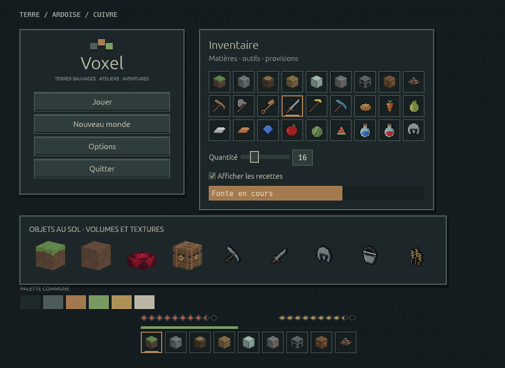

# Terre, ardoise et cuivre

Le jeu conserve une lecture voxel familière et développe ses propres matières : verts
sauge, terre chaude, pierre bleutée, bois veinés, métal patiné et accents cuivrés.
Les dessins sont originaux et générés par le projet, sans textures, modèles ou polices
provenant de Minecraft.



Cette planche utilise le thème et les images du jeu, avec un rendu CPU sans fenêtre.

## Matières et objets

- PNG RGBA en **16 × 16**, échantillonnés sans flou. Les aplats se composent de groupes
  de pixels ; les détails isolés servent aux arêtes et aux cristaux.
- Palette ramenée à 32 niveaux par canal, ombres légèrement froides, reflets chauds.
  La transparence des plantes, feuilles et objets est conservée.
- Outils dessinés en diagonale, manche en bas à gauche. Les points de prise sont
  définis dans `games/voxel/src/hand.rs` et vérifiés contre les icônes.
  La pioche porte une tête transversale à deux pointes ; la hache une large lame
  à talon ; la pelle un fer de bêche et une poignée en D.
- Les aliments ont des silhouettes dédiées. Le four conserve sa bouche aux pixels
  `x = 4..11`, `y = 8..13`, utilisés par les flammes animées.
- Les icônes des blocs sont des miniatures isométriques **32 × 32**, calculées à partir
  des textures de dessus/côté et des boîtes du modèle, puis mises en cache.

L'herbe et la terre utilisent un grain périodique : leurs pixels de bord se raccordent
après réduction de palette. Le dessus de l'herbe reçoit en plus une faible variation
continue dans le shader, sur plusieurs blocs et sans rupture entre quads greedy.
Le bord végétal latéral se raccorde horizontalement, sans contour sombre systématique.

## Objets lâchés

Les piles dans le monde utilisent les faces et boîtes du bloc d'origine. Les outils,
armures et provisions sont extrudés à partir des pixels opaques de leur propre PNG ;
les bandes de même couleur sont fusionnées et mises en cache par objet. Les modèles
tournent, reçoivent la lumière du lieu et restent masqués par les murs. Les transparents
sont dessinés après les opaques, du plus loin au plus proche ; les feuilles conservent
leurs découpes. F5 invalide aussi ce cache.

L'action configurable **Jeter un objet** (`KeyQ` physique par défaut) lance un exemplaire
de la case sélectionnée devant le joueur. Son usure et son enchantement sont conservés.

Les couleurs `color` des blocs et des objets sont des moyennes **linéaires** de leurs
PNG sRGB, en excluant les pixels transparents. Elles servent aux objets au sol, au
terrain lointain et au repli sans texture. Le terrain lointain applique les mêmes
multiplicateurs de biome que les chunks détaillés.

## Interface et personnages

`games/voxel/src/skin.rs` centralise la palette, les boutons, les cases, les cadres et les
jauges. Les panneaux sont en ardoise sombre, les textes couleur lin, la sélection en
cuivre. Les losanges rouges indiquent la vitalité, les grains dorés la nourriture et
la barre sauge l'expérience. Les écrans des mods partagent le même thème.

Le bras porte une manche vert grisé et un poignet couleur cuir. Les habitants portent
des tabliers et accessoires associés à leur métier ; la faune utilise des tons naturels.
Les ciels et la lumière du soir reprennent cette palette.

## Régénérer et contrôler

```sh
cargo run -p assetgen -- --textures-only
cargo run -p voxel --example skin_preview -- docs/images/skin-preview.png
```

Les générateurs de surfaces sont dans `tools/assetgen/src/textures.rs`, ceux des objets
dans `tools/assetgen/src/textures/items.rs`. La génération inclut les assets des mods
de référence Example et Mécanique et reste déterministe.

Après un changement de dessin, **F5** recharge les textures, les miniatures et les
icônes extrudées en main. Les changements du thème et de la lumière, écrits en Rust,
nécessitent de relancer le binaire recompilé. Le mode `VOXEL_SCREENSHOTS` fournit aussi
les vues en jeu, dont les poses de repos, de minage et d'épée.
