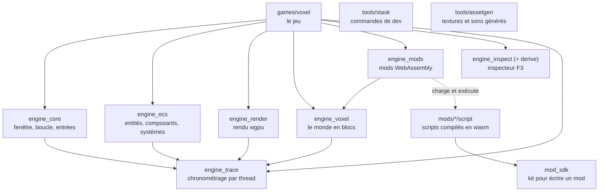
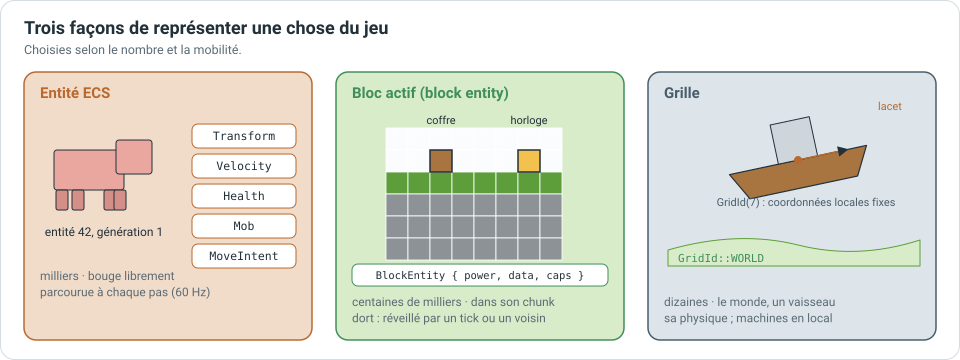
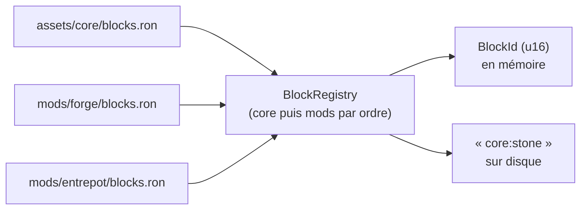
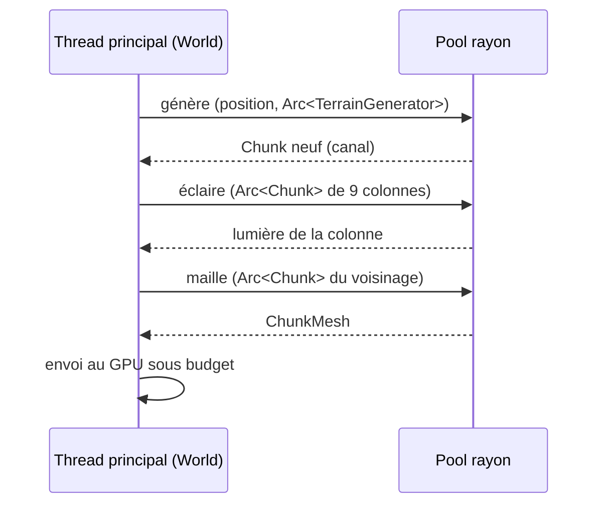

# 1. Architecture

[← Sommaire](README.md) · [Chapitre suivant : boucle et ECS →](02-boucle-et-ecs.md)

## Les crates

Le dépôt est un *workspace* Cargo. Chaque crate a un rôle précis, et les dépendances ne vont que dans un
sens : le moteur ne connaît pas le jeu, le monde ne connaît pas le GPU.

| Crate | Lignes (env.) | Rôle | Dépendances externes clés |
|---|---|---|---|
| `engine_trace` | 500 | Des *spans* chronométrés, écrits au format Chrome trace (Perfetto) | aucune |
| `engine_core` | 600 | La fenêtre, la boucle à pas fixe, l'état du clavier et de la souris | `winit` |
| `engine_ecs` | 1 200 | Un ECS écrit à la main (sparse sets, requêtes, planning, événements) | aucune |
| `engine_render` | 3 600 | Le renderer : arènes GPU, culling, passes, ciel et nuages, shaders WGSL | `wgpu`, `egui-wgpu` |
| `engine_voxel` | 42 000 | Tout le monde en blocs : registre, chunks, génération, lumière, maillage, streaming, sauvegarde, machines, réseaux, fluides, physique | `rayon`, `noise`, `postcard`, `lz4_flex` |
| `engine_mods` | 4 800 | Manifeste et ordre des mods, bac à sable `wasmtime`, fonctions hôtes, banc d'essai | `wasmtime`, `semver` |
| `mod_sdk` | 2 300 | Le kit Rust des auteurs de mods (API sûre au-dessus de l'ABI) | aucune |
| `engine_inspect` | 200 | Le trait `Inspect` et sa macro `derive`, pour afficher et modifier des composants | `egui` |
| `games/voxel` | 49 000 | Le jeu : joueur, créatures, interface, survie, quêtes, aventure, sons... | `kira`, `egui-winit`, `notify` |
| `tools/xtask` | — | `cargo xtask ...` : construire les mods, cartes, benchmark, pilotage, vérifications | — |
| `tools/assetgen` | — | Génère les textures et sons du jeu de base et du pack 32 px | `png` |

> `engine_voxel` ne dépend **pas** de wgpu : il produit des sommets (des `Vec<MeshVertex>`), le jeu les
> donne au renderer. On peut donc tester tout le monde (génération, maillage, physique) sans GPU.

## Où vit chaque chose

Le jeu manipule trois sortes d'objets, choisies selon leur nombre et leur mobilité :

| | Exemples | Où | Combien | Coût au repos |
|---|---|---|---|---|
| **Entité ECS** | joueur, créatures, objets au sol, wagons, projectiles | `engine_ecs::World` | milliers | parcourue à chaque pas |
| **Bloc actif** (*block entity*) | coffre, four, câble, machine, rail | rangé dans son chunk | centaines de milliers | **nul** : réveillé par un tick programmé ou un voisin |
| **Grille** | le monde, un vaisseau, une contraption | `GridId → BlockAccess` | dizaines | sa physique |

Règle : **ce qui bouge librement est une entité ; ce qui est fixé dans une grille est un bloc actif.** Un
wagon est une entité ; le rail sous lui est un bloc actif.

## Les principes qui reviennent partout

### 1. Le contenu est en données, pas en code

Blocs, objets, recettes, biomes, minerais, structures, créatures, quêtes, enchantements, dimensions :
tout est décrit en **RON** (`assets/core/*.ron`), puis complété par chaque mod (`mods/<id>/*.ron`).
Ajouter un bloc ne demande pas de recompiler. Le rechargement à chaud (F5, ou automatiquement) relit
textures, shaders, sons et `blocks.ron` en cours de partie.

### 2. Deux identifiants : un texte stable, un numéro rapide

- L'**identifiant texte** avec espace de noms (`core:stone`, `forge:alloy_furnace`) est stable : c'est
  lui qu'on écrit dans les fichiers et les sauvegardes.
- Le **numéro** (`BlockId(u16)`, `ItemId`) est attribué au chargement : 2 octets par bloc dans un chunk,
  comparaisons instantanées. Il dépend des mods installés, donc **il n'est jamais écrit sur disque** tel
  quel (chaque chunk sauvegardé a sa palette de textes).

### 3. Des threads qui ne se bloquent pas

Le thread principal possède le monde. Les threads de fond (un pool `rayon` qui laisse deux cœurs libres)
génèrent, éclairent et maillent des chunks **sans jamais toucher au monde** : ils reçoivent des
`Arc<Chunk>` en lecture seule et renvoient des résultats neufs par un canal. Pas de `Mutex<World>`. Si le
thread principal modifie un chunk pendant qu'une tâche le lit, `Arc::make_mut` lui en fait une copie.

### 4. Le déterminisme

Tout part de la **graine**. Un chunk se génère seul, dans n'importe quel ordre, sur n'importe quel thread,
et donne toujours le même résultat. C'est ce qui permet de ne sauvegarder que les chunks modifiés : les
autres se régénèrent à l'identique. Les tests `generation_reference.rs` figent les empreintes de la
génération v1 ; ceux de la v3 vérifient ses propriétés (eau contenue, donjons sur la roche...).

### 5. Mesurer avant d'optimiser

`engine_trace` met des *spans* partout (≈ 50 ns allumé, une lecture atomique éteint). `VOXEL_TRACE`
écrit une trace Perfetto, `VOXEL_PIPELINE=1` mesure les délais de chaque chunk, `cargo xtask bench`
rejoue des trajets identiques. Les choix (maillage binaire, arène GPU, terrain lointain, fluides à
volume) ont tous été pris sur des mesures, consignées dans `docs/architecture.md`.

## Les règles d'architecture vérifiées

`cargo xtask check-arch` vérifie quatre règles à chaque passage :

1. **Le moteur ne connaît pas le jeu** : aucune crate de `crates/` ne dépend de `games/`, `mods/` ou
   `tools/` (le moteur doit pouvoir servir à un autre jeu).
2. **La simulation ne dépend pas de l'affichage** : `engine_voxel`, `engine_ecs` et `engine_mods` ne
   dépendent ni de `winit`, ni de `wgpu`, ni d'`egui`. Ils tournent sans fenêtre (tests, serveur un jour).
3. **`engine_trace` et `mod_sdk` restent sans dépendance** : tout le monde s'en sert, ou elles sont
   compilées en WebAssembly.
4. **Pas de fichier géant** : au-delà de 2 500 lignes, un fichier `.rs` se découpe en modules.

`unsafe` n'apparaît que dans `mod_sdk`, à la frontière avec le WebAssembly, chaque bloc justifié par un
commentaire `// SAFETY:`. `cargo clippy --workspace --all-targets` et `cargo fmt` complètent.

[← Sommaire](README.md) · [Chapitre suivant : boucle et ECS →](02-boucle-et-ecs.md)
