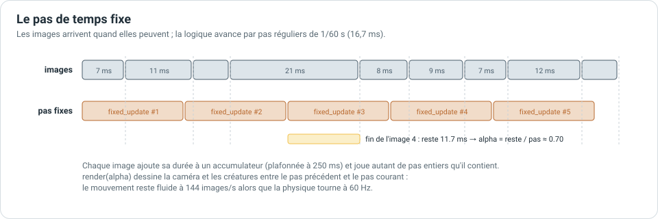
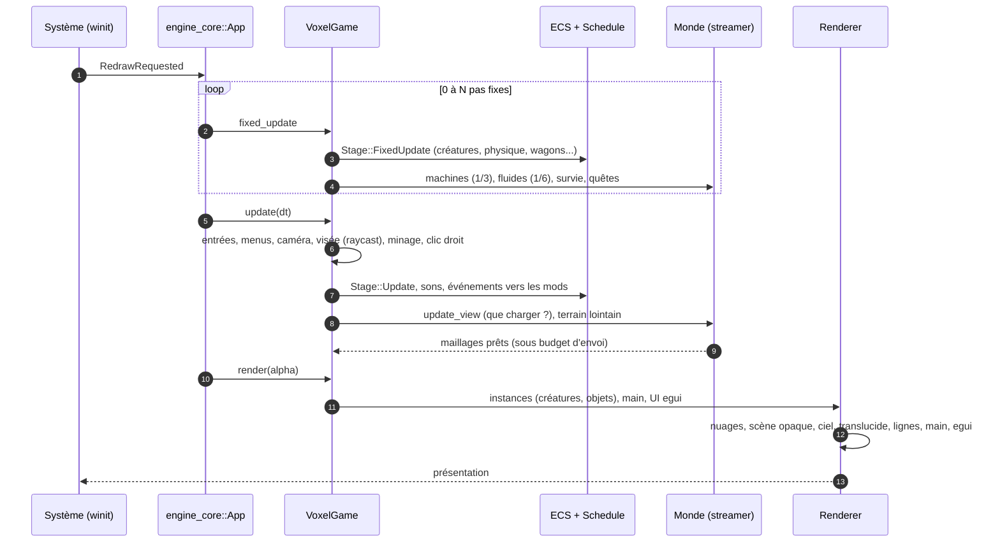
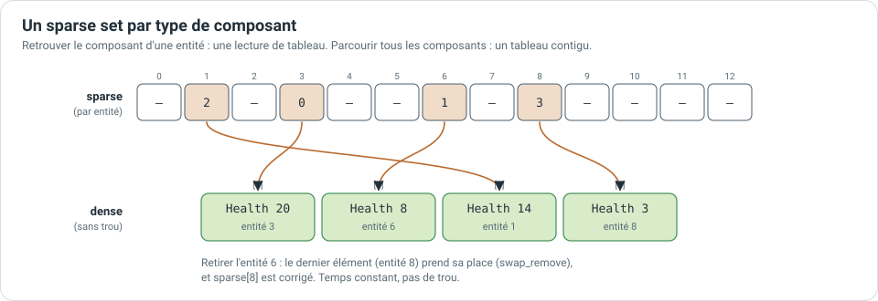
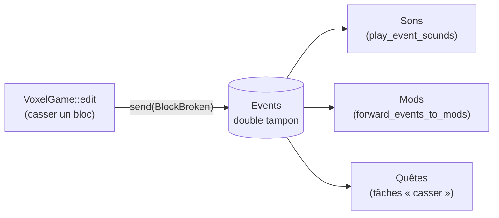

# 2. La boucle de jeu et l'ECS

[← Architecture](01-architecture.md) · [Sommaire](README.md) · [Le monde en blocs →](03-monde.md)

## Le contrat entre le moteur et le jeu

`engine_core` crée la fenêtre (`winit`), écoute le système, et appelle le jeu. Un jeu implémente le trait
`Game` (`crates/engine_core/src/app.rs`) puis appelle `engine_core::run` :

| Méthode | Quand | Équivalent Unity |
|---|---|---|
| `new(ctx)` | une fois, la fenêtre existe (on crée le renderer) | `Awake` |
| `fixed_update(ctx)` | 60 fois par seconde, à pas fixe | `FixedUpdate` |
| `update(ctx, dt)` | une fois par image, avec la durée réelle | `Update` |
| `render(ctx, alpha)` | une fois par image ; `alpha` interpole entre deux pas | — |
| `window_event(ctx, e)` | chaque événement brut ; `true` = consommé (egui) | — |
| `exit(ctx)` | juste avant de quitter : on sauvegarde | `OnApplicationQuit` |

## Le pas de temps fixe

La logique (physique, IA, machines) avance par **pas de 1/60 s**, quel que soit le nombre d'images par
seconde : c'est la méthode « *Fix Your Timestep!* » de Glenn Fiedler (`crates/engine_core/src/time.rs`).



- Chaque image ajoute sa durée réelle à un **accumulateur** (plafonnée à 250 ms, pour ne pas rattraper des
  secondes de retard après une pause du système).
- Tant que l'accumulateur contient un pas entier, on joue un `fixed_update` et on retire un pas.
- Le reste, rapporté à un pas, donne `alpha` (0 à 1) : la caméra et les créatures sont dessinées
  **entre** leur position du pas précédent et celle du pas courant. À 144 images par seconde, le joueur
  glisse sans à-coups alors que la physique ne tourne qu'à 60 Hz.

Plusieurs fréquences se dérivent du pas de 60 Hz :

| Fréquence | Quoi | Où |
|---|---|---|
| 60 Hz | physique du joueur et des créatures, IA, wagons, structures mobiles | `Stage::FixedUpdate` |
| 20 Hz (1 pas sur 3) | machines, réseaux, ticks aléatoires des plantes, scripts des mods | `Machines`, `modding.rs` |
| 10 Hz (1 pas sur 6) | fluides (budget de 4 ms par étape) | `step_fluids` |
| 4 Hz | créatures dirigées par un script (`brain: true`) | `mob_brains.rs` |
| chaque image | entrées, caméra, visée, UI, sons, streaming, rendu | `update`, `render` |

## Une image, de bout en bout



### Ce que fait `fixed_update` (jeu en cours)

1. L'intention du joueur (clavier, ou commande distante `ctl`) devient un `MoveIntent`.
2. `Stage::FixedUpdate` : les systèmes de l'ECS, dans l'ordre où ils sont ajoutés
   (`games/voxel/src/main.rs`) :
   `tick` → apparition → soleil (les morts-vivants brûlent) → élevage → IA → trajets des scripts →
   structures mobiles → physique → wagons → animation → environnement → attaque → tirs → projectiles →
   régénération des élites → morts.
3. Équipement, ramassage des objets, sacs, quêtes.
4. `mods.fixed_step` : un pas sur trois, le **tick des machines** (natives et scripts WebAssembly).
5. Fluides, blocs des wagons, vie, faim, aventure, charmes, pas, mort.

### Ce que fait `update` (chaque image)

Les menus et Échap, la console, l'inventaire (E), la capture de la souris, le regard, le cycle jour/nuit,
la météo, les effets de l'eau, les habitants des villages proches, l'ambiance sonore, les dimensions, les
structures mobiles et les wagons, le vol libre, **le lancer de rayon** (le bloc visé), le minage et la
chaîne du clic droit (wagon → structure → porte → lit → conteneur → machine → habitant → animal →
houe → engrais → charme → guide → objet de mod → **poser un bloc**), l'animation du bras, la sauvegarde
automatique, le rechargement à chaud, puis le **streaming** : `update_view` dit au streamer où regarde la
caméra, et les maillages prêts partent vers le GPU.

## L'ECS écrit à la main

`engine_ecs` est un ECS minimal mais complet, écrit pour être lu (`crates/engine_ecs`).

- Une **entité** est un numéro avec une **génération** : quand l'entité 42 meurt et que sa case sert à une
  nouvelle, l'ancien numéro `(42, gén. 0)` devient invalide, et un monstre qui le gardait comme cible ne
  vise pas la nouvelle venue par erreur.
- Un **composant** est n'importe quel type Rust (`Transform`, `Health`, `Mob`...).
- Un **système** est une fonction sur le monde, rangée dans un `Schedule` par étape.

### Le stockage : un *sparse set* par type



Chaque type de composant a son `SparseSet<T>` : un tableau **dense** (les composants à la suite, sans
trou : parcourir tous les `Transform` est un parcours de tableau contigu, idéal pour le cache) et un
tableau **sparse** (pour chaque numéro d'entité, la place de son composant dans `dense`). Retirer un
composant met le dernier élément du tableau dense à sa place (`swap_remove`) : temps constant, pas de trou.

Le monde garde une table `TypeId → Box<dyn ComponentStorage>`, chacun dans un `RefCell` : une requête
`(&Position, &mut Velocity)` emprunte deux stockages en même temps, l'un en lecture, l'autre en écriture,
vérifié à l'exécution plutôt qu'avec de l'`unsafe`.

```rust
// Toutes les créatures avec une position et une vie :
ecs.query::<(&Transform, &mut Health, &Mob)>().for_each(|entity, (t, health, mob)| {
    if t.position.y < -64.0 { health.current = 0.0; }
});
```

`for_each` plutôt qu'un itérateur : l'emprunt de chaque élément se termine avant le suivant, ce que le
compilateur peut prouver sans `unsafe`.

### Ressources, commandes et événements

- **Ressources** : des valeurs uniques rangées dans le monde (`PlayerEntity`, `Sky`, `Arc<MobRegistry>`,
  le streamer partagé...).
- **Commandes** : un système qui veut créer ou détruire une entité pendant une requête les met en file ;
  elles s'appliquent après.
- **Événements** (`games/voxel/src/events.rs`) : `BlockBroken`, `BlockPlaced`, `EntitySpawned`,
  `EntityDied`, `PlayerAttacked`, `PlayerDamaged`, `Tick`... dans un
  **double tampon** : un événement envoyé pendant une image reste lisible pendant celle-ci et la suivante,
  puis disparaît. Chaque lecteur garde un curseur. Les sons, les statistiques, les quêtes et les mods
  écoutent les mêmes événements sans se connaître.



### Le partage du monde

Le `ChunkStreamer` vit dans un `Rc<RefCell<...>>` (`games/voxel/src/shared.rs`) rangé comme ressource :
le jeu, les systèmes de l'ECS (la physique des créatures lit les blocs) et l'hôte des mods y accèdent.
Le `RefCell` vérifie à l'exécution qu'on ne l'emprunte pas en écriture deux fois.

## Les composants du jeu

| Composant | Porté par | Rôle |
|---|---|---|
| `Transform`, `Velocity`, `Collider` | joueur, créatures, objets, wagons | position, vitesse, boîte |
| `MoveIntent` | joueur, créatures | où l'entité veut aller (clavier ou IA) |
| `Health` | joueur, créatures | vie |
| `Player`, `Flying` | joueur | marqueurs (vol libre) |
| `PreviousPosition` | ce qui bouge | la position du pas précédent, pour interpoler avec `alpha` |
| `Mob`, `Wander`, `MobAnim`, `Hurt` | créatures | sorte, errance, animation, recul après un coup |
| `Love`, `BreedCooldown`, `Baby` | animaux | élevage |
| `BrainGoal`, `BrainState` | créatures dirigées par un script | but et mémoire fournis par le mod |
| `Home`, `Trader` | habitants | maison du village, échanges |
| `OnGrid(GridId)` | qui se tient sur une structure mobile | sa physique se fait dans le repère de la structure |
| `Riding` | passager d'un wagon | la caméra suit le wagon |
| `Elite`, `DroppedItem`, `Cart`, `CartCargo`... | | voir les modules du jeu |

Tous dérivent `Inspect` : l'**inspecteur** (F3) affiche et modifie leurs champs en direct.

[← Architecture](01-architecture.md) · [Sommaire](README.md) · [Le monde en blocs →](03-monde.md)
