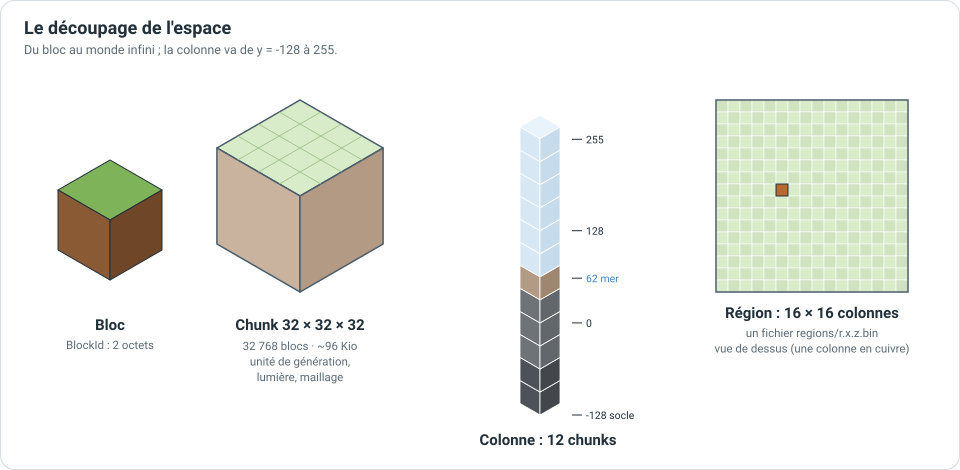
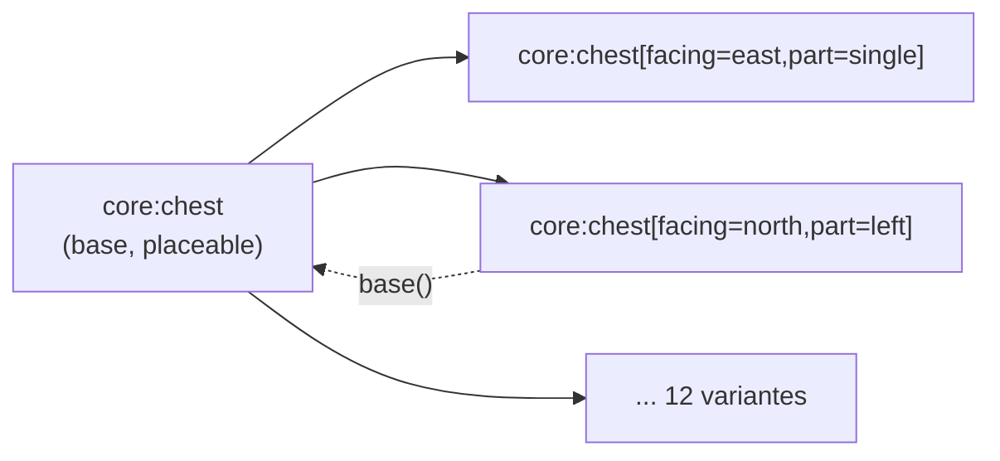
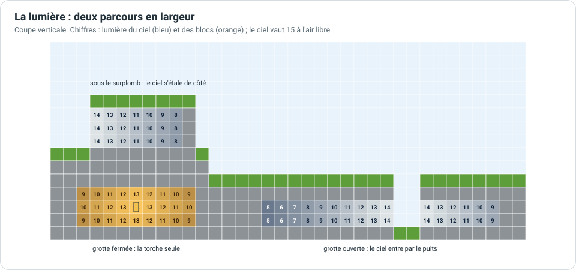
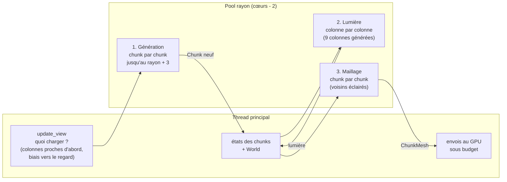
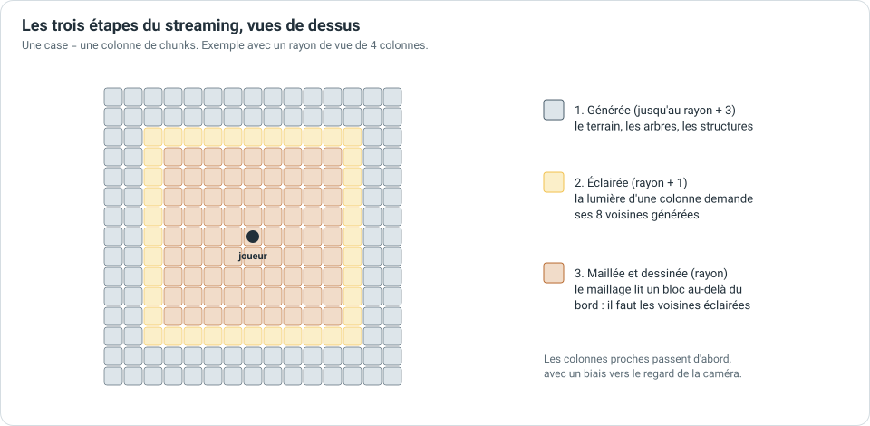
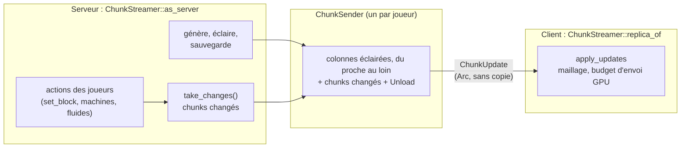
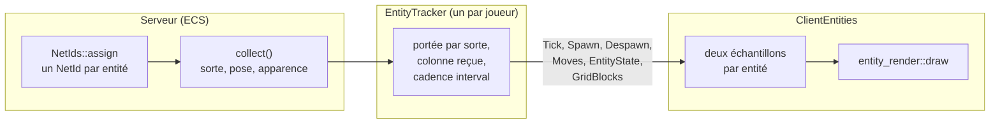
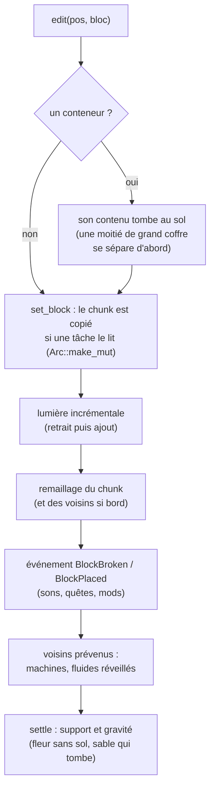
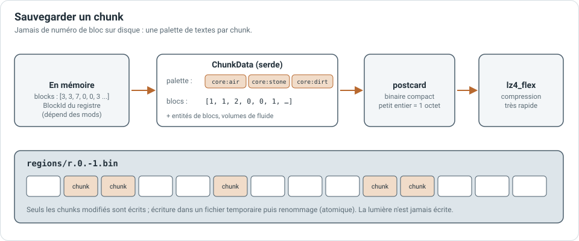

# 3. Le monde en blocs

[← Boucle et ECS](02-boucle-et-ecs.md) · [Sommaire](README.md) · [La génération →](04-generation.md)

Tout ce chapitre vit dans `crates/engine_voxel`.

## Le découpage de l'espace



| Unité | Taille | Rôle |
|---|---|---|
| **Bloc** | 1 × 1 × 1 | un `BlockId` (`u16`, 2 octets) |
| **Chunk** | 32 × 32 × 32 blocs | l'unité de stockage, de génération, de lumière et de maillage |
| **Colonne** | 1 × 12 chunks (y de -128 à 255) | l'unité de la lumière du ciel et du cache de génération |
| **Région** | 16 × 16 colonnes | un fichier de sauvegarde `regions/r.<x>.<z>.bin` |
| **Monde** | infini en x et z | une table `HashMap<IVec3, Arc<Chunk>>` (`World`) |

Les coordonnées : `x` vers l'est, `y` vers le haut, `z` vers le sud. La mer est à `y = 62`. Un monde v3 va
de `y = -128` (le socle, `MIN_CHUNK_Y = -4`) à `y = 255` (`MAX_CHUNK_Y = 8`, exclu) ; un monde v1, de 0 à 191.

### Un chunk

```rust
pub struct Chunk {
    blocks: Box<[BlockId]>,                     // 32 768 blocs, index x + 32·z + 1024·y
    light: Box<[u8]>,                           // 32 768 octets : ciel (4 bits) | blocs (4 bits)
    block_entities: HashMap<u16, BlockEntity>,  // les blocs actifs, presque toujours vide
    biomes: Vec<u8>,                            // le biome de chaque colonne (teintes), recalculé
    fluids: HashMap<u16, u16>,                  // le volume des cellules de fluide en mouvement
}
```

Un chunk pèse environ 96 Kio (blocs + lumière). Le monde le garde dans un `Arc` : les threads de fond le
lisent sans copie, et le thread principal le copie seulement s'il le modifie pendant qu'une tâche le lit
(`Arc::make_mut`).

## Le registre des blocs

`BlockRegistry` (`registry.rs`) lit `assets/core/blocks.ron` puis le `blocks.ron` de chaque mod.

```ron
(
    id: "core:chest", name: "Coffre", color: (0.18, 0.08, 0.04),
    boxes: [
        (from: (1, 1, 1), to: (15, 10, 15)),     // le corps, en seizièmes de bloc
        (from: (1, 10, 1), to: (15, 13, 15)),    // le couvercle
        (from: (2, 13, 2), to: (14, 14, 14)),
        (from: (6, 8, 0), to: (10, 12, 1)),      // la serrure
    ],
    textures: (top: "chest_top", side: "chest_side_panel", bottom: "chest_inside",
               front: "chest_side", back: "chest_back_panel"),
    behavior: "core:chest",
    hardness: 2.0, tool: Axe,
    states: [Facing4, ChestPart],
    lid: (body: 0, boxes: [1, 2, 3], hinge: (10, 15), inside: "chest_inside", ...),
)
```

Une définition (`BlockDef`) porte : nom, couleur (carte, lointain), solidité, transparence, lumière émise
et absorbée, textures par face, **forme** (`Cube`, `Cross` pour les plantes, `Flat`, `Model` avec des
boîtes, `Rail`), sons, dureté et outil, support nécessaire (sol, eau, terre labourée), gravité (sable),
comportement (`behavior` : la machine qui l'anime), fluide, conduit de réseau, ports d'inventaire,
portail vers une dimension...

### Les états et les variantes

Un bloc peut **varier** selon des états : chaque combinaison est un bloc du registre, avec son propre
`BlockId`. La forme écrite dans le fichier est celle de la première valeur ; les autres sont déduites par
rotation ou symétrie des boîtes.

| État | Valeurs | Exemple |
|---|---|---|
| `Facing4` | nord, est, sud, ouest | four, coffre, escalier |
| `Facing6` | + haut, bas | piston, tuyau à sens unique |
| `Half` | bas, haut | dalle, escalier retourné |
| `Axis` | y, x, z | bûche couchée |
| `DoorOpen` | fermé, ouvert | porte |
| `ChestPart` | seul, gauche, droite | moitié de grand coffre |



Les clés des variantes s'écrivent `core:chest[facing=east,part=single]`. Un état ajouté **en dernier**
garde lisibles les sauvegardes d'avant : sa première valeur répond aussi au nom sans lui
(`core:chest[facing=east]`).

## Les blocs actifs et leurs capacités

Un bloc qui a un état propre (un coffre et ses objets, un four qui chauffe, un câble) a une
**entité de bloc**, rangée dans son chunk :

```rust
pub struct BlockEntity {
    pub power: u8,                          // signal émis vers les voisins (0 à 15)
    pub data: Vec<u8>,                      // octets libres, lus par le comportement
    pub caps: Option<Box<Capabilities>>,    // 8 octets quand il n'y en a pas
}
pub struct Capabilities {
    pub energy: Option<EnergyStorage>,      // quantité, capacité, débits
    pub tanks: Vec<FluidTank>,              // fluides en millibuckets
    pub inventory: Option<Inventory>,       // cases d'ItemStack (identifiant texte + nombre)
    pub kinetic: Option<Kinetic>,           // vitesse de rotation et contrainte (« stress »)
}
```

Les **capacités** sont des conteneurs génériques communs à tous les mods, à la manière des
*capabilities* de Forge : un câble d'un mod alimente la machine d'un autre. Chacune dit **par quelle
face** elle échange (`Sides`, 6 bits) et offre `insert` / `extract` avec un mode simulation (« combien
accepterais-tu ? »).

### Les formes : une case de pièces

Un seul bloc du registre, `core:shaped` (`shaped/`), sert à toutes les formes : couches de 1 à 16 seizièmes,
pentes à 16 niveaux (24 orientations, coins sortants et rentrants), escaliers, pavés (marche, poutre, tranches,
panneaux, planchettes), microblocs sur une grille 4 × 4 × 4 et formes qui se raccordent (muret, barrière,
portillon, vitres). Son contenu est dans son entité de bloc (`BlockEntity::data`), pas dans des variantes :
aucun bloc à déclarer par matériau, et n'importe quel cube plein (du jeu ou d'un mod) peut être taillé
(`is_shapeable`).

```rust
pub enum Piece {
    Layer { face: Face, offset: u8, thickness: u8 },              // une tranche collée à une face
    Slope { base: Face, up: Face, level: u8, corner: Corner },    // un plan incliné : 24 orientations
    Micro { cells: u64 },                                         // des cellules de 1/64 de bloc
    Cuboid { min: [u8; 3], max: [u8; 3], kind: PieceKind, count: u8 }, // un pavé au seizième
    Stairs { facing: u8, ceiling: bool, vertical: bool },         // un escalier, droit ou vertical
    Connected { kind: Link, open: bool },                         // muret, barrière, portillon, vitres
}
pub struct Part { pub piece: Piece, pub material: u8 }   // indice dans `materials`
pub struct Shaped { pub materials: Vec<String>, pub parts: Vec<Part> }
```

Le module est découpé : `grid` (l'occupation 16³), `piece` (`Piece`), `slope` (pentes), `connected` (formes
raccordées), `kind` (`PieceKind` : les 23 sortes d'objets), `format`, `place` (où poser selon le point visé).

- **Une pièce, un matériau** : `materials` est une liste d'identifiants **texte** (`core:oak_planks`), jamais
  de numéros de blocs. Au plus 16 matériaux et 32 pièces par case. Le format (`encode` / `decode`) commence par
  un octet de version : **`VERSION = 2`**, et la version 1 (pentes `facing, ceiling, level`) se relit comme des
  pentes droites au sol ou au plafond. Un matériau que le registre ne connaît plus garde son nom et se dessine
  en `core:unknown`.
- **L'occupation** (`occupancy`) : 16 × 16 × 16 bits, calculée à la demande. `try_add` refuse un recouvrement et
  fusionne ce qui se touche (même matériau) : une couche s'épaissit, une pente monte de niveau, des
  demi-couches s'allongent, des microblocs se réunissent. Une planchette qui touche une autre planchette (autre
  face) est rognée d'un seizième à l'arête.
- **Les pentes** : une base (la face d'appui) et un haut (la face vers laquelle elles montent) ; en coin, la
  hauteur d'une colonne est `h(max(dz, dx))` (sortant, une pyramide) ou `h(min(dz, dx))` (rentrant), `dz` et
  `dx` étant les distances aux deux bords hauts. Toute la géométrie est écrite une fois (pente canonique) puis
  remenée dans l'orientation par une rotation propre (`slope::Frame`).
- **Les tranches** (d'arête : n × n × 16 ; de coin : n³, n de 1 à 8) grandissent d'un cran (`try_grow`). Un
  objet tranche vaut 16 seizièmes cubes (une barre 1 × 1 × 16), un objet tranche de coin 8 ; grossir de n à n + 1
  coûte la différence (`slice_cost`, `corner_slice_cost`) et casser rend le total : rien ne se perd.
- **Les formes raccordées** occupent **seules** leur case (`AddError::Alone`). Leur géométrie n'est pas
  sauvegardée : elle se calcule des **voisins** (`connected::neighbours_at`, comme les conduits). Un muret se
  raccorde à un muret, un portillon et un cube plein opaque ; une barrière à une barrière, un portillon et un
  cube ; une vitre à une vitre et à un cube ; un portillon s'oriente selon ses voisins. Une case se remaille
  quand un voisin change (le streamer remaille déjà le chunk d'un bloc modifié et ceux de ses 26 voisins, et,
  pour un changement d'entité, ceux des six cellules voisines).
- **Les boîtes** (`boxes`) : la visée et le contour. Pentes en escalier de seizièmes (au plus 16 groupes, deux
  boîtes par groupe en coin). `connections::boxes_at` les lit dans l'entité, **voisins compris**. La
  **collision** a sa propre lecture, `World::collision_boxes` (`connections::collision_at`) : une barrière et un
  portillon fermé montent à 24 seizièmes (la physique regarde aussi la rangée de cellules sous le corps pour
  les boîtes qui dépassent), un portillon ouvert ne gêne plus (`None`). La marche automatique de 0,6 monte une
  pente en marchant, en coin aussi.
- **La simplification** (`store`) : une case vide redevient de l'air, une case pleine d'un seul matériau le vrai
  bloc de ce matériau.
- **Les structures mobiles** : une case de formes tourne avec le vaisseau qui se repose (`Shaped::turned`).
- **Le terrain lointain** compte une case de formes pleine à plus de moitié comme un sol, avec la couleur de
  son matériau principal.

Côté jeu, une pièce qu'on tient est un objet (`core:shape_slab`...) dont le `damage` est le **numéro du
matériau** dans la palette du monde (`materials.ron`) : voir `games/voxel/src/shape_materials.rs` et `07-jeu.md`.

### Les grilles

Un bloc se désigne par `GridPos { grid, pos }`, pas seulement par ses coordonnées : `GridId::WORLD` est
le monde, chaque structure mobile (vaisseau) a la sienne, en coordonnées locales qui ne changent jamais.
Le code des machines passe par le trait `BlockAccess` (lire et écrire blocs et entités), implémenté par le
monde (`ChunkStreamer`) et par les sous-grilles (`SubGrid`) : une machine ne sait pas si elle vole.

## La lumière

Deux niveaux de 0 à 15 par bloc, rangés dans un octet (`light.rs`) :

- **la lumière du ciel** tombe tout droit depuis le haut du monde sans rien perdre dans l'air, puis s'étale
  sur les côtés en perdant 1 par bloc ;
- **la lumière des blocs** part des blocs émissifs (torche 14, pierre lumineuse 15) et perd 1 par bloc.



Les deux se calculent par un **parcours en largeur** (BFS) : les sources entrent dans une file, chaque
bloc sorti donne `niveau - 1` à ses six voisins s'ils étaient moins éclairés. Comme on avance par distance
croissante, chaque bloc reçoit son niveau final dès sa première visite.

- **En tâche de fond** : `LightRegion::compute` éclaire une **colonne** entière (la lumière du ciel
  tombe du haut), avec ses 8 voisines générées (elle déborde de 15 blocs).
- **Sur le thread principal**, quand le joueur casse ou pose : `update_light` fait un BFS de **retrait**
  (on éteint ce qui dépendait de l'ancienne source) puis un BFS d'**ajout**.

Au rendu, l'heure du jour multiplie la lumière du ciel : la nuit ne demande aucun recalcul.

## Le streaming : un monde infini

`ChunkStreamer` (`streaming.rs`) charge, éclaire et maille les chunks autour du joueur, en tâche de fond
(seul, ou en deux rôles : voir plus bas « Le serveur et la réplique »).





1. **Génération**, chunk par chunk, jusqu'au rayon de vue + 3.
2. **Lumière**, colonne par colonne : il faut la colonne et ses 8 voisines générées.
3. **Maillage**, chunk par chunk, jusqu'au rayon de vue : la lumière douce et l'occlusion lisent un bloc
   au-delà du bord, il faut donc les voisins éclairés.

**Les priorités.** On complète des colonnes entières, de la plus proche à la plus lointaine, avec un biais
borné vers ce que regarde la caméra (aucune colonne n'est affamée). Seul le maillage le plus récent de
chaque chunk attend son envoi ; celui d'un bloc que le joueur vient de modifier passe en tête, hors budget.

**Le budget d'envoi** (`transfer.rs`) compte des **octets** et du **temps** par image, commun aux chunks et
au terrain lointain : un chunk de plaine pèse quelques kilo-octets, une forêt dense plusieurs centaines.
Le premier envoi de l'image passe toujours (sinon un très gros maillage ne partirait jamais). L'ancien
maillage reste affiché jusqu'à l'arrivée du nouveau : pas de trou pendant un remaillage.

**Le déchargement.** Au-delà du rayon + une marge, un chunk est retiré ; s'il a été modifié, il est d'abord
sauvegardé, et un résumé de sa surface est gardé pour le terrain lointain (`edited_surface.rs`).

**Mesurer.** `VOXEL_PIPELINE=1` note, pour chaque chunk, les délais demande → généré → lumière →
maillé → envoyé (`pipeline_timing.rs`).

### Le serveur et la réplique

Dans le jeu, le monde est tenu **en deux endroits** (multijoueur, sous-lot 3a ; voir
`docs/plan-multijoueur.md`). Le même `ChunkStreamer` joue deux rôles :



- **Le serveur** charge, génère, éclaire et sauvegarde, mais **ne maille rien**. Il note les chunks qui
  changent (`ChunkChange`) : les positions des blocs posés ou cassés par une action immédiate (`edits`), et
  un drapeau `remesh` pour un changement qui peut attendre (lumière, fluide, machine, forme). Un changement
  de données seules (le contenu d'un coffre) ne remaille rien.
- **L'expéditeur** (`ChunkSender`, un par joueur) envoie des **colonnes entières**, du plus proche au plus
  lointain sous un budget (256 chunks par pas), et seulement quand leur lumière est calculée : la lumière
  est dans le chunk. Un chunk n'est maillé que si ses 26 voisins sont là, et la réplique sait qu'une colonne
  est complète dès que son premier chunk arrive. Il renvoie aussi les chunks changés que le joueur a, et
  libère (`Unload`) ceux sortis du rayon plus une marge.
- **La réplique** ne génère, n'éclaire ni ne sauvegarde rien : elle range les chunks reçus et les maille
  avec les mêmes priorités, le même budget, les mêmes couches sombres que le streamer seul. Elle tient les
  **mêmes `Arc`** que le serveur : une édition copie le chunk (`Arc::make_mut`, environ 96 Kio) tant que
  la réplique tient l'ancien.
- **Une édition se voit dans la même image** : le serveur l'applique, l'expéditeur la renvoie à la fin de
  l'image, et la réplique remplace d'abord tous les chunks reçus, puis refait la géométrie de chaque
  position éditée (le chunk et ses voisins) et remaille tout de suite, hors budget.

Ce que le client dessine ou vise (rendu, rayon de visée, culling des grottes, pas, couvercles de coffre,
eau, vent, lumière du bras) lit la réplique (`VoxelGame::view_world`) ; la physique, l'IA, les mods, les
machines, les fluides, les actions des joueurs (`handle`) et les outils de débogage `ctl` lisent le
serveur (`VoxelGame::streamer`).

### Les entités vues par le client

Les créatures, objets au sol, wagons, projectiles, structures mobiles et autres joueurs suivent le même
modèle (multijoueur, sous-lot 3b). Le rendu ne lit plus leur ECS : il lit une **réplique d'entités**.



- **`NetId`** : un numéro du serveur, jamais réutilisé dans une partie, posé comme composant sur chaque entité
  répliquée. Le client désigne ce qu'il voit par ce numéro (`ClientMsg::Attack`, les cases d'un wagon) ; le
  serveur le retrouve (`NetIds::entity`), refuse un numéro inconnu ou mort, et revérifie sa propre visée.
- **Le suivi** (`entities.rs`) envoie `Spawn` quand une entité entre dans la portée du joueur (créatures 80
  blocs, objets 48, projectiles 64, wagons, structures et joueurs 128), dans une colonne que son client a reçue ;
  `Despawn` quand elle sort (4 blocs de marge) ou meurt ; `Moves` pour ce qui a bougé, tous les `interval` pas
  fixes ; `EntityState` quand l'apparence change (blessure, petit qui grandit, couleur de toison) ;
  `GridBlocks` pour les blocs d'une structure mobile, quand sa révision change. `interval` vaut 1 sur le
  lien en mémoire (60 Hz, comme avant) et 3 (20 Hz) sera la valeur du réseau ; `VOXEL_ENTITY_INTERVAL=3` l'essaie.
- **L'interpolation** (`client_entities.rs`) : la réplique garde les deux derniers échantillons de chaque
  entité, datés du pas fixe du serveur (`ServerMsg::Tick`), et dessine au temps `pas - interval + alpha`. Avec
  `interval = 1`, c'est exactement l'interpolation entre `PreviousPosition` et la position qu'avait le rendu ;
  avec 3, la pose glisse d'un échantillon à l'autre en trois pas. Un autre joueur marche d'après ses
  déplacements (le serveur n'envoie que sa pose).
- **Le dessin** (`entity_render.rs`) lit la réplique et le monde que voit la fenêtre (la lumière). La
  créature ou le wagon visé est choisi dans la réplique (`ClientEntities::hit`).
- **`ctl ghost [nom] [x y z]`** ajoute un joueur serveur sans fenêtre (`ghosts.rs`), vu des autres comme
  une entité `Player`, dessiné avec son nom ; `ctl ghost remove` le retire. Il sert à voir un autre
  joueur avant le réseau.

## Modifier le monde

Casser ou poser passe par `VoxelGame::edit` (jeu) puis `ChunkStreamer::set_block` (moteur) :



`settle` (`block_rules.rs`) traite une **file de positions** : casser le bloc sous une colonne de sable la
fait tomber entièrement, et les fleurs posées dessus avec.

## La sauvegarde



`SaveStore` (`save.rs`) écrit un dossier par monde :

```
saves/<monde>/
├── world.ron           réglages lisibles : graine, heure, joueur hôte, mods, version de génération
├── players/<uuid>.ron  un fichier par joueur : position, inventaire, progression d'aventure
├── regions/
│   └── r.<x>.<z>.bin   les chunks modifiés d'une région de 16 × 16 colonnes
├── grids.bin           les structures mobiles
├── carts.bin           les wagons
├── backpacks.bin       le contenu des sacs à dos
├── items.bin           les fiches des objets enrichis (affixes, gemmes, enchantements)
├── quests.ron          l'avancement du livre de quêtes
├── mod_data.ron        les données que les mods gardent pour ce monde
└── dimensions/<nom>/   les autres dimensions : leurs regions/, grids.bin, carts.bin
```

Un fichier illisible n'est jamais écrasé : il est mis de côté (`items.bin.illisible`) et le jeu repart
d'un état vide, en le disant dans les logs.

- **Seuls les chunks modifiés** sont écrits : les autres se régénèrent depuis la graine. La lumière n'est
  jamais écrite : elle se recalcule.
- **Jamais de numéro de bloc sur disque** : chaque chunk écrit sa **palette** (les identifiants texte qu'il
  contient) et ses blocs comme des indices dans cette palette. Au chargement, on retraduit avec le
  registre du moment : ajouter ou retirer un mod ne casse pas un monde (un bloc inconnu devient
  `core:unknown` et garde son nom pour revenir si le mod revient).
- **Format** : `serde` + `postcard` (compact) + `lz4_flex` (compression très rapide).
- **Écriture atomique** : un fichier temporaire, puis un renommage. Un plantage au milieu laisse l'ancien
  fichier entier.
- **Deux versions** : celle du **format** (`FORMAT_VERSION`, comment lire les fichiers) et celle de la
  **génération** (`GenerationVersion`, comment le terrain est calculé). Un monde garde sa version de
  génération à vie : changer les formules ferait bouger le paysage sous les constructions du joueur.

[← Boucle et ECS](02-boucle-et-ecs.md) · [Sommaire](README.md) · [La génération →](04-generation.md)
