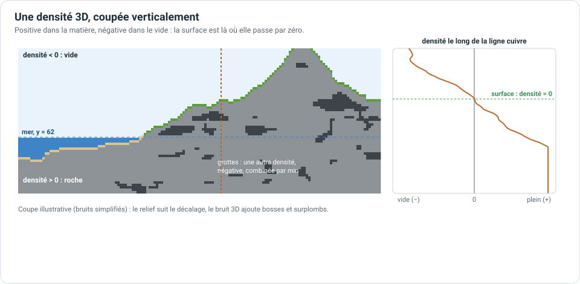
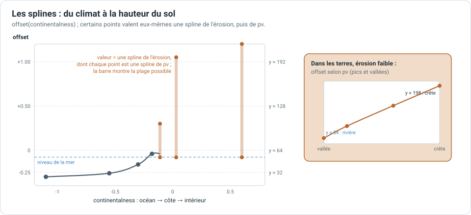
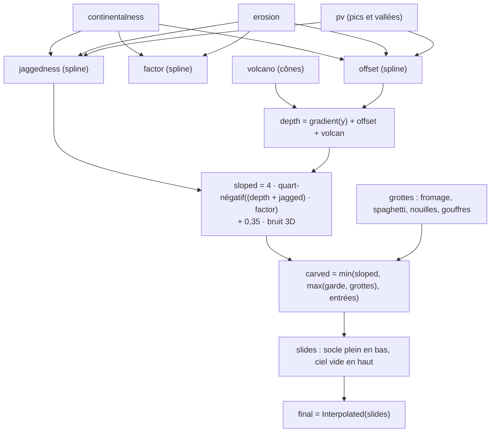
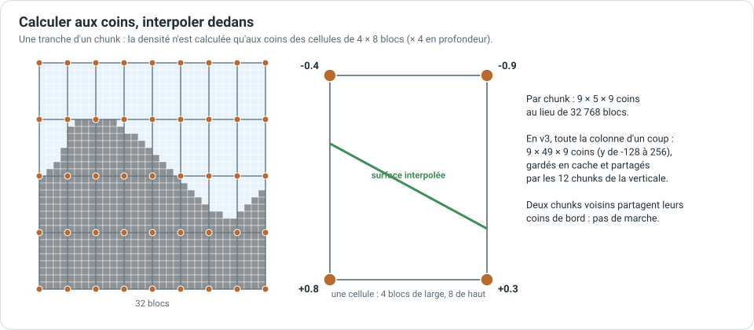
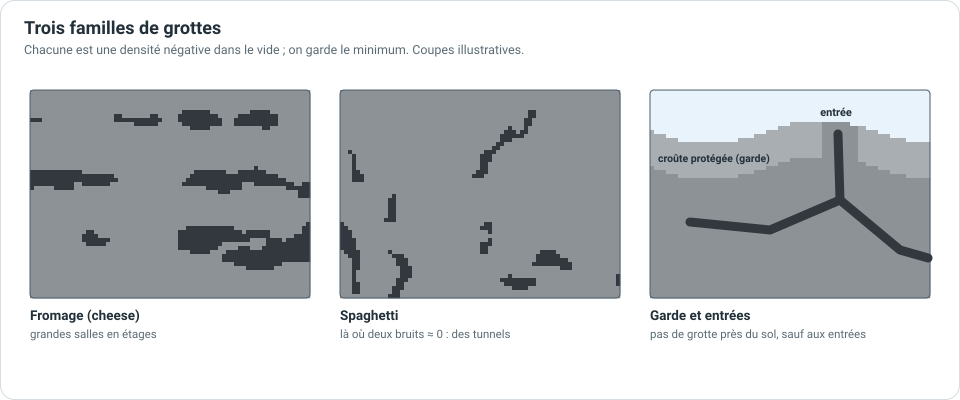
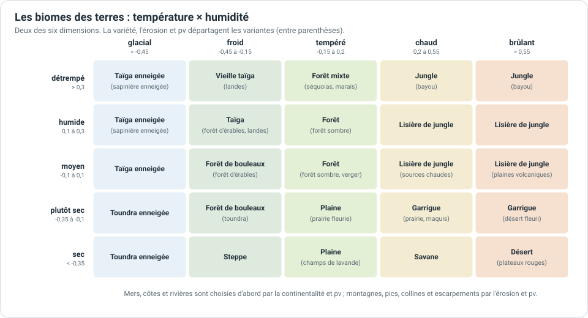
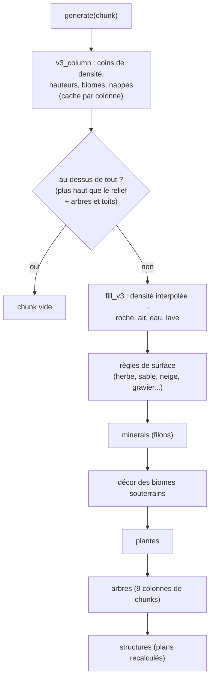
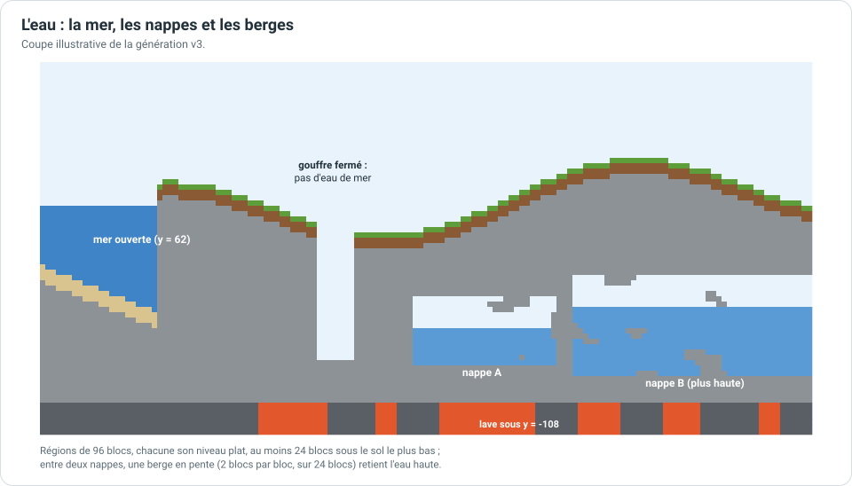
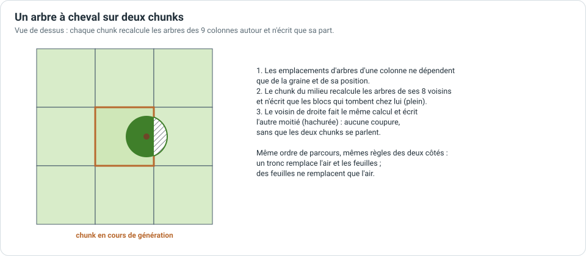

# 4. La génération du monde

[← Le monde en blocs](03-monde.md) · [Sommaire](README.md) · [Le rendu →](05-rendu.md)

Les nouveaux mondes utilisent la **génération v3** : le modèle de Minecraft moderne (densité 3D,
paramètres climatiques, splines, grottes en bruit, biomes multi-paramètres), réécrit ici avec nos propres
valeurs. Les mondes anciens gardent la **v1**, figée (voir la fin du chapitre).

Fichiers :

| Fichier | Contenu |
|---|---|
| `assets/core/worldgen/terrain_v3.ron` | les bruits et les fonctions de densité (relief, grottes, volcans, nappes) |
| `assets/core/worldgen/biomes_v3.ron` | les 46 biomes de surface, chacun une case dans l'espace des paramètres |
| `assets/core/worldgen/surface_v3.ron` | les règles de surface : quel matériau sur le sol du dessus |
| `assets/core/biomes.ron`, `ores.ron`, `structures.ron` | les biomes (couleurs, plantes, arbres), minerais, structures |
| `crates/engine_voxel/src/density_graph/` | le moteur de densité : bruits, description RON, graphe compilé |
| `crates/engine_voxel/src/generator/v3.rs`, `v3_rules.rs` | la génération d'un chunk v3 |
| `crates/engine_voxel/src/generator/{features,structures}.rs`, `trees.rs` | végétation, arbres, structures |

## L'idée : une densité en chaque point

Le terrain n'est pas une carte de hauteurs mais une **fonction de densité 3D** : en chaque point (x, y, z),
un nombre, **positif dans la matière, négatif dans le vide**. La surface est là où la densité passe par
zéro. Une densité en 3D permet ce qu'une carte de hauteurs ne sait pas faire : surplombs, arches, falaises
creusées, grottes.



La densité de base, `depth`, vaut 0 à y = 64 et diminue avec l'altitude (un gradient vertical de -128 à
256). On lui **ajoute un décalage** (`offset`) qui dépend du lieu : +0,5 pose la surface vers y = 128,
-0,25 vers y = 32. Tout l'art est de choisir ce décalage selon le climat.

## Les paramètres climatiques

Six cartes de bruit très étalées, lues en (x, z), décrivent chaque lieu. Elles varient de -1 à 1 environ.

| Paramètre                             | Ce qu'il décide                                                                       |
| ------------------------------------- | ------------------------------------------------------------------------------------- |
| **continentalness**                   | océan profond (bas) → côte → intérieur des terres (haut)                              |
| **erosion**                           | bas : montagnes escarpées ; haut : plaines usées                                      |
| **ridges → pv** (*peaks and valleys*) | `pv = 1 - 3·ridges - 2` : -1 au fond des vallées (les rivières), +1 sur les crêtes    |
| **temperature**, **humidity**         | le climat, pour les biomes                                                            |
| **variety**                           | la variante d'un climat (forêt claire ou sombre, verger, érables), en grandes plaques |

Un bruit `shift` déforme légèrement les coordonnées avant de lire ces cartes : des côtes et des vallées
moins régulières.

### Le bruit

`density_graph/noise.rs` : du **Perlin amélioré** (Ken Perlin, 2002), sommé en **octaves** (chaque octave
deux fois plus fine, avec son amplitude), et le *normal noise* (deux sommes d'octaves décalées). Chaque
bruit est dérivé de la graine **et de son nom** : l'ordre de création ne change rien, et ajouter un bruit
ne déplace pas les autres.

```ron
"continentalness": (first_octave: -11, amplitudes: [1.0, 1.0, 1.5, 1.5, 1.0, 0.25, 0.1]),
```

`first_octave: -11` : la première octave a une longueur d'onde de 2¹¹ = 2 048 blocs.

## Des paramètres au relief : les splines

Une **spline** transforme un paramètre en valeur par des points de contrôle (avec dérivées), et la valeur
d'un point peut elle-même être une spline d'un autre paramètre : c'est un arbre de courbes.



`offset` (la hauteur moyenne du sol) suit d'abord la continentalité : océan profond -0,30, côte vers 0,
puis, dans les terres, une spline de l'érosion dont chaque point est une spline de `pv`. Dans les terres
peu érodées, le sol monte de -0,08 au fond des vallées (y ≈ 53, sous la mer : **une rivière ne peut pas
être perchée**) jusqu'à 1,05-1,20 sur les crêtes (y ≈ 200).

Deux autres splines complètent :

- `factor` : grand, le relief suit le décalage de près (plaines nettes) ; petit, le bruit 3D prend plus de
  place (escarpements, surplombs) ;
- `jaggedness` : les dentelures des sommets, seulement sur les crêtes des massifs.



## Le graphe de densité

Les fonctions sont écrites en RON (`terrain_v3.ron`), puis **compilées en graphe** (`density_graph/graph.rs`) :
des nœuds dans un tableau, les fonctions nommées (`Ref("depth")`) calculées une seule fois et partagées.

| Nœud | Rôle |
|---|---|
| `Constant`, `Add`, `Mul`, `Min`, `Max`, `Abs`, `Square`, `HalfNegative`, `QuarterNegative` | arithmétique |
| `Noise`, `ShiftedNoise` | un bruit du fichier, à l'échelle donnée |
| `YClampedGradient` | un gradient vertical borné |
| `Spline` | une courbe, éventuellement imbriquée |
| `RangeChoice` | l'une ou l'autre fonction selon un intervalle |
| `Cones` | les volcans : des cônes avec cratère, un par carré de 320 blocs au plus, là où le masque le permet |
| `FlatCache`, `Cache2d`, `CacheOnce` | des caches : une valeur par (x, z), ou par position |
| `Interpolated` | calculé aux coins des cellules seulement, puis interpolé |

### Calculer peu, interpoler beaucoup

Calculer `final` en chacun des 32 768 blocs d'un chunk serait trop cher. `Interpolated` n'est évalué
qu'aux **coins de cellules de 4 × 8 × 4 blocs**, puis interpolé trilinéairement dans chaque cellule.



En v3, le générateur calcule ces coins pour **toute une colonne de chunks** d'un coup (9 × 49 × 9 coins,
de y = -128 à 256) et la garde en cache (`v3_column`) : les 12 chunks d'une verticale la partagent. Le même
calcul donne les **hauteurs de surface** (pour le jeu, les arbres, le terrain lointain) : elles collent
donc toujours aux blocs. Deux chunks voisins partagent leurs coins de bord : aucune marche à la frontière.

## Les grottes

Trois familles de grottes, toutes des densités **négatives dans le vide**, combinées par `Min` :



- **fromage** (*cheese*) : de grandes salles, rangées en étages par un bruit de couche ;
- **spaghetti** : des tunnels, là où **deux bruits sont tous deux proches de zéro** (l'intersection de deux
  surfaces est une ligne), d'épaisseur variable ;
- **nouilles** : des réseaux fins, seulement là où un bruit les autorise ;
- **gouffres** : dans les biomes de gouffre cristallin, les grandes salles se creusent davantage.

Une **garde** protège la surface : pas de grotte à moins d'une quinzaine de blocs du sol (la densité du
relief, ou la profondeur sous la surface estimée), sauf aux **entrées**, un bruit qui laisse les tunnels
déboucher. Pas d'entrée sous la mer, sur les côtes basses ni au fond des vallées : l'eau s'y engouffrerait.

## Les biomes

### En surface : le plus proche dans un espace à six dimensions

Chaque biome de `biomes_v3.ron` occupe une **case** dans l'espace (température, humidité, continentalité,
érosion, pv, variété). Une colonne prend le biome dont la case est la plus proche : distance nulle dedans,
carré de l'écart dehors, plus un petit décalage propre au biome pour départager.

```ron
(biome: "core:river", continentalness: (-0.115, 2.0), pv: (-2.0, -0.9), erosion: (-0.45, 2.0)),
(biome: "core:beach", continentalness: (-0.15, -0.115), erosion: (-0.3, 2.0), temperature: (-0.45, 2.0)),
```



Les 46 biomes de surface : mers (profonde, tempérée, chaude, froide), côtes (plage, plage enneigée,
rivage rocheux), rivière, plaines, prairie, steppe, prés fleuris, champs de lavande, forêts (feuillus,
bouleaux, mixte, sombre, érables, séquoias, verger), taïgas, toundras, savane, désert, désert fleuri,
badlands, maquis, jungles, marais, bayou, montagnes (boisées, rocheuses, enneigées), lande, hautes terres,
escarpements, volcan et plaines volcaniques, sources chaudes...

Un biome (`assets/core/biomes.ron`) donne : ses couleurs d'herbe, de feuillage et d'eau, son sol et sa
sous-couche, ses strates colorées, ses plantes, ses arbres et leur densité, ses minerais propres.

### Sous terre : des biomes en 3D

Sous y = 30 et à plus de 16 blocs sous la surface, deux bruits 3D (`cave_amount`, `cave_kind`), lus sur
une grille de 8 blocs, placent trois biomes souterrains : le **gouffre cristallin** (cristaux, grandes
salles), la **grotte luminescente** et la **grotte fongique** (champignons géants).

## Remplir un chunk



### La surface

Pour chaque colonne, en descendant, on compte les blocs pleins d'affilée depuis le sommet. Les matériaux
de surface ne vont qu'au **sol du dessus**, plein sans interruption depuis le haut : le plancher et le
plafond d'une grotte restent en roche. `surface_v3.ron` est une liste ordonnée de règles ; la première dont
toutes les conditions tiennent donne le matériau :

```ron
(when: [Underwater, Subsurface], then: BiomeUnderwater),             // le fond marin du biome
(when: [Steep, Depth(max: 2), Noise(noise: "scree", min: 0.45, max: 9.0)],
    then: Block("core:gravel")),                                     // éboulis sur les versants
(when: [Steep, Depth(max: 3)], then: Block("core:stone")),           // roche nue des falaises
(when: [Depth(max: 0), Cold, Not(Biomes(["core:beach", "core:desert", "core:badlands"]))],
    then: Block("core:snow")),                                       // la neige sur le dessus
(when: [Depth(max: 0)], then: BiomeSurface),                         // sinon : l'herbe, le sable...
(when: [Subsurface], then: BiomeSubsurface),                         // ... et la terre dessous
```

Conditions : profondeur sous le sommet, sous-couche, biome, sous l'eau, gel (la même règle que les ticks
aléatoires : la neige ne fondra pas), pente raide, altitude, bruit. Matériaux : un bloc, le sol du biome
(avec ses taches), sa sous-couche, son fond marin, ses strates.

### L'eau



- **La mer** est à y = 62, mais elle ne remplit que les colonnes **ouvertes sur la mer** : là où la densité
  du relief sans les grottes est faible à y = 62. Un gouffre au milieu des terres ne se remplit pas jusqu'à
  sa bouche.
- **Les nappes** : le monde est découpé en régions de 96 blocs (frontières déformées) ; chacune a un niveau
  d'eau plat, gardé au moins 24 blocs sous le sol le plus bas de la région. Les grottes sous ce niveau sont
  noyées.
- **Les berges** : entre deux nappes de niveaux différents, une pente de 2 blocs par bloc sur 24 blocs
  retient l'eau haute ; au-delà, le pied d'une très haute retenue reste un mur de roche.
- **La lave** remplit le vide souterrain sous y = -108, et les cratères des volcans.
- **Les sources chaudes** : des bassins là où un bruit est fort, dans leur biome.

### Les minerais

`assets/core/ores.ron` : chaque minerai a une plage d'altitude, une taille de filon (une marche aléatoire)
et un nombre moyen de filons par chunk. En v3, `deep` donne d'autres altitudes : les minerais profonds
descendent sous 0, dans la pierre profonde. Charbon, fer, cuivre, or, étain, plomb, argent, nickel,
cinabre, malachite, saphir, rubis, émeraude, diamant, quartz, jade (montagnes), pierre lumineuse (poches).
Chaque minerai tire ses filons avec **son rang** dans la liste : on n'ajoute qu'à la fin, sinon tous les
filons du monde bougeraient.

## Les arbres et les frontières de chunks

Un arbre près d'un bord déborde sur le chunk voisin, et chaque chunk se génère seul. La solution
(`features.rs`) :



1. Les emplacements d'arbres d'une colonne de chunks ne dépendent que de la graine et de sa position.
2. Pour générer un chunk, on recalcule les arbres des **9 colonnes autour** et on n'écrit que les blocs qui
   tombent chez lui.
3. Le voisin fait le même calcul et écrit l'autre moitié. Pour que deux arbres qui se chevauchent donnent
   le même résultat des deux côtés, on les parcourt toujours dans le même ordre, avec des règles qui ne
   dépendent que du chunk (un tronc remplace l'air et les feuilles ; des feuilles ne remplacent que l'air).

Bosquets et clairières : un bruit lent module la probabilité (forte dans les bosquets, faible ailleurs, même
moyenne), avec un écart minimal entre arbres. Les essences (`trees.rs`) sont des fonctions qui énumèrent
leurs blocs à partir de la base et d'un générateur pseudo-aléatoire : la même fonction sert à la génération
et aux pousses qui grandissent. Les mondes v3 ont des arbres plus grands (`TreeBlocks::tall`).

## Les structures

Villages, ruines, donjons, mines abandonnées (`generator/structures.rs`) suivent le même principe :

1. **Où** : le monde est découpé en cases de `spacing` chunks (village 14, ruine 10, donjon 8, mine 9) ;
   chaque case tire (selon la graine et `chance`) si elle contient une structure, et où.
2. **Quoi** : un **plan** (`Blueprint`) : une liste de blocs à poser, des coffres et leur butin, des
   endroits où des habitants apparaissent. Il ne dépend que de la graine du site et des hauteurs du terrain
   (elles aussi déterministes) : chaque chunk qui le recalcule obtient exactement le même.
3. **Poser** : chaque chunk regarde les cases autour, dessine sa part de chaque structure qui le touche.

Les **donjons** (`structures/graph.rs`) sont un graphe de salles enterrées : une entrée sur une grille, un
arbre de salles qui pousse, la plus profonde pour le boss, deux bouts de branche pour le trésor, un butin
de plus en plus riche avec la profondeur. En v3, ils sont posés à la hauteur où le sol est le plus plein,
avec une coque de pierre autour des salles et des couloirs : jamais un donjon flottant dans une grande
grotte.

## La v1, figée

Les mondes créés avant la v3 gardent la **v1** : une carte de hauteurs (continentalité, érosion,
température, humidité, rivières), un relief mélangé selon la distance climatique, des grottes en bruit 3D,
de y = 0 à 191. Elle ne change plus : `tests/generation_reference.rs` en fige les empreintes (graines 7,
42 et un corpus), dans tous les ordres de génération et quel que soit l'état du cache des colonnes.
`VOXEL_GENERATION=1` crée encore un monde v1. La v2 (un prototype) a été retirée ; ses mondes sont refusés
avec une explication.

## Les dimensions

`dimensions.ron` (d'un mod) décrit des mondes parallèles : leur générateur (le terrain du jeu, un monde
plat, le vide), leur ciel (couleur, lumière fixe ou cycle du jour), leur gravité, leur dossier de
sauvegarde. On y passe par un **portail**, un bloc dont `blocks.ron` dit `portal: "mod:dimension"`.

## Observer la génération sans jouer

| Commande | Ce qu'elle produit |
|---|---|
| `cargo xtask map` | des cartes PNG : altitude, pente, climat, continentalité, biomes (v3 par défaut, `--generator v1`) |
| `cargo xtask map --maps hauteur-blocs,materiau` | la surface réelle, issue des blocs |
| `cargo xtask map --section z=0 --from -256 --to 256` | une **coupe verticale** : grottes, nappes, croûte |
| `cargo run --release -p engine_voxel --example recette` | la recette de la v3 (statistiques et vérifications) |

[← Le monde en blocs](03-monde.md) · [Sommaire](README.md) · [Le rendu →](05-rendu.md)
