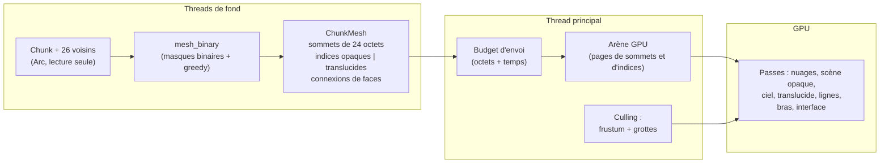
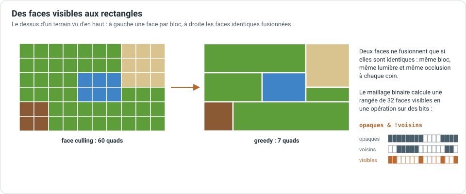
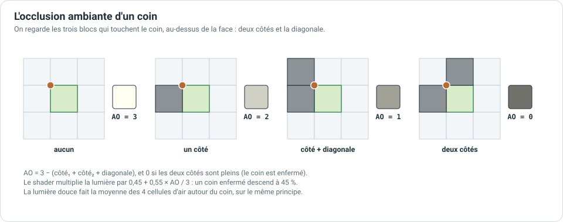
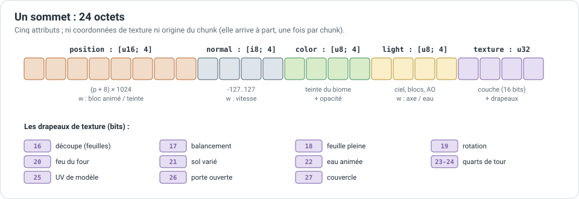
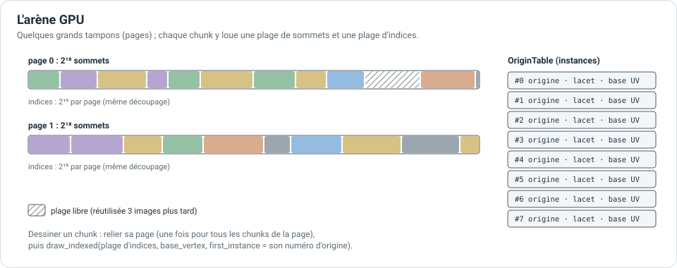
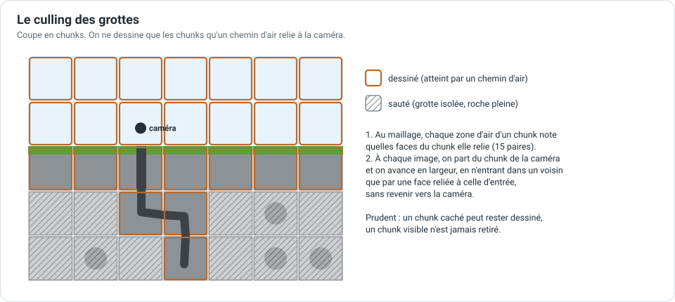
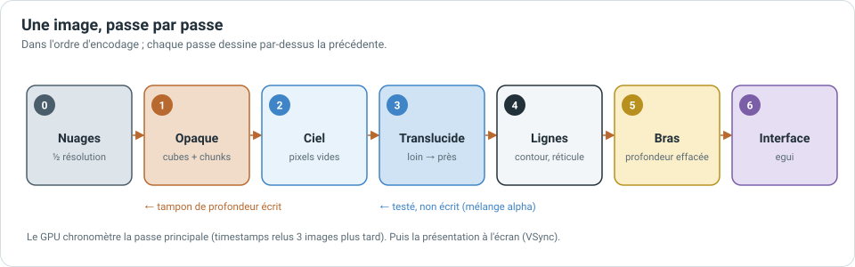
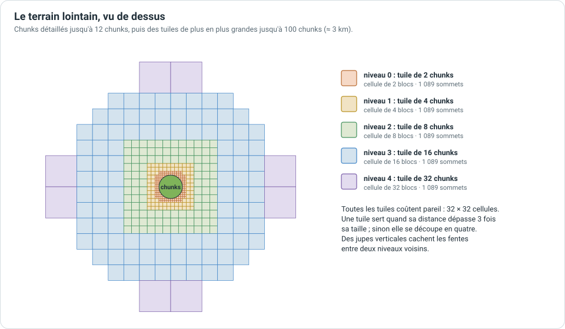

# 5. Le rendu

[← La génération](04-generation.md) · [Sommaire](README.md) · [La simulation →](06-simulation.md)

Le rendu se fait en deux temps, sur deux crates :

1. **`engine_voxel`** transforme les blocs en triangles (le **maillage**), sur les threads de fond. Il ne
   connaît pas le GPU.
2. **`engine_render`** envoie ces triangles au GPU avec **wgpu** (Metal sur Mac, Vulkan, DirectX 12) et les
   dessine en plusieurs passes, avec des shaders WGSL.



## Le maillage : des blocs aux triangles

### Ne dessiner que les faces visibles

Un chunk de terrain a 32 768 blocs, donc 196 608 faces possibles ; une sur vingt environ est visible. Une
face n'est dessinée que si le voisin de ce côté est transparent (air, eau, verre, feuilles...). Les faces
de même apparence, coplanaires et voisines sont ensuite **fusionnées** en grands rectangles : c'est le
*greedy meshing*.



Trois mailleurs coexistent (`mesh.rs`), avec le même résultat pour les deux derniers :

| Mailleur | Principe | Usage |
|---|---|---|
| `mesh_culled` | une face par côté visible | référence, tests |
| `mesh_greedy` | + fusion des faces identiques | référence de `mesh_binary` |
| `mesh_binary` | **masques binaires** : une rangée de 32 cellules tient dans un `u32` | **par défaut** |

`mesh_binary` (`mesh/binary.rs`) :

1. **Copie à plat** du chunk et de deux blocs de chaque côté (36³ cellules), rangée par rangée depuis les
   27 chunks : on ne consulte plus les voisins cellule par cellule.
2. **Masques** : pour chaque axe, un entier de 32 bits par rangée dit quelles cellules sont des cubes
   opaques. Une rangée entière de faces visibles se calcule en une opération : `opaques & !cache(voisine)`.
3. **Greedy sur ce qui existe** : on ne calcule l'apparence (lumière, occlusion, teinte) que des faces
   visibles, puis on fusionne. Les feuilles, l'eau, le verre passent par la voie complète ; les plantes,
   dalles, escaliers, rails et modèles par leurs propres routines.

### La lumière de chaque coin

Chaque sommet porte sa lumière, **lissée** :

- **lumière douce** : la moyenne des 4 cellules d'air qui touchent ce coin, au lieu de la lumière d'une
  seule cellule (qui ferait des marches d'escalier) ;
- **occlusion ambiante** (AO) : un coin coincé contre des blocs reçoit moins de lumière diffuse. On compte
  les 3 blocs autour du coin (deux côtés et la diagonale), méthode de Mikola Lysenko (« 0fps »).



Deux faces ne fusionnent que si **tous leurs coins** ont la même lumière et la même occlusion : la fusion
ne change jamais l'image.

### Le format d'un sommet : 24 octets



```rust
pub struct MeshVertex {
    pub position: [u16; 4],  // (p + 8) × 1024 dans le chunk ; w : bloc animé ou masque de teinte
    pub normal: [i8; 4],     // -127..127 ; w : vitesse de rotation
    pub color: [u8; 4],      // teinte (biome) et opacité
    pub light: [u8; 4],      // ciel, blocs, occlusion ; w : axe de rotation ou profondeur d'eau
    pub texture: u32,        // couche de texture (16 bits) + drapeaux
}
```

- Les positions sont **locales au chunk**, en 1/1024 de bloc à partir de -8 : les coins entiers restent
  exacts (pas de fente entre deux faces voisines) et un modèle peut déborder un peu du bloc. L'origine du
  chunk arrive à part, une fois par chunk.
- Il n'y a **pas de coordonnées de texture** : le shader les déduit de la position et de la normale. Un bloc
  montre une texture entière, et un grand rectangle fusionné la répète tout seul.
- Les **drapeaux** de `texture` disent au shader quoi faire : découpe des pixels transparents (feuilles,
  plantes), balancement au vent, rotation animée (engrenages), feu du four, sol à variation douce, eau
  animée, quarts de tour (rails), porte ouverte, couvercle de coffre.

Les blocs translucides (eau, verre, glace) vont dans une **seconde liste d'indices**, dessinée après
l'opaque, avec mélange alpha.

## L'arène GPU : peu de tampons, beaucoup de chunks

Un tampon par chunk ferait des milliers de liaisons par image. `arena.rs` range toute la géométrie dans
quelques grands tampons :



- `GeometryArena` : des **pages** de 2¹⁸ sommets et 2¹⁹ indices. Un maillage occupe une plage de sommets
  et une plage d'indices **dans la même page** ; on le dessine avec `base_vertex` et sa plage d'indices,
  sans rien relier tant que la page ne change pas.
- `RangeAllocator` : un allocateur de plages (meilleur ajustement, fusion des plages libres voisines).
- `OriginTable` : l'origine, le lacet (structures mobiles) et la base des textures de chaque chunk
  (32 octets), dans un seul tampon lu comme des instances : le chunk `n` se dessine avec
  `first_instance = n`.
- Une plage libérée n'est réutilisée qu'après 3 images : le GPU lit peut-être encore les précédentes. Les
  pages vides sont rendues au système (sauf une de réserve).

## Le culling : ne dessiner que ce qu'on voit

Deux filtres successifs, à chaque image :

1. **Le frustum** (`frustum.rs`) : les 6 plans de la pyramide de vision, extraits de la matrice
   vue-projection (Gribb et Hartmann) ; un chunk dont la boîte est entièrement dehors est sauté.
2. **Les grottes** (`visibility.rs`, l'« *advanced cave culling* » de Minecraft 1.8) : debout sur l'herbe,
   le frustum garde toutes les grottes sous nos pieds. Or on ne voit un chunk que si un **chemin d'air** y
   mène depuis la caméra.



- **Au maillage**, `FaceConnections::of_chunk` remplit chaque zone d'air du chunk et note quelles faces
  du chunk elle relie (15 paires possibles : « par l'air, on passe de l'ouest au dessus »).
- **À chaque image**, `VisibilityGraph::visible` part du chunk de la caméra et avance en largeur : on
  n'entre dans un voisin que par une face reliée à celle d'entrée, s'il est dans le champ, sans jamais
  revenir vers la caméra. Le résultat est prudent : il peut garder un chunk caché, jamais en retirer un
  visible. F6 l'allume ou l'éteint.

## Une image, passe par passe



`Renderer::draw_scene` (`crates/engine_render/src/renderer.rs`) encode, dans l'ordre :

| # | Passe | Ce qu'elle dessine | Profondeur |
|---|---|---|---|
| 0 | **Nuages** | un volume de nuages intégré par rayons, à **demi-résolution**, dans une image intermédiaire | — |
| 1 | **Scène : opaque** | les cubes instanciés (créatures, objets, wagons), puis les chunks opaques **regroupés par page** de l'arène | écrite |
| 2 | **Ciel** | un triangle plein écran, seulement dans les pixels encore vides : atmosphère, soleil, lune, étoiles, nuages composés | testée |
| 3 | **Scène : translucide** | l'eau, le verre, la glace, triés **du plus loin au plus proche** par chunk | testée, non écrite |
| 4 | **Lignes** | le contour du bloc visé et le réticule | testée |
| 5 | **Bras** | le bras et l'objet tenu, avec sa propre projection (proche à 0,05) ; la profondeur est effacée avant : il ne traverse jamais un mur | effacée |
| 6 | **Interface** | egui : HUD, inventaire, menus | aucune |

L'opaque se dessine dans n'importe quel ordre (le tampon de profondeur trie). Le translucide doit être
dessiné après ce qu'il y a derrière lui : un tri grossier par chunk suffit pour de l'eau et du verre.

Le GPU chronomètre la passe principale avec deux *timestamps* (`gpu_timer.rs`), relus trois images plus
tard pour ne jamais faire attendre le CPU.

## Les shaders

| Fichier | Rôle |
|---|---|
| `chunk_shader.wgsl` | les chunks et le terrain lointain : lumière, textures, eau, brouillard |
| `shader.wgsl` | les cubes instanciés (créatures, objets, wagons, particules) |
| `hand.wgsl` | le bras à la première personne |
| `sky.wgsl` | l'atmosphère, les astres, les nuages volumétriques |
| `lines.wgsl` | contours et réticule |

### Le shader des chunks

**Sommet** : décoder la position (`/ 1024 - 8`), l'agrandir pour une tuile lointaine, appliquer les
animations (balancement des feuilles au vent, rotation des engrenages, couvercle de coffre qui s'ouvre
autour de sa charnière, porte), tourner du lacet d'une structure mobile, ajouter l'origine.

**Fragment** :

```text
uv        = face_uv(position, normale)               // pas d'UV stockées
texel     = texture[couche](uv)                       // tableau de textures 16×16 (ou 32×32)
albedo    = couleur du sommet × texel                 // teinte du biome pour l'herbe et les feuilles
ciel      = luminosité(lumière_ciel) × jour × (0,6 + 0,4 × face au soleil) × teinte du ciel
torches   = luminosité(lumière_blocs) × orange chaud
lumière   = max(ciel, torches) + 0,03                 // le max, comme Minecraft (pas la somme)
lumière  *= 0,45 + 0,55 × occlusion
couleur   = albedo × lumière
couleur   = mix(couleur, couleur du ciel, brouillard(distance horizontale))
```

- `luminosité(niveau)` : chaque niveau en moins divise par environ 1,25 (15 → 1 ; 7 → 0,17 ; 0 → 0,04).
- Le **jour** multiplie seulement la lumière du ciel : la nuit tombe sans recalculer la moindre lumière.
- Le **brouillard** suit la distance **horizontale** : un cylindre, comme le rayon de chargement.
- **L'eau** : houle animée (gradients de vagues), reflet du ciel selon l'angle, transparence selon la
  profondeur, chutes d'eau à filets.
- **Sous l'eau** : le rouge s'éteint vite, puis le vert ; au loin tout devient bleu sombre ; des caustiques
  dansent près de la surface.
- Les feuilles au cœur du feuillage remplissent leurs trous de vert sombre (un buisson dense), celles du
  bord découpent leurs pixels transparents.

### Le ciel et les nuages

- **Atmosphère** analytique : diffusion de Rayleigh (le bleu du ciel, le rouge du couchant) et lobe de Mie
  (le halo autour du soleil), sans table précalculée.
- **Soleil, lune** (avec ses cratères) et **étoiles** (une grille fixe projetée sur l'hémisphère).
- **Nuages volumétriques** : une densité 3D (bruits) intégrée le long des rayons, à demi-résolution, avec
  une couverture qui suit la météo ; le ciel les compose à pleine résolution. Un léger tramage adoucit les
  dégradés sombres.

## Les textures

Les textures des blocs sont un **tableau de couches** (`texture_2d_array`), une couche par texture, 16×16
pixels (32×32 avec le pack « earth-copper-32 »), avec leurs niveaux de mip. La couche 0 est blanche (bloc
sans texture). Elles sont générées par `tools/assetgen` (procédural, reproductible) et rechargées à chaud.
Le dernier mip donne la couleur moyenne, utilisée pour la surface de l'eau vue de loin.

## Le terrain lointain

Au-delà des chunks détaillés, un décor simplifié prolonge le monde jusqu'à des kilomètres (`far.rs`).



- **Seulement la surface** : pour une grille de points, la hauteur et le biome que le générateur donne
  sans rien creuser. Un maillage lisse, coloré selon le biome, l'altitude et la pente, avec la mer.
- **Des tuiles de 32 × 32 cellules** à cinq niveaux : une cellule fait 2, 4, 8, 16 ou 32 blocs. Toutes les
  tuiles coûtent pareil (1 089 sommets) ; un **arbre quaternaire** (`select_tiles`) prend des tuiles fines
  près du monde détaillé et de plus en plus grandes avec la distance (une tuile sert quand sa distance
  dépasse 3 fois sa taille).
- **Aucun trou** : le décor commence exactement où les chunks s'arrêtent ; des **jupes** verticales cachent
  les fentes entre deux niveaux ; une région ne change de niveau que d'un coup, quand toutes ses nouvelles
  tuiles sont prêtes. Une tuile dont le relief dépasse la plage des sommets passe à une unité plus grande.
- **Arbres et villages au loin** (`far_props.rs`) : une pyramide par arbre (la couronne) sur les tuiles
  fines, une maison par bâtiment de village, un mur par ruine.
- **Ce que le joueur a construit** : un chunk modifié laisse un résumé de sa surface (`edited_surface.rs`),
  que les tuiles préfèrent au générateur.
- **Même format que les chunks** : le shader multiplie les positions par l'échelle de la tuile. Deux threads
  construisent les tuiles ; l'envoi partage le budget des chunks.

Mesuré : voir 4 km de paysage ne coûte pas de temps mesurable (120 images par seconde avec ou sans), alors
que 64 chunks détaillés de rayon divisent les images par trois.

## Les autres dessins

- **Créatures, objets au sol, wagons, projectiles, particules** : des **cubes instanciés** (`CubeInstance`),
  un seul maillage de cube répété avec une matrice, une couleur, une texture par instance ; un seul appel
  de dessin pour tous.
- **Le bras** (`hand_model.rs`) : décrit en coordonnées de vue, il suit le regard et s'anime (frappe, minage,
  manger, geste) ; il prend la lumière du bloc où se trouve le joueur.
- **Les icônes des objets** (`item_art.rs`) : des miniatures isométriques des blocs, calculées une fois.
- **Les structures mobiles** : leurs chunks locaux sont maillés par le même mailleur et dessinés avec leur
  origine et leur lacet ; les textures restent accrochées à la structure.

[← La génération](04-generation.md) · [Sommaire](README.md) · [La simulation →](06-simulation.md)
