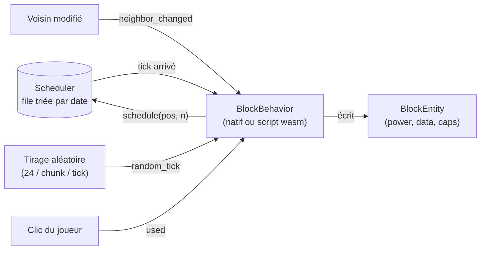
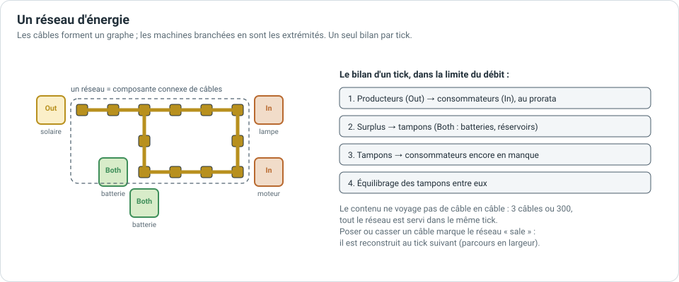
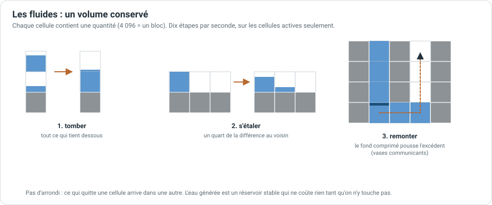
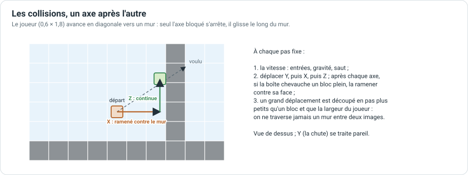
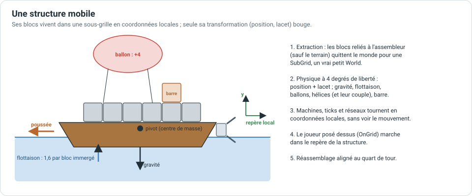
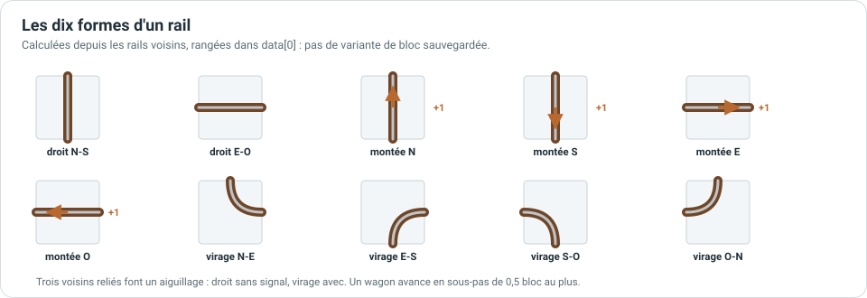
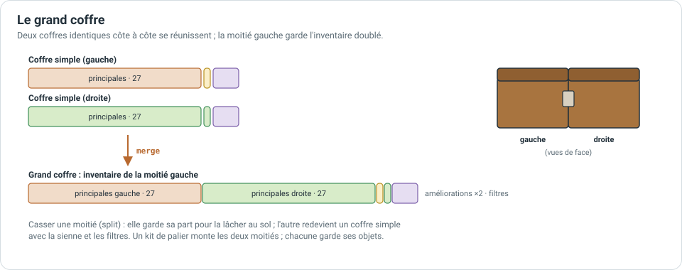

# 6. La simulation

[← Le rendu](05-rendu.md) · [Sommaire](README.md) · [Le jeu →](07-jeu.md)

Ce qui vit dans le monde : les blocs actifs (machines), les réseaux qui les relient, les circuits, les
fluides, la physique du joueur et des créatures, les structures mobiles et les wagons.

## Les machines : ne réveiller que ce qui travaille

Une construction peut compter des centaines de milliers de blocs actifs (câbles, rails, coffres...), qui ne
font rien la plupart du temps. Une liste parcourue à chaque tick coûterait autant qu'il y a de blocs ;
`tech/machines.rs` ne paie que pour ceux **qui travaillent**. Un bloc actif dort, et il est réveillé :

- par un **tick programmé** (« réveille-moi dans 10 ticks ») : une file triée par date (`Scheduler`) ;
- par un **voisin qui change** : un bloc modifié prévient ses 6 voisins ;
- par un **tick aléatoire** : 24 blocs par chunk et par tick sont tirés au sort dans un rayon de 4 chunks
  autour du joueur (l'herbe s'étend, les pousses grandissent, la terre labourée sèche, les feuilles
  orphelines tombent), soit en moyenne un réveil toutes les 70 s par bloc, sans liste à tenir ;
- par le **joueur** (un clic droit sur le bloc).

Les machines tournent à **20 ticks par seconde** (un pas fixe sur trois). Un comportement implémente
`BlockBehavior` : `placed`, `loaded`, `neighbor_changed`, `scheduled_tick`, `random_tick`, `used`.

**Par lots.** Un comportement reçoit **toutes** ses machines à réveiller d'un coup (une liste de
positions). Pour un mod en WebAssembly, chaque appel a un coût fixe : un appel avec 10 000 positions coûte
bien moins que 10 000 appels.

Comportements natifs : horloge, lampe, coffres à paliers (améliorations passives), contrôleur de stockage,
four, alambic, chargeurs de wagons, terre labourée, herbe, feuilles, pousses, circuits, machines de base
(`tech.rs`). Les mods ajoutent les leurs (voir le chapitre 8).

## Les réseaux : câbles, tuyaux, arbres de transmission

Simuler chaque conduit séparément (chacun passe son contenu au voisin) est lent et instable : l'énergie
mettrait N ticks à traverser N câbles, et oscillerait. `tech/networks.rs` regroupe les conduits en **réseaux** :

1. **Le graphe** : un réseau est une composante connexe de conduits de même sorte (énergie, fluide,
   rotation, objets), avec ses **extrémités** : les machines branchées, par la face qui touche le conduit,
   si leur capacité accepte cette face.
2. **Recalcul incrémental** : poser, casser ou changer un voisin marque le réseau « sale » ; au tick
   suivant, seuls les réseaux sales sont reconstruits par un parcours en largeur (fusion et coupure
   comprises). Les réseaux ne sont pas sauvegardés : ils se refont au chargement.
3. **Un bilan par réseau et par tick** : le contenu ne « voyage » pas. Une machine à 100 câbles de la
   centrale est servie dans le même tick que sa voisine.

**Répartition (énergie, fluides).** Chaque extrémité a un rôle : producteur (`Out`), consommateur (`In`)
ou tampon (`Both` : batterie, réservoir). Dans l'ordre, dans la limite du débit du réseau : producteurs
vers consommateurs (au prorata), surplus vers les tampons, tampons vers les consommateurs en manque, puis
équilibrage des tampons.

**Rotation.** La vitesse de la source la plus rapide, partagée si la contrainte demandée ne dépasse pas
celle fournie ; sinon (ou si deux sources tournent en sens contraire), le réseau se bloque.

**Objets.** Les tuyaux d'objets déplacent des piles entre inventaires, en respectant les ports (`inputs`,
`outputs`, filtres) ; un coffre à paliers n'offre que ses cases principales.

Mesuré : un réseau de 50 000 câbles se construit en 10 ms et son tick coûte 7 µs.

| Machine de base (`tech.rs`) | Rôle |
|---|---|
| Panneau solaire | 4 d'énergie par tick à ciel ouvert |
| Batterie | stocke 100 000 |
| Lampe électrique | consomme 4 par tick |
| Pompe, réservoir, remplisseur | tirent, stockent et versent de l'eau |
| Moteur | énergie → rotation (64 tr/min, 512 de contrainte) |
| Ventilateur | consomme de la rotation |

## Les circuits

`tech/circuits.rs` : un signal de 0 à 15 (`BlockEntity::power`) émis par des interrupteurs et reçu par des
mécanismes.

- **Câble** : à chaque changement, le réseau de câbles entier est recalculé d'un coup (la puissance est
  celle de la meilleure source moins la distance) : pas de signal fantôme, et 2 000 câbles coûtent un
  parcours, pas 2 000 réveils.
- **Levier, bouton** (une demi-seconde), **inverseur**, **répéteur** (directionnels, avec délai ; un
  inverseur bouclé fait une horloge), **herse**, **lampe**, **piston** et **piston collant** (jusqu'à
  12 blocs, refuse un bloc qui a un état).
- Un bloc qui change d'apparence (levier baissé, lampe allumée) est un autre bloc ; changer de bloc efface
  l'état actif, que `restyle` recopie.

## Les fluides

`fluids/sim.rs` simule l'eau et la lave en **conservant le volume** : chaque cellule contient une quantité
(4 096 = un bloc), en entiers, pour que rien ne se perde par arrondi. Dix fois par seconde, chaque cellule
**active** :

1. **tombe** : verse dans la cellule du dessous tout ce qui y tient ;
2. **s'étale** : donne à chaque voisine horizontale moins remplie un quart de la différence ;
3. **remonte** : si elle est trop pleine, l'excédent monte d'une cellule.

L'étape 3 fait les **vases communicants** : une cellule peut contenir un peu plus d'un bloc (2 % de plus par
bloc de fluide au-dessus d'elle). Au fond d'une colonne, l'eau est « comprimée » ; reliée par le bas à une
colonne moins haute, la pression la fait remonter jusqu'à ce que les surfaces s'égalisent.

- Seules les cellules **actives** (qui viennent de changer, et leurs voisines) sont calculées ; une cellule
  immobile s'endort.
- L'eau **générée** (mers, lacs, nappes) est un **réservoir** stable : plein, absent de la table des
  volumes, il ne coûte rien tant qu'on n'y touche pas.
- Un **budget de 4 ms** par étape borne le pire cas : une très grande inondation coule plus lentement, sans
  faire saccader le jeu.

Mesuré : un lac de 24 × 24 × 3 se vide par un trou de 2 × 2 en 318 s de jeu, ~2,6 ms par étape ; une
grotte de 30 × 6 × 30 se remplit depuis la mer.

## La physique

### Le joueur et les créatures

`physics.rs` : le joueur est une boîte de 0,6 × 1,8 × 0,6 blocs.

À chaque pas fixe :

1. la vitesse vient des entrées (ou de l'IA), de la gravité, du saut ;
2. la boîte se déplace **un axe après l'autre** (Y, puis X, puis Z) ; après chaque axe, si elle chevauche
   un bloc plein, on la ramène contre la face de ce bloc. Seul l'axe bloqué s'arrête : on **glisse** le
   long d'un mur ;
3. un grand déplacement est découpé en pas plus petits qu'un bloc et que la largeur du joueur : même très
   vite, on ne traverse pas un mur entre deux images.

Les créatures utilisent la même boîte à leur taille (`PlayerBody::with_size`), plus la nage, les marches
d'un bloc et la gravité propre à la dimension.

### Le bloc visé

`raycast.rs` : l'algorithme **DDA d'Amanatides et Woo** saute d'une frontière de bloc à la suivante (la
plus proche des trois axes) : on visite exactement les blocs que le rayon traverse, dans l'ordre. Les
modèles (dalles, escaliers, coffres) sont testés boîte par boîte.

### Le chemin des créatures

`motion/pathfind.rs` : un **A\*** sur les blocs. Une case est la position des pieds ; une créature peut s'y tenir si
son corps y passe sans danger et si un bloc la porte (ou si c'est de l'eau : elle nage). D'une case à
l'autre : à plat dans 8 directions (pas de coin coupé), une marche vers le haut, une descente bornée. Le
nombre de cases explorées est limité ; sans chemin, on va vers la case la plus proche du but.

## Les structures mobiles

Un vaisseau, un bateau, une contraption : un groupe de blocs détaché du monde (`motion/subgrid.rs`, `motion/ship.rs`).

1. **Extraction** : un parcours à partir de l'assembleur rassemble tout ce qui lui est relié par une face,
   sauf le terrain ; les blocs et leurs états sont copiés dans une `SubGrid` (un vrai `World` local, en
   coordonnées qui ne changent jamais) et retirés du monde. 4 096 blocs au plus.
2. **Transformation** : une position (le pivot, au centre de masse) et un **lacet**. Les machines, les ticks
   et les réseaux continuent en coordonnées locales, sans rien savoir du mouvement.
3. **Physique** : un corps rigide à quatre degrés de liberté (position et lacet) : gravité, **flottaison**
   (chaque bloc immergé déplace 1,6), **ballons** (portance 4), **hélices** (poussée selon la rotation
   reçue de leur réseau, et couple si elles sont décentrées), **barre**, frottements, collisions axe par
   axe avec le terrain.
4. **Le joueur porté** : une entité qui se pose sur un pont reçoit `OnGrid` ; sa physique tourne dans le
   repère de la structure : il marche, saute et tombe normalement sur un pont qui avance et tourne.
5. **Réassemblage** : la structure se repose alignée sur la grille (rotation arrondie au quart de tour,
   orientations des blocs tournées avec elle) si la place est libre ; sinon elle refuse.

Sauvegarde : `grids.bin`. Limites : rotation au lacet seulement, pas de collisions entre structures, pas
de fluides à bord.

## Les rails et les wagons

- **Les rails** (`motion/rails.rs`) sont des blocs actifs (`rail: Normal | Booster | Detector | Activator | Stop`).
  Leur **forme** (deux droites, quatre montées, quatre virages) est calculée depuis les rails voisins à la
  pose et au changement d'un voisin, et rangée dans `data[0]` ; trois liens font un **aiguillage** (droit
  sans signal, virage avec).
- **La physique** (`motion/rail_motion.rs`) : une abscisse le long du chemin du rail et une vitesse signée, en
  **sous-pas** de 0,5 bloc au plus (aucun rail sauté, même à 30 blocs/s) : gravité dans les pentes,
  accélérateur, butoir, frottement, vitesse maximale. Au bout de la voie, le wagon **déraille** et
  reprend une physique de boîte.
- **Les trains** : `couple` garde deux wagons à distance (la locomotive tire), `bump` repousse deux wagons
  qui se touchent.
- **Le jeu** (`vehicles/carts.rs`) : wagonnet, wagon coffre, wagon trémie, locomotive ; passagers ; chargeurs et
  déchargeurs branchés aux tuyaux. Sauvegarde : `carts.bin`.

## Le stockage

`tech/storage.rs` : des coffres à **paliers** (27 → 45 → 54 → 81 → 108 cases) qu'on monte sur place avec un kit,
des **emplacements d'amélioration** (piles ×2 et ×4, compactage, néant, entonnoir), un **contrôleur** qui
voit jusqu'à 64 coffres voisins comme un seul inventaire, et le **grand coffre** (`blocks/double_chest.rs`) : deux
coffres identiques côte à côte se réunissent, la moitié gauche garde l'inventaire doublé.

Les cases d'un coffre sont rangées en trois blocs : principales (les seules que voient les tuyaux),
améliorations, filtres (fantômes). Monter de palier ne déplace que les deux derniers blocs.

[← Le rendu](05-rendu.md) · [Sommaire](README.md) · [Le jeu →](07-jeu.md)
