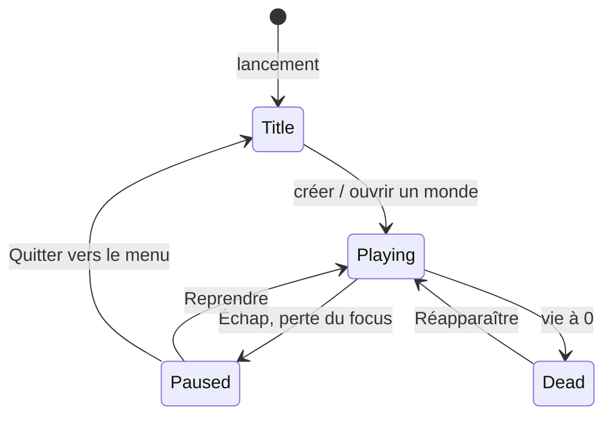
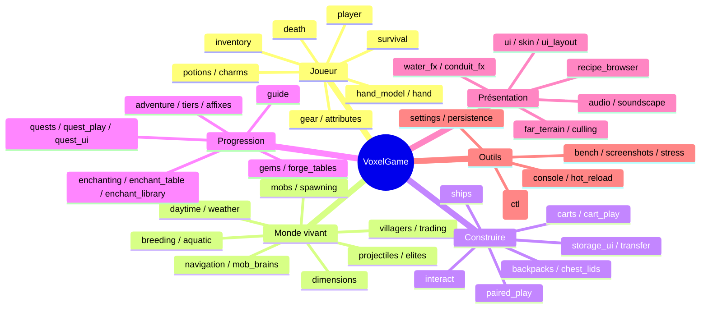
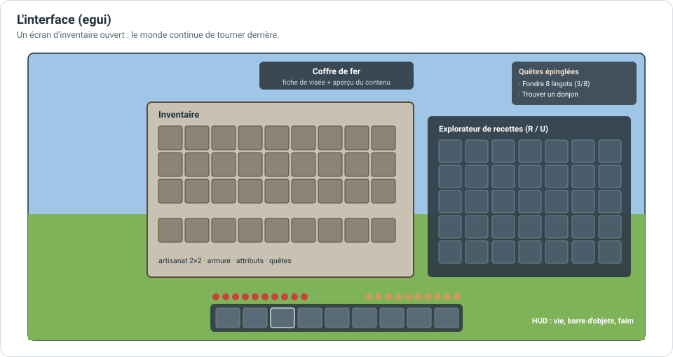

# 7. Le jeu

[← La simulation](06-simulation.md) · [Sommaire](README.md) · [Les mods →](08-mods.md)

`games/voxel` est le jeu construit sur le moteur : environ 49 000 lignes, une centaine de modules. Ce
chapitre en donne la carte.

## Les modes



- **Title** : le menu principal, avec un monde vivant en fond (créatures, machines, caméra qui tourne
  lentement), la liste des mondes, la création, les packs graphiques.
- **Playing** : la partie ; un écran d'inventaire ouvert libère la souris sans arrêter le monde.
- **Paused** : le monde s'arrête ; pages d'options. La fenêtre qui perd le focus met en pause et rend la
  souris (sauf dans les modes automatiques).
- **Dead** : l'écran de mort et sa cause ; l'inventaire tombe au sol, on réapparaît au lit ou au point de
  départ.

## La carte des modules



### Le joueur

| Module | Rôle |
|---|---|
| `player.rs` | le joueur est une entité ECS comme les créatures (`Transform`, `Velocity`, `Collider`, `Health`, `Player`) |
| `inventory.rs` | 9 cases de barre, 27 de réserve, 4 d'armure, la grille d'artisanat |
| `survival.rs` | ce qui blesse (chute, noyade, feu, lave, faim) et l'armure qui protège ; tout passe par `Vitals`, testable sans fenêtre |
| `attributes.rs`, `gear.rs` | des **attributs** (dégâts, armure, vitesse, portée...) calculés depuis l'objet en main, l'armure et les effets |
| `potions.rs`, `charms.rs` | effets temporaires ; charmes qui gardent un effet actif |
| `hand_model.rs` | le bras à la première personne et l'objet tenu, en coordonnées de vue |

### Le monde vivant

| Module | Rôle |
|---|---|
| `mobs.rs` | créatures décrites dans `entities.ron`, systèmes ECS (IA, physique, attaque, mort) |
| `spawning.rs` | où, quand et combien de créatures apparaissent (lumière, biome, heure) |
| `navigation.rs` | suivre un chemin A\* (le moteur cherche, le jeu marche) |
| `mob_brains.rs` | créatures dirigées par le script de leur mod (`brain: true`), par lot, 4 fois par seconde |
| `villagers.rs`, `trading.rs` | habitants des villages et échanges décrits dans `trades.ron` |
| `elites.rs`, `projectiles.rs` | hostiles renforcées, attaques à distance |
| `daytime.rs`, `weather.rs` | cycle jour/nuit (0 = minuit, 0,5 = midi), pluie, neige, orage |
| `dimensions.rs` | changer de dimension par un portail : ciel, gravité, dossier |

### Construire et ranger

`interact.rs` (leviers, houe, engrais, animaux), `storage_ui.rs` et `transfer.rs` (un seul écran pour
coffres, wagons coffres, sacs et contrôleur ; Déposer, Compléter, Tout prendre, Trier), `backpacks.rs` (sacs
à dos améliorables), `chest_lids.rs` (les couvercles suivent l'écran ouvert), `carts.rs` / `cart_play.rs`
(wagons), `ships.rs` (assembler un vaisseau, le piloter), `paired_play.rs` (lits et portes).

### Les formes (couches, pentes, microblocs)

L'**établi de taille** (`shaping_ui.rs`) transforme un bloc plein en pièces (`engine_voxel::shaped::PieceKind`, vingt-trois objets `core:shape_*`, rangés en
familles dans une liste qui défile : couches, pentes, escaliers, panneaux, formes raccordées). Une tranche posée
sur une tranche l'agrandit ; un clic droit ouvre un portillon. Le matériau d'une pièce est le
`damage` de sa pile : un numéro de la **palette du monde** (`materials.ron`, `shape_materials.rs`), attribué au
premier usage et jamais réutilisé. Les piles de même pièce et même matériau s'empilent (c'est la seule exception à
« seules les piles neuves s'empilent », voir `inventory::stackable` et `storage.rs`). `shaped_play.rs` pose une pièce
dans la case visée (ou la voisine), la retire pièce par pièce et décrit la visée ; `shape_ctl.rs` donne les commandes
`shape`, `rebuild`, `shaping`, `pieces`. L'icône d'une pile de pièces est dessinée avec les textures de son matériau
(`item_art::piece_icon`, en cache par pièce et matériau).

### La progression

| Système | Modules | Données |
|---|---|---|
| Livre de quêtes | `quests`, `quest_progress`, `quest_play`, `quest_ui/*` | `quests.ron` |
| Aventure : paliers du monde, butin à affixes, élites, envahisseurs | `adventure*`, `tiers*`, `affixes`, `elites` | `tiers.ron`, `affixes.ron`, `rarities.ron` |
| Enchantement : table à stats, livres, bibliothèque, enclume | `enchant*` | `enchantments.ron` |
| Gemmes, récupération, réforge | `gems`, `gem_sockets`, `forge_tables`, `forge_ui` | `gems.ron` |
| Guide du voyageur | `guide`, `guide_ui` | `guide.ron` |

Le principe est partout le même : un module **pur** (règles et données, testé sans fenêtre ni ECS) et un
module de **jeu** qui l'observe et l'affiche. Les objets enrichis (affixes, gemmes, enchantements, usure)
ont une **fiche** rangée dans `items.bin` (`item_data.rs`), désignée par un numéro dans l'objet.

## L'interface



- **egui** dessine tout (`ui.rs`) : HUD (vie, faim, barre d'objets, effets, quêtes épinglées), écrans
  (inventaire, établi, four, conteneurs, enchantement, quêtes, guide, échanges), menus, inspecteur (F3).
- **La peau** « terre, ardoise et cuivre » (`skin.rs`) : une palette et des cadres communs.
- **Mise en page adaptative** (`ui_layout.rs`) : fenêtres bornées à l'écran, cases et colonnes qui
  s'adaptent jusqu'à 320 pixels de large.
- **L'explorateur de recettes** (`recipe_browser.rs`), façon JEI : une liste de tous les objets à côté de
  l'inventaire ; R montre les recettes d'un objet, U ses usages (toutes les sortes de recettes ramenées à
  une forme commune par `RecipeIndex`).
- **La fiche de visée** (`ui_target.rs`) : nom et origine du bloc ou de la créature visés, aperçu du
  contenu d'un coffre.
- **Les menus des mods** (`mod_menu.rs`) : le mod **décrit** son menu, le jeu le dessine.

## Le son

`audio.rs` (avec `kira`) : sons des blocs (pas, casse, pose selon la matière), éclaboussures, coffres,
ambiance jour/nuit, pluie, tonnerre ; `soundscape.rs` : une musique de temps en temps et des ambiances.
Les sons sont joués **en réaction aux événements** (`BlockBroken`, `BlockPlaced`...), sans que le code qui
casse les blocs les connaisse.

## La persistance

`persistence.rs` décide **quand** sauvegarder (toutes les 30 secondes et à la fermeture) et ajoute l'état
du jeu (heure, joueur, inventaire) à ce que le moteur écrit (chapitre 3). Les options du joueur sont dans
`settings.ron` à la racine du projet (distance de rendu, champ de vision, sensibilité, volumes, touches),
celles des mods dans `mod_settings.ron`.

## Les outils pour tester sans clavier

| Variable | Effet |
|---|---|
| `VOXEL_WORLD=nom` | ouvre (ou crée) ce monde directement, sans menu |
| `VOXEL_SEED=n` | la graine d'un monde neuf |
| `VOXEL_CONTROL=1` | écoute des commandes texte sur `127.0.0.1:7878` (`cargo xtask ctl ...`) |
| `VOXEL_SCREENSHOTS=dossier` | visite guidée qui enregistre ~60 captures (biomes, nuit, grottes, écrans) |
| `VOXEL_BENCH=fichier.csv` | benchmark reproductible (même graine, mêmes trajets, midi figé) |
| `VOXEL_STRESS=N` | test de charge : N machines et tapis construits autour du joueur |
| `VOXEL_TRACE=fichier.json` | trace Perfetto de tous les threads |
| `VOXEL_PIPELINE=1` | délais de chaque étape des chunks |
| `VOXEL_MUTE=1`, `VOXEL_TEXTURE_PACK`, `VOXEL_SAVES`... | son coupé, pack graphique, dossier des mondes |

**Le pilotage** (`control.rs`) accepte une ligne de texte par commande et répond en JSON :

```bash
cargo xtask ctl "mode fly" "goto 9 71 9" "place 8 70 14 core:chest[facing=north]" "screenshot shots/a.png"
```

`state`, `goto`, `look`, `lookat`, `walk`, `place`, `break`, `block`, `give`, `select`, `use`, `stock`,
`container`, `inventory`, `time`, `weather`, `summon`, `screenshot`, `click`, `key`, `type`... et les
commandes propres aux quêtes, à l'aventure, à l'enchantement et au stockage (`*_ctl.rs`). C'est ce qui
permet de vérifier une fonctionnalité en jeu, capture à l'appui, sans toucher au clavier.

**La console** (Entrée ou `/`) accepte des commandes en jeu ; **le rechargement à chaud** (`hot_reload.rs`)
relit shaders, textures, sons et `blocks.ron` dès qu'ils changent sur disque (F5 pour tout).

[← La simulation](06-simulation.md) · [Sommaire](README.md) · [Les mods →](08-mods.md)
