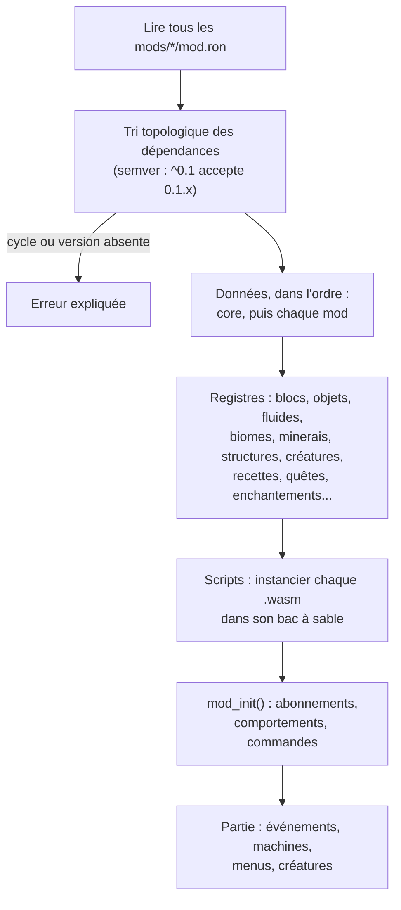
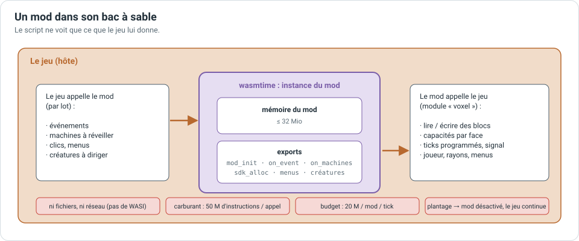
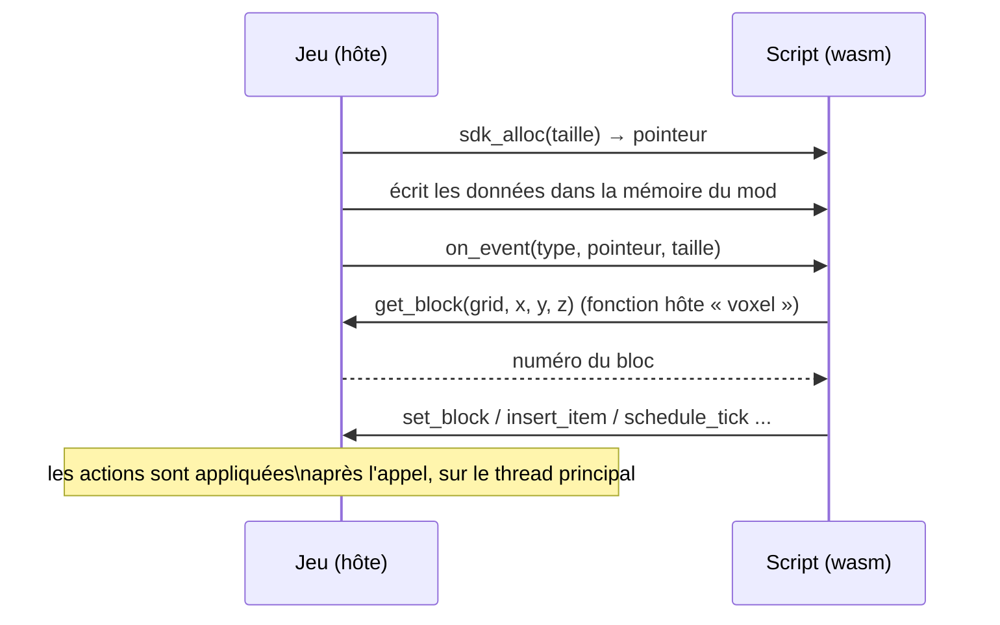

# 8. Les mods

[← Le jeu](07-jeu.md) · [Sommaire](README.md)

Un mod ajoute du contenu (données) et, s'il le faut, du comportement (un script WebAssembly). Le jeu de
base lui-même est un « mod » : son espace de noms est `core`, ses données sont dans `assets/core/`. Ce
chapitre explique la **mécanique** ; le guide pour écrire un mod est [`docs/modding.md`](../modding.md).

## Un mod, c'est un dossier

```
mods/example/
├── mod.ron            le manifeste : id, version, dépendances, script, options
├── blocks.ron         des blocs (même format que assets/core/blocks.ron)
├── ores.ron           des filons
├── entities.ron       des créatures
├── textures/          des PNG (16×16)
├── script/            le code Rust du script (une crate)
└── example.wasm       le script compilé (cargo xtask build-mods)
```

Six mods accompagnent le jeu : `example`, `forge` (métallurgie), `entrepot` (stockage et tri),
`mecanique` (rotation, à la Create), `magie`, `donjons`.

## Le chargement



- Chaque mod passe **après ses dépendances** (tri topologique, `manifest.rs`). Un cycle (A dépend de B qui
  dépend de A) est une erreur expliquée.
- Les identifiants d'un mod sont dans **son espace de noms** (`forge:alloy_furnace`) : deux mods peuvent
  avoir chacun un bloc `ruby`.
- Les données d'un mod **s'ajoutent** à celles du jeu (blocs, recettes, quêtes...) ; certains fichiers
  peuvent aussi compléter des éléments existants (biomes, chapitres de quêtes, pages du guide).
- La **version de génération** enregistre l'empreinte des fichiers de génération de chaque mod : retirer
  ou modifier un mod qui change le terrain est signalé à l'ouverture du monde.

## Le script : WebAssembly dans un bac à sable



Un script est du code écrit par quelqu'un d'autre. Il est compilé en WebAssembly
(`wasm32-unknown-unknown`) et exécuté par `wasmtime` (`crates/engine_mods/src/runtime.rs`) :

| Garde-fou | Valeur |
|---|---|
| Fichiers, réseau | **aucun** : pas de WASI, seulement les fonctions du jeu |
| Mémoire | 32 Mio au plus |
| Temps par appel | 50 millions d'instructions (« carburant ») ; une boucle infinie tombe en panne sèche |
| Budget par tick | 20 millions d'instructions par mod ; au-delà, ses machines sont reportées d'un tick |
| Plantage, dépassement prolongé | le mod est **désactivé**, avec un message ; le jeu continue |

### L'interface

Le jeu et le script n'échangent **que des entiers et des flottants** ; les textes et les listes passent par
la mémoire du script.



- **Exports du mod** : `memory`, `sdk_alloc`, `mod_init`, `on_event(type, ptr, len)`,
  `on_machines(type, ptr, n)`, et selon les besoins le clic droit, les menus, les options, les créatures.
- **Fonctions hôtes** (module d'import `voxel`, `runtime/host.rs`), générées depuis un catalogue
  (`hooks.ron`) : lire et écrire des blocs (`grid, x, y, z`), les capacités par face (énergie, fluides,
  objets, rotation, avec simulation), programmer des ticks, émettre du signal, journaliser, lire le joueur et
  lancer des rayons, diriger des créatures, décrire des menus, garder des données par monde, appeler un
  autre mod, ajouter des commandes...
- **Le kit** (`crates/mod_sdk`) cache tout cela derrière une API Rust sûre : un mod implémente le trait
  `Mod` et l'exporte avec `export_mod!`.

```rust
use mod_sdk::{Event, Mod};

#[derive(Default)]
struct MonMod;

impl Mod for MonMod {
    fn init(&mut self) {
        mod_sdk::subscribe(mod_sdk::EventKind::BlockBroken);
    }
    fn event(&mut self, event: Event) {
        if let Event::BlockBroken { pos, .. } = event {
            mod_sdk::log(&format!("bloc cassé en {pos:?}"));
        }
    }
}

mod_sdk::export_mod!(MonMod);
```

### Pourquoi « par lot »

Passer du jeu au script coûte cher (le plein de carburant, la copie des données) ; l'inverse est presque
gratuit. Le jeu appelle donc un script **une fois par tick et par comportement**, avec toutes les machines
à réveiller :

| Mesure (`cargo bench -p engine_mods --bench wasm`) | Temps |
|---|---|
| un appel du jeu vers le script (vide) | 134 ns |
| un appel du script vers le jeu (`get_block`) | 6 ns |
| 10 000 horloges natives, un tick | 1,07 ms |
| 10 000 horloges WebAssembly, par lot | 1,39 ms (+30 %) |
| les mêmes, un appel par machine | 1,91 ms |

Même logique pour les créatures dirigées par un script : quatre fois par seconde, **toutes** les créatures
proches d'un mod partent en un seul lot (12 mots par créature : position, vie, direction du joueur,
drapeaux, mémoire), et le script répond par des ordres (marcher, sauter, frapper).

### Les menus des machines

Le script **décrit** un menu (titre, textes, jauges, boutons, cases d'inventaire), le jeu le vérifie
(tailles, nombre d'éléments, textes valides : un mod ne doit pas faire planter l'interface) et le dessine,
puis renvoie les actions du joueur. Cinq fois par seconde, un `Refresh` permet de mettre les jauges à jour.
Aucun dessin ne passe par le script.

## Tester un mod sans fenêtre

`engine_mods::testing::Harness` charge **le vrai script compilé** dans un vrai petit monde (terrain plat,
graine fixe), avec les blocs et les objets du jeu et de ses mods :

```rust
let mut h = Harness::for_mod("example")?;
h.place(IVec3::new(0, 100, 0), "example:breaker");
let requests = h.event(&ModEvent::BlockBroken { at: GridPos::world(IVec3::ZERO), block: h.block_id("core:stone") })?;
```

```bash
cargo xtask test-mod example
```

## Les commandes utiles

| Commande | Effet |
|---|---|
| `cargo xtask new-mod <id>` | crée le squelette d'un mod (manifeste, script, test) |
| `cargo xtask build-mods` | compile tous les scripts en `.wasm` |
| `cargo xtask test-mod <id>` | compile et teste un mod |
| `cargo xtask hooks` | régénère l'interface depuis le catalogue `hooks.ron` |
| `cargo xtask docs` | la référence du kit (`mod_sdk`) |
| `cargo xtask ctl mods` | en jeu : ce que chaque mod consomme (dernier tick, pire tick, appels reportés) |

[← Le jeu](07-jeu.md) · [Sommaire](README.md)
