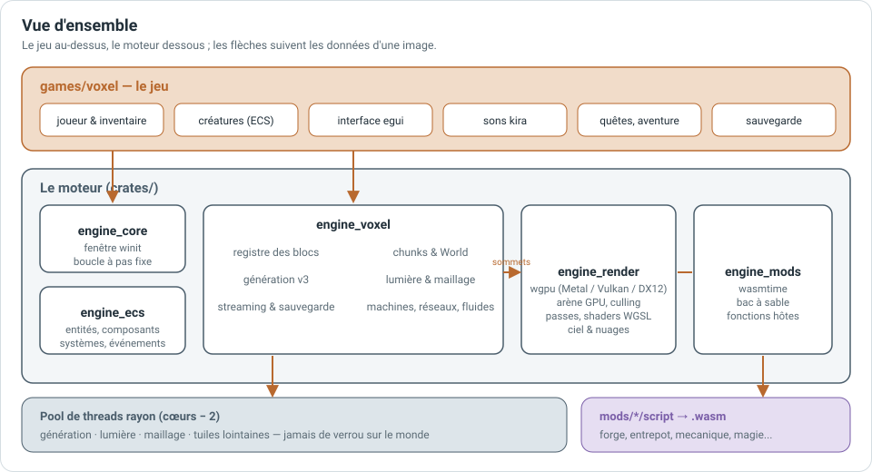
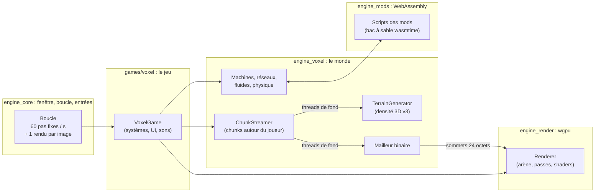

# Le moteur et le jeu voxel : documentation complète

Cette documentation explique **comment le moteur fonctionne**, du clavier jusqu'aux pixels : la boucle de
jeu, le monde en blocs, la génération du terrain, le rendu, la simulation (machines, réseaux, fluides),
le jeu lui-même et les mods. Chaque chapitre part d'une vue d'ensemble, puis descend dans les détails
avec des schémas, en renvoyant aux fichiers du code.

Elle décrit le code **tel qu'il est** (génération v3 active, v2 retirée). Les plans de travail
(`docs/plan-*.md`) racontent pourquoi et comment chaque partie a été construite ; ici, on explique le
résultat.

## Sommaire

| Chapitre | Ce qu'on y apprend |
|---|---|
| [1. Architecture](01-architecture.md) | Les crates, qui dépend de qui, les grands principes (données en RON, identifiants texte, threads sans verrou) |
| [2. Boucle de jeu et ECS](02-boucle-et-ecs.md) | Le pas de temps fixe, ce qui se passe dans une image, l'ECS écrit à la main |
| [3. Le monde en blocs](03-monde.md) | Blocs, registre et états, chunks, entités de blocs, lumière, streaming, sauvegarde |
| [4. La génération du monde](04-generation.md) | La densité 3D, le climat, les splines, les grottes, les biomes, l'eau, le décor, les structures |
| [5. Le rendu](05-rendu.md) | Le maillage, le format des sommets, l'arène GPU, le culling, les passes, les shaders, le terrain lointain |
| [6. La simulation](06-simulation.md) | Machines et ticks, réseaux, circuits, fluides, physique, structures mobiles, rails |
| [7. Le jeu](07-jeu.md) | Les modes, les systèmes de jeu, l'interface, la persistance, les outils de test |
| [8. Les mods](08-mods.md) | Données RON, scripts WebAssembly, bac à sable, interface hôte |

## Le moteur en une image

## Lire le code en même temps

- Presque chaque fichier commence par un commentaire `//!` qui explique **pourquoi** il existe : c'est la
  meilleure porte d'entrée, et cette documentation s'en inspire.
- `cargo doc --open -p engine_voxel` donne la référence de chaque fonction publique.
- Les chiffres (temps, tailles) viennent des benchmarks cités dans `docs/architecture.md` et les plans.

## Les autres documents

- [`docs/architecture.md`](../architecture.md) : l'historique des grandes décisions et leurs mesures.
- [`docs/modding.md`](../modding.md) : le guide complet pour écrire un mod.
- [`docs/art-direction.md`](../art-direction.md) : la direction artistique (textures, palette).
- [`docs/plan-generation-v3.md`](../plan-generation-v3.md) : le plan de la génération actuelle.
- [`docs/plan-generation-rendu.md`](../plan-generation-rendu.md) : le plan du pipeline de chunks et du rendu.
