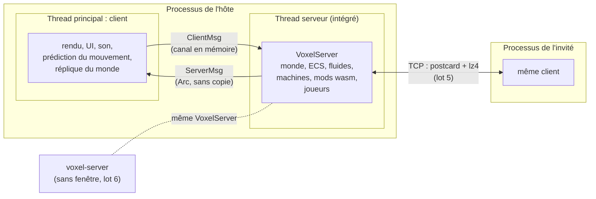

# Plan : le multijoueur, en commençant par un serveur local

But de la première étape : **deux joueurs sur le même réseau local** (ou deux fenêtres sur la même machine)
jouent dans le même monde. L'architecture doit déjà être celle du jeu final, pour que le serveur dédié et
le jeu par Internet viennent ensuite sans tout refaire.

## 1. Ce que fait Horizon

Horizon (`horizon-rust/horizon`, cloné et lu le 20 nov. 2026) est un clone de Minecraft Java en Rust. Comme
pour la génération, on reprend **les idées** et jamais le code : il est sous LGPL-3.0, et son protocole est
celui de Mojang.

### Un seul code serveur pour tout

- En solo, le monde tourne sur **son propre thread serveur** (`game/world/integrated.rs`), comme le serveur
  intégré de Minecraft. La fenêtre le rejoint comme un joueur, par un **tuyau en mémoire** : un tick long
  ne bloque jamais une image.
- « Ouvrir au réseau local » ne fait qu'ouvrir un port TCP devant ce même serveur.
- Le serveur dédié (`--dedicated`) est le même binaire, sans fenêtre ni son.
- Leur règle : *single player, LAN, `--dedicated` and the supervisor run the same server code*. Deux copies
  du code finiraient par diverger.

### Le prix d'un départ tardif

Horizon n'a pas commencé ainsi. Au départ, le jeu de l'hôte restait le jeu solo. Les invités passaient par
un « hub » à côté, et l'héritage se voit encore :

- Chaque action d'un invité **échange son état avec celui de l'hôte** dans le `Game` (`as_guest`), joue le
  code solo, puis rend l'échange. C'est fragile et tout le code doit en tenir compte.
- Il y a deux versions de nombreux fichiers : `lan_*.rs` côté hôte, `remote_*.rs` côté client.
- Le passage du solo sur un thread serveur a été fait après coup (PR #1514). Le découpage du jeu en
  `horizon-gameplay` (serveur) et `horizon-client-gameplay` (client) est encore en cours.

**Leçon pour nous** : séparer serveur et client *avant* d'ouvrir le réseau. Le solo doit lui-même passer par
le chemin client ↔ serveur ; c'est ainsi que les bogues du multijoueur se voient tous les jours.

### Leurs bonnes idées techniques

| Idée | Chez Horizon | Pour nous |
|---|---|---|
| Serveur intégré sur un thread, la fenêtre jointe par un tuyau en mémoire | `integrated.rs`, `connection::Pipe` | lots 3 et 4 |
| Sections partagées au lieu d'être copiées entre le serveur et la fenêtre du même processus | `lan/handoff.rs` (`Weak` vers les sections du serveur) | nos chunks sont déjà des `Arc<Chunk>` : on envoie l'`Arc` en mémoire, les octets seulement par TCP |
| Un chunk encodé et compressé **une fois** pour tous les joueurs, et gardé jusqu'à sa prochaine modification | `SharedFrames`, cache de chunks (§5.3) | lot 5 |
| Le tick ne fait que déposer des messages ; le cadrage, la compression et les écritures se font sur des threads réseau | `lan/io_pool.rs` | lot 5 (un thread par connexion suffit pour quelques joueurs) |
| File d'envoi bornée par joueur : au-delà, on ralentit l'envoi des chunks, puis on déconnecte | `Outbox`, `MAX_PENDING` | lot 5 |
| Le client prédit son propre mouvement ; le serveur décide de tout le reste | `remote/mod.rs` | lot 2 |
| Mouvement contrôlé par le serveur (« moved too quickly ») ; la vraie anti-triche (rejeu de la prédiction) seulement en dédié | `lan/prediction.rs`, `anticheat.rs` | contrôle simple au lot 2 ; l'anti-triche plus tard |
| État des invités sauvegardé par joueur (`players/data/<uuid>.dat`) | `lan/playerdata.rs` | lot 1 |
| Découverte LAN : annonce en multicast toutes les 1,5 s, liste dans l'écran Multijoueur | `lan/discovery.rs` | lot 5 |
| Tests de bout en bout avec des **bots** sans fenêtre, et un banc de charge (TPS, MSPT p99, octets par joueur, temps de connexion) | `horizon-bots`, `tools/lan_e2e.py`, `server_bench.py` | lot 7 |
| Jouer entre amis sur Internet : code d'invitation, tunnel chiffré, UPnP/NAT-PMP, relais | `play-with-friends.md`, `horizon-relay` | **hors de cette étape** |

## 2. Où en est notre jeu

Le moteur est déjà bien placé :

- `engine_voxel`, `engine_ecs` et `engine_mods` tournent **sans fenêtre**. `check-arch` le vérifie, et la
  règle a été écrite pour « serveur un jour ».
- Les chunks sont des `Arc<Chunk>` de 32³, déjà sérialisés avec `postcard` et compressés avec `lz4_flex`
  pour les sauvegardes.
- Les identifiants texte sont stables ; les numéros ne sont jamais écrits sur disque, et chaque chunk
  sauvegardé porte sa palette.
- La génération est déterministe à partir de la graine.

Ce qui bloque vient du jeu (`games/voxel`) :

1. **`VoxelGame` est un monolithe** de ~80 champs (`main.rs:205`). Il mêle :
   - le **serveur** : monde, fluides, mods, ECS, villages, échanges ;
   - le **client** : renderer, caméra, UI, son, terrain lointain, effets ;
   - **le** joueur : `inventory`, `vitals`, `hunger`, `gear`, `effects`, `potions`, `adventure`,
     `quest_book`...
2. **Un seul joueur partout.** Il y a un seul `player: Entity` et une ressource `PlayerEntity`. Le
   `PlayerSave` est écrit dans `world.ron`. Le streamer charge autour d'**une** caméra (`update_view`).
3. **Les entrées agissent directement sur le monde.** Le clic droit enchaîne une quinzaine de cas dans
   `update` : wagon, porte, conteneur, machine... L'UI egui lit et modifie le monde et les inventaires sur
   place.
4. **Pas `Send`.** Le monde est partagé par `Rc<RefCell<ChunkStreamer>>` (`shared.rs`). Ce n'est pas un
   défaut : un serveur construit **sur son thread** peut garder ses `Rc`. Il faut seulement que rien ne
   passe d'un thread à l'autre, sauf les messages.
5. Le pilotage `ctl` écoute un seul port fixe (7878). Pour piloter deux instances, il faut
   `VOXEL_CONTROL=7879` (déjà possible) et une commande `ctl --port`.

## 3. L'architecture visée

- **`VoxelServer`** est l'autorité. Il possède le monde, l'ECS, la simulation (fluides, machines, réseaux,
  mods wasm, créatures) et l'état de chaque joueur. Il avance à pas fixe de 60 Hz, comme aujourd'hui, et ne
  connaît ni `winit`, ni `wgpu`, ni `egui`, ni `kira` (une nouvelle règle de `check-arch`).
- **`VoxelClient`** possède :
  - le renderer, la caméra, l'UI, le son et les effets ;
  - une **réplique** du monde : chunks reçus, maillage, terrain lointain ;
  - les entités vues, interpolées ;
  - **son** joueur.

  Il prédit son propre mouvement, puis envoie des **intentions** au serveur.
- **Le lien** est un trait `Link` à deux implémentations :
  - **en mémoire** : canaux `crossbeam`, messages passés tels quels, chunks en `Arc` ;
  - **TCP** : trames préfixées par leur longueur, encodées en `postcard`, compressées en `lz4` au-delà de
    256 octets.
- **Le solo est un client relié à un serveur intégré.** « Ouvrir au réseau local » ajoute un écouteur TCP
  devant le même serveur.

### Où ranger le code

- `crates/engine_net` (nouveau, sans dépendance graphique) : le trait `Link`, le cadrage, le lien mémoire,
  le lien TCP, la poignée de main et la découverte LAN. C'est générique : le moteur ne connaît pas les
  messages du jeu, il transporte des octets ou des valeurs `T: Serialize`.
- `games/voxel/src/protocol.rs` : les enums `ClientMsg` et `ServerMsg` et la version du protocole.
- `games/voxel_server/` (nouvelle crate, une bibliothèque plus un binaire `voxel-server`) : le serveur,
  extrait de `games/voxel`, sans dépendance graphique.
- `games/voxel` : le client. Il dépend de `voxel_server` pour lancer le serveur intégré.

## 4. Les messages

Ce qui est décrit ici est la forme ; la liste exacte se complète lot par lot.

**Du client vers le serveur (`ClientMsg`)** : des intentions, jamais des résultats.

| Message | Contenu |
|---|---|
| `Hello` | version du protocole, nom du joueur, liste des mods avec leur version, empreinte du contenu |
| `Move` | position, vitesse, regard, au sol, mode (marche/vol), numéro de pas. Le serveur vérifie la vitesse et la traversée des blocs, et renvoie `Correct` s'il refuse. |
| `Dig` | début, avancement, fin, annulation ; bloc et face, numéro de séquence |
| `Use` | clic droit sur un bloc, une entité ou dans le vide ; bloc, face, point visé, main |
| `Attack` | entité visée |
| `SelectSlot`, `Drop` | barre rapide, objet jeté |
| `MenuClick` | menu ouvert, case, bouton, maj ; `MenuButton` pour les boutons (Ranger, Réparer, une recette d'enclume...) |
| `CloseMenu`, `Chat`, `Command` | — |
| `Respawn`, `Settings` | distance de vue (le serveur borne la sienne) |

**Du serveur vers le client (`ServerMsg`)**

| Message | Contenu |
|---|---|
| `Welcome` | identifiant du joueur, graine (pour le terrain lointain), dimension, **table des numéros** (texte → `BlockId` et `ItemId` du serveur), heure, météo |
| `Chunk` / `Unload` | un chunk 32³ avec ses blocs actifs visibles par le client, et sa lumière |
| `Blocks` | modifications groupées par chunk (position, nouvel état), et blocs actifs changés (couvercle de coffre, machine qui tourne) |
| `Spawn` / `Despawn` / `Moves` | entités : créatures, joueurs, objets au sol, wagons, projectiles, sous-grilles (bateaux, contraptions). Positions envoyées à 20 Hz, en relatif quand c'est possible. |
| `PlayerState` | vie, faim, XP, effets, inventaire. On envoie les **cases modifiées**, pas l'inventaire entier. |
| `OpenMenu` / `MenuState` / `CloseMenu` | une **vue de menu** décrite en données (cases, barres, textes, boutons). Le client la dessine, le serveur garde la vérité. |
| `Correct` | position imposée (téléport, mouvement refusé) |
| `Sound`, `Particles`, `Swing`, `Hurt` | effets à jouer. Les événements `BlockBroken`... deviennent des messages pour les joueurs proches. |
| `Time`, `Weather`, `Chat`, `PlayerList`, `Kick` | — |
| `ModHud` / `ModMenu` | ce que les mods affichent : barres du HUD, menus de machine, pages d'options du monde |

**La table des numéros.** Les numéros dépendent des mods installés. Le serveur envoie donc sa table à la
connexion, et le client traduit une fois pour toutes. Au premier lot réseau, on exige les **mêmes mods et la
même version** des deux côtés : la poignée de main compare les listes et l'empreinte du contenu, et refuse
sinon avec un message clair. Pousser les mods manquants au client vient plus tard.

**Les mods** tournent **uniquement sur le serveur**. Le client ne charge que leurs données (blocs, textures,
sons, modèles) pour dessiner. Leurs menus (`mod_menu.rs`) et leurs barres de HUD deviennent des vues
envoyées par le serveur.

## 5. Les lots

Chaque lot laisse le **solo jouable et identique**, passe les tests, et se commite à part. Les lots 1 à 4 ne
montrent rien à l'écran : c'est le prix d'une architecture propre (la leçon d'Horizon), et c'est là
qu'est le gros du travail.

### Lot 1 : le joueur devient un joueur parmi d'autres

- `PlayerState` regroupe tout ce qui appartient à un joueur : inventaire, survie, faim, équipement, effets,
  potions, aventure, livre de quêtes, point de réapparition, XP, mode, menu ouvert, minage en cours. Le jeu
  en garde une table `Players` (`PlayerId` → état et entité ECS) ; la ressource `PlayerEntity` disparaît.
- **Sauvegarde par joueur** : `saves/<monde>/players/<nom>.ron`. Le `player` de `world.ron` est relu une
  fois pour les anciens mondes : il devient le joueur hôte. On ne touche pas aux mondes existants avant
  leur réouverture.
- **Le streamer charge autour de plusieurs centres** (des « tickets »), un par joueur, au lieu d'une
  caméra. Le maillage reste attaché à la vue locale.
- Les événements (`BlockBroken`, `PlayerDamaged`...) portent le `PlayerId` qui les cause. Les quêtes, les
  stats et l'aventure les comptent au bon joueur.
- Les créatures choisissent **le joueur le plus proche** pour la cible, le regard, l'apparition et la
  disparition.
- Tests : deux joueurs dans un `VoxelServer` de test sans fenêtre. Le chargement couvre les deux zones,
  les inventaires sont séparés, la sauvegarde puis le rechargement rendent deux joueurs.

#### Le lot 1 en détail (état du code au 20 nov. 2026, branche `multijoueur`)

Mesures : `self.inventory` est cité 201 fois dans 33 fichiers. `self.player` 110 fois dans 28 fichiers.
`PlayerEntity` 25 fois dans 7 fichiers (`mobs.rs` surtout). `self.quest_book` 40 fois, `self.gear` 30, `self.adventure` 30,
`self.hunger` 22.

**1a. `PlayerState` et `Players` (mécanique, aucun changement de comportement)**

- Nouveau module `games/voxel/src/players.rs`. `PlayerId(u32)`, et `PlayerState` regroupe :
  - les champs de `VoxelGame` propres à un joueur : `player` (l'entité ECS), `inventory`, `vitals`, `hunger`, `gear`,
    `effects`, `potions`, `adventure` (la part du joueur), `quest_book`, `experience`, `bed`, `mining`, `air_swing`, le menu
    ouvert ;
  - `name: String` et `uuid: u128` (identifiant local).
- Ne pas y mettre ce qui est propre à la fenêtre : la caméra, l'UI, la main, le son, les effets d'eau.
- `Players` est une table (`Vec` ou `BTreeMap`) avec `local: PlayerId`. Accès : `self.me()` et `self.me_mut()`, ou des
  emprunts disjoints quand le vérificateur d'emprunts l'exige.
- Remplacer les accès un par un. `cargo build` à chaque fichier ; aucun comportement ne change.
- Le nom du joueur local vient de `settings.ron` : un champ `player_name` (par défaut « Joueur ») et `player_uuid` (tiré au
  hasard au premier lancement), avec `#[serde(default)]`.

**1b. L'ECS connaît plusieurs joueurs**

- La ressource `PlayerEntity(Entity)` devient `PlayerEntities(Vec<Entity>)`, tenue à jour par `Players`.
- Les systèmes qui lisent le joueur (`mobs.rs`, `spawning.rs`, `projectiles.rs`, `aquatic.rs`, `villagers.rs`, `ships.rs`)
  prennent **le joueur vivant le plus proche** : cible, regard, fuite, apparition et disparition des créatures (distance au
  joueur le plus proche), et tirs qui touchent n'importe quel joueur.
- Un composant `PlayerId` sur l'entité de chaque joueur permet de remonter à son état.
- Les tests existants de `mobs.rs` (`insert_resource(PlayerEntity(...))`) suivent. On ajoute des tests à deux joueurs :
  - une créature hostile vise le plus proche ;
  - les créatures n'apparaissent pas près d'un joueur ;
  - une créature ne disparaît pas tant qu'un joueur est proche.

**1c. Le streamer charge autour de plusieurs centres (`engine_voxel`)**

- `ChunkStreamer` reçoit une liste de **tickets** : `update_views(&[View { position, forward, mesh: bool }])`.
  `update_view(position, forward)` reste un raccourci pour un seul centre.
- Les chunks chargés sont l'union des rayons de chaque centre. La priorité d'un chunk est la meilleure (la plus petite) sur
  l'ensemble des centres. Un chunk n'est libéré que s'il est hors de **tous** les rayons.
- Le maillage, l'envoi au GPU et le terrain lointain restent attachés au centre `mesh: true`, la vue locale. Les autres
  centres chargent, génèrent et éclairent seulement. Ils simulent aussi : machines, fluides et créatures fonctionnent dans
  les chunks chargés, comme aujourd'hui.
- Tests dans `engine_voxel` :
  - deux centres éloignés chargent les deux zones ;
  - retirer un centre libère sa zone et seulement elle ;
  - aucun maillage hors du centre `mesh` ;
  - un seul centre se comporte exactement comme avant (les tests existants passent sans changement).

**1d. Une sauvegarde par joueur**

- `saves/<monde>/players/<uuid>.ron` contient un `PlayerFile` : le `PlayerSave` actuel, l'inventaire, l'aventure du joueur,
  le livre de quêtes, l'équipement et le nom. Le type va dans `engine_voxel::save`, à côté de `PlayerSave`.
- **Au chargement** :
  - on cherche `players/<uuid du joueur local>.ron` ;
  - à défaut, on relit le `player` et l'inventaire de `world.ron` (anciens mondes) ;
  - les deux absents, c'est un joueur neuf au point de départ.
- **À la sauvegarde** :
  - on écrit `players/<uuid>.ron` pour chaque joueur ;
  - on garde aussi l'hôte dans `world.ron`, pour que la branche `main` ouvre encore le monde.
- Ce qui reste au monde dans `world.ron` : l'heure, la difficulté, le palier du monde, la dimension.
- Si la progression d'aventure est commune au monde, elle reste dans `world.ron`. Lire `adventure.rs` et `tiers.rs` avant
  de décider. Le choix proposé : le palier choisi est au monde, les compteurs (victimes, profondeur) au joueur.
- Tests : un aller-retour de deux joueurs, un ancien `world.ron` sans dossier `players/` relu, et un joueur neuf.

**1e. Les événements portent le joueur**

- `BlockBroken`, `BlockPlaced`, `PlayerAttacked`, `PlayerDamaged`, `EntityDied` (le tueur) et les ramassages portent
  `player: Option<PlayerId>`.
- Les quêtes, les statistiques et l'aventure comptent au joueur concerné. Les mods reçoivent l'événement comme avant :
  l'ABI des mods ne change pas dans ce lot.

**Ce que le lot 1 ne fait pas** : rien sur le réseau, ni sur le découpage serveur/client, ni sur un deuxième joueur
visible en jeu. Le seul joueur réel reste le joueur local. Les tests à deux joueurs passent par l'ECS, le streamer et la
persistance, sans fenêtre.

**Vérification** :
- `cargo fmt --all` ;
- `cargo clippy --workspace --all-targets` sans avertissement ;
- `cargo test --workspace` ;
- `cargo xtask check-arch` ;
- en jeu (`VOXEL_WORLD=multitest`, puis réouverture d'un monde de test existant comme `formestest`) : déplacement, minage,
  inventaire, coffre, mort et réapparition, sauvegarde puis réouverture (position et inventaire retrouvés, fichier
  `players/<uuid>.ron` créé).
- **Ne jamais ouvrir ni modifier `saves/world`.**

### Lot 2 : les entrées deviennent des intentions

- Chaque action passe par `ClientMsg`, puis par `handle(player, msg)` côté simulation. Le clic droit, le
  minage, l'attaque, les clics de l'inventaire et des menus, les boutons de machine, la console : tout.
- **Le mouvement** reste prédit par la physique locale. Le simulateur reçoit `Move` et le contrôle : vitesse
  maximale selon le mode, pas de traversée de bloc plein. Sinon il répond `Correct`.
- En solo, les messages sont appliqués **dans la même image** : aucun changement de ressenti.
- `ctl` passe par les mêmes intentions. C'est un bon test : chaque commande d'action devient un message.

#### Le lot 2 en détail (après le lot 1, `8e11220`)

État du code :
- `VoxelGame::update` (`main.rs` ~1 000-1 140) lit la souris et enchaîne directement les actions.
  - Clic gauche : `hit_mob`, `strike_mob`, `punch_cart`, `mine(dt)`.
  - Clic droit : `use_cart`, `use_ship`, `place_conduit_first`, `use_assembler`, `use_door`, `use_bed`, `open_container`,
    `use_machine`, `trade_with_villager`, `feed_mob`, `use_hoe`, `use_fertilizer`, `use_charm`, `use_guide`,
    `use_mod_item`, `place_at_target`.
  - Bouton droit tenu : `update_eating`.
- Toutes ces fonctions lisent `self.target` (le rayon de la fenêtre) et `self.camera`.
- `main.rs` fait 2 481 lignes : ce lot doit **en sortir** du code, pas en ajouter.

**Portée.** Ce lot couvre les actions **dans le monde** et les **clics de cases** de l'inventaire et des conteneurs.
Les boutons des écrans (forge, enchantement, quêtes, guide, aventure, établi de taille...) restent en l'état : ils
deviendront des vues au lot 3.

**2a. Le protocole**

- `games/voxel/src/protocol.rs` définit `ClientMsg`, avec `Serialize`/`Deserialize` pour être prêt pour `postcard` au lot 5.
- Les variantes :
  - `Move { position, velocity, yaw, pitch, on_ground, mode, step }` ;
  - `Dig { phase: Start | Abort | Finish, pos, face }` ;
  - `Attack { entity }` ;
  - `Use { hand_held: bool, sneaking: bool }` (le clic droit) ;
  - `Eat { held: bool }` ;
  - `SelectSlot(u8)`, `Drop { all: bool }` ;
  - `SlotClick { container, slot, button, shift }` ;
  - `CloseMenu`, `Chat(String)`, `Command(String)`, `Respawn`.
- Chaque message d'action porte la **visée** : `Aim { eye: Vec3, forward: Vec3 }`.
- Le serveur **refait lui-même le lancer de rayon** à partir de `eye` et `forward` sur son monde. Il ne croit jamais un
  bloc ou une créature que le client dirait viser. En solo, le résultat est le même que `self.target`.
- `eye` est refusé s'il est à plus de 1,5 bloc de l'œil du joueur côté serveur.
- Une entité est désignée par `EntityRef(u64)` (`Entity::to_bits`). Un identifiant réseau stable viendra au lot 3.

**2b. Le côté qui agit : `handle(player, msg)`**

- Un module `games/voxel/src/intents.rs` (ou `intents/`) contient `VoxelGame::handle(&mut self, player: PlayerId,
  msg: ClientMsg)`.
- Pendant le traitement, une **visée d'action** `self.acting: Option<ActingAim { player, eye, forward, hit: Option<RayHit>,
  mob: Option<Entity> }>` remplace `self.target` et `self.camera` dans les fonctions `use_*`, `mine`, `strike_mob`,
  `place_at_target`, etc. On fait passer ces fonctions par un accesseur (`self.aim()`), qui rend la visée d'action si elle
  existe, sinon celle de la fenêtre.
- L'état touché est celui de `self.players.get(player)`, jamais `me()` en dur, dans tout ce qui est appelé depuis `handle`.
- **Minage**, comme Minecraft :
  - le client fait avancer la fissure et le son localement (prédiction, même ressenti qu'aujourd'hui) ;
  - il envoie `Dig Start`, puis `Finish` quand la fissure est complète ;
  - le serveur accepte `Finish` si le bloc est le même qu'au `Start`, à portée, et si au moins 70 % du temps de minage
    théorique s'est écoulé (en ticks fixes) ; sinon il refuse et renvoie l'état du bloc (au lot 3 ; ici un log).
  - Le mode créatif ou le minage instantané passe directement.
- **Mouvement** : la physique du joueur local reste où elle est. `Move` est contrôlé par `movement_check` (fonction pure,
  testée) :
  - vitesse horizontale au plus celle du mode, avec sprint, effets et marge ;
  - pas de traversée d'un bloc plein entre deux positions ;
  - chute ou vol selon le mode.

  Un refus produit un `ServerMsg::Correct { position }` (le type `ServerMsg` est créé ici avec seulement `Correct`), que le
  client applique. En solo, `Move` n'est vérifié que quand la variable `VOXEL_CHECK_MOVES=1` est mise, pour ne rien coûter
  ni rien changer par défaut, et les tests l'appellent directement.
- `SlotClick` passe par la logique existante (`inventory::click_slot`) sur l'inventaire du joueur `player` et sur le
  conteneur ouvert **par ce joueur** : le conteneur ouvert passe dans `PlayerState`.

**2c. Le côté qui lit les entrées**

- Un nouveau module `games/voxel/src/play_input.rs` reçoit la chaîne d'entrées de `update` (souris, touches de la barre,
  manger, jeter). Il ne fait plus que **fabriquer des messages** dans `self.outbox`.
- `update` vide ensuite la file **dans la même image** : `for msg in outbox { self.handle(local, msg) }`. Aucun délai,
  même ressenti.
- Les retours locaux immédiats (bras qui frappe, son de coup, fissure) restent du côté client, déclenchés à l'envoi.
- Les écrans egui qui déplacent des objets entre des cases (inventaire, coffre, sac, four) envoient `SlotClick` au lieu
  d'appeler `click_slot` directement. Les autres écrans ne changent pas dans ce lot.
- `ctl` : `break`, `place`, `use`, `attack`, `select`, `eat` et `respawn` passent par `ClientMsg` et `handle`, pas par un
  chemin à part.

**Tests**

- `movement_check` : marche, sprint, vol, téléportation refusée, mur traversé refusé, chute acceptée.
- Minage : `Finish` trop tôt refusé, à temps accepté, bloc changé entre-temps refusé, hors de portée refusé.
- `handle` pour un **deuxième joueur** dans un test sans fenêtre, si `VoxelGame` peut s'en passer. Sinon, testez les
  fonctions pures qu'il appelle, et dites-le.
- Les tests existants passent sans changement.

**Vérification en jeu**
- monde `multitest` : casser, poser, coffre (déposer et prendre), porte, manger, frapper une créature, jeter un objet,
  inventaire ;
- les mêmes actions par `ctl` ;
- `VOXEL_CHECK_MOVES=1` : marcher, sprinter, voler et tomber ne déclenchent aucune correction.

### Lot 3 : le client ne lit plus que ce qu'on lui envoie

- **`ClientWorld`** : la réplique des chunks reçus. Le maillage, le terrain lointain, la visée (lancer de
  rayon), le culling des grottes et les sons de pas lisent la réplique, plus jamais le monde du serveur.
- **Les entités vues** : composants de rendu seulement (modèle, position interpolée, animation). L'IA, la vie
  et la physique des créatures restent sur le serveur. Interpolation entre deux envois de 20 Hz, avec
  100 ms de retard (le `PreviousPosition` actuel sert de point de départ).
- **Les menus deviennent des vues** : coffres, fours, établi, établi de taille, enchantement, forge,
  échanges, quêtes, guide. Le serveur envoie une `MenuView` (données) et ses mises à jour ; l'UI dessine
  la vue et renvoie des `MenuClick`. C'est le plus gros morceau : les écrans egui lisent aujourd'hui le
  monde directement. On convertit écran par écran, en commençant par l'inventaire et le coffre.
- Le serveur et le client sont encore **dans le même thread**. Le lien mémoire est vidé à chaque pas. On
  peut ainsi comparer facilement l'ancien et le nouveau chemin.

#### Le lot 3 découpé (après le lot 2, `38b1f9e`)

Le lot 3 est trop gros pour un seul passage : 180 lectures du streamer dans 41 fichiers, 56 requêtes ECS côté jeu, et
tous les écrans. On le coupe en quatre sous-lots, chacun commité à part, le solo restant identique à chaque fois.

| Sous-lot | Contenu |
|---|---|
| **3a. Le monde côté client** | les chunks envoyés par le serveur, une réplique qui maille ; le rendu, la visée et le culling lisent la réplique |
| **3b. Les entités côté client** | `NetId`, apparition, disparition, positions à 20 Hz, interpolation ; le rendu des créatures, objets, wagons, projectiles, bateaux et autres joueurs lit la réplique |
| **3c. L'état du joueur et les effets** | vie, faim, XP, effets et cases d'inventaire envoyés au client ; le HUD les lit ; sons, particules, coups et `Correct` deviennent des messages |
| **3d. Les menus en vues** | `MenuView` pour les conteneurs (coffre, four, sac, établi), puis chaque autre écran (taille, enchantement, forge, échanges, quêtes, guide, aventure, menus des mods) |

##### 3a en détail

**But.** Le serveur ne maille plus rien. Le client reçoit des chunks et les maille dans sa **réplique**. Tout ce que la
fenêtre dessine ou vise vient de la réplique, plus jamais du monde du serveur.

**Côté serveur**

- Le streamer du serveur tourne **sans vue maillée**. Le lot 1 l'a rendu possible : `mesh: false` sur toutes les vues.
  Il charge, génère, éclaire et sauvegarde.
- Le streamer note chaque chunk dont l'`Arc` a changé : bloc posé, lumière, bloc actif, machine. Il le fait avec
  `take_changed()` ou un équivalent, une fois par pas.
- Un **expéditeur par joueur** (`ChunkSender`, dans `engine_voxel` s'il ne dépend pas du jeu) garde la liste des chunks
  envoyés. À chaque pas, il envoie :
  - les chunks prêts (générés **et** éclairés) dans le rayon de vue du joueur, du plus proche au plus lointain, avec un
    budget par pas ;
  - `Unload` pour ceux sortis du rayon de vue plus la marge ;
  - pour un chunk déjà envoyé qui a changé, le chunk de nouveau, avec **les positions modifiées** quand c'est une
    édition. La réplique en a besoin pour remailler les voisins d'un bloc de bordure, comme aujourd'hui.
- Les messages : `ServerMsg::Chunk { pos, chunk: Arc<Chunk> }`, `ChunkChanged { pos, chunk, edits: Vec<IVec3> }` et
  `Unload(pos)`.
  - En mémoire, l'`Arc` passe sans copie.
  - Au lot 5, le transport TCP encodera le chunk avec le format des sauvegardes, et `ChunkChanged` en différences.
  - Pour ce lot, `ServerMsg` peut ne pas être `Serialize` (un `Arc<Chunk>` direct).

**Côté client**

- La **réplique** est un mode du `ChunkStreamer` existant, sans générateur ni sauvegarde, pour réutiliser tout le
  maillage (priorités, budget d'envoi, couches sombres, remaillage des voisins) et ses tests.
  - `insert_chunk`, `replace_chunk(pos, chunk, edits)` et `remove_chunk`.
  - La réplique ne recalcule **pas** la lumière : elle vient dans le chunk.
- **Ce qui lit la réplique** (« le monde que je vois ») :
  - `stream_upload.rs` et le rendu ;
  - le lancer de rayon de la fenêtre (`self.target`, `ui_target.rs`) ;
  - le culling des grottes ;
  - le terrain lointain (les chunks proches chargés) ;
  - les effets d'eau, les pas, `chest_lids`, `conduit_fx`, `shapes_scene` et les captures.
- **Ce qui reste au serveur** : la physique, l'IA, les mods, les machines, les fluides, `intents.rs` (il refait déjà sa
  propre visée) et `ctl block` / `inspect` (outils de débogage).
- Le **joueur local** garde sa physique sur l'ECS partagé. C'est sa prédiction ; il ne sera séparé qu'au lot 4.
- Un accesseur `self.view_world()` (la réplique) et `self.streamer()` (le serveur) rendent l'intention lisible à chaque
  lecture.

**Le ressenti** : une édition traitée par `handle` doit être remaillée **dans la même image**. Le serveur vide les
changements et la réplique les applique avant l'envoi au GPU, en remaillage urgent comme aujourd'hui.

**Coût mémoire** : la réplique tient les mêmes `Arc` que le serveur. Une édition sur le serveur copie donc le chunk
(`Arc::make_mut`), soit environ 64 Ko par chunk modifié. On le mesure (`cargo xtask bench` avant et après) et on le
note.

**Tests**

- La réplique reçoit un chunk et le maille, et un remplacement remaille avec ses voisins de bordure.
- L'expéditeur :
  - envoie du plus proche au plus lointain sous budget ;
  - n'envoie pas un chunk non éclairé ;
  - envoie `Unload` hors du rayon ;
  - renvoie un chunk changé, et seulement aux joueurs qui l'ont.
- Deux joueurs ont des envois indépendants.
- Les tests actuels du streamer passent.
- `cargo xtask bench` : temps d'image et mémoire comparés à `38b1f9e`, avec les nombres dans le rapport.

**En jeu** (`multitest`, `VOXEL_SAVES` du scratchpad) :
- le monde apparaît autour du joueur et se charge en volant loin ;
- casser et poser se voient tout de suite, y compris en bordure de chunk ;
- une torche éclaire le chunk voisin ;
- une porte s'ouvre ;
- le couvercle du coffre s'anime ;
- le terrain lointain est en place ;
- une capture avant/après au même endroit doit être identique.

**Réalisé (3a).** Écarts au plan :
- `ChunkChanged` porte `{ pos, chunk, edits, remesh }` : `edits` (blocs posés ou cassés par une action immédiate)
  se remaille dans l'image ; `remesh` (lumière, fluide, machine, forme) remaille en tâche de fond ; ni l'un
  ni l'autre, c'est un changement de données seules (contenu d'un coffre), sans remaillage. Sans cette
  distinction, une machine qui travaille aurait remaillé son chunk à chaque tick.
- Les envois sont **par colonnes entières éclairées** (la réplique sait qu'une colonne est complète dès que
  son premier chunk arrive : les chunks vides ne sont jamais envoyés). Une colonne sans aucun chunk non vide
  ne serait jamais connue de la réplique (cas qui n'existe pas dans les mondes v1 et v3).
- La réplique partage le générateur (registre, hauteur du monde) et les threads de fond du serveur : un seul
  pool. Le terrain lointain lit encore le générateur et les résumés de surface du serveur (calcul depuis la
  graine, voir le tableau des choix).
- `VOXEL_PIPELINE=1` mesure maintenant la réplique (chunk reçu → maillé → envoyé).
- Les menus (conteneurs, four...) lisent encore les blocs actifs du serveur : ils deviennent des vues au 3d.

##### 3b en détail (après 3a, `bd836e3`)

**But.** La fenêtre ne lit plus l'ECS du serveur pour dessiner les entités : créatures, objets au sol, wagons,
projectiles, sous-grilles (bateaux, contraptions) et autres joueurs. Le serveur les décrit par messages ; le client tient
une **réplique d'entités** avec seulement ce que le rendu demande.

État du code :
- `render` (`main.rs`) construit les instances avec `mobs::instances`, `projectiles::instances`, `carts::instances` et
  `drops::instances`, qui lisent l'ECS du serveur (`Transform`, `PreviousPosition`, `Mob`, `Hurt`, `Elite`,
  `MobAnim`...) ;
- `ships::GridMeshes::sync` lit `mods.subgrids` ;
- `play_input` choisit la créature frappée avec `mobs::hit_mob(&self.ecs, ...)`.

**Côté serveur**

- **`NetId(u32)`** est un composant posé sur toute entité répliquée par un compteur du serveur, jamais réutilisé dans une
  partie. `EntityRef` du protocole devient un `NetId` : le client désigne ce qu'il voit, le serveur retrouve l'entité
  et revalide comme aujourd'hui.
- **Un suivi par joueur** (`EntityTracker`) garde les entités envoyées. Une entité est vue si elle est dans un chunk
  envoyé à ce joueur et à moins de N blocs de lui (portée par sorte : créatures 80, objets 48, projectiles 64, wagons et
  grilles 128).
- **Les messages**
  - `Spawn { id, kind, position, yaw, ... }`. Le `kind` décrit l'apparence :
    - `Mob { key, variant (couleur du mouton, bébé...), elite, held }` ;
    - `Item { stack }` ;
    - `Cart { kind, contents }` ;
    - `Projectile { kind }` ;
    - `Grid { id, blocks: Arc<...> }` ;
    - `Player { name }`.
  - `Despawn(id)`.
  - `Moves(Vec<{ id, position, yaw, anim }>)` : l'animation (`MobAnim` : phase, foulée, regard, coup de bras) est calculée
    par le serveur et envoyée.
  - `EntityState { id, hurt, held, variant... }` : les changements d'apparence.
  - Pour une grille : sa transformation, et ses blocs quand ils changent.
- **Cadence** : un `Moves` tous les `interval` pas fixes, seulement pour ce qui a bougé.
  - `interval = 1` sur le lien en mémoire (solo, 60 Hz, **identique à aujourd'hui**) ;
  - `interval = 3` (20 Hz) prévu pour le TCP au lot 5. La valeur est un réglage du suivi, testé avec les deux valeurs.

**Côté client**

- **`ClientEntities`** contient, pour chaque `NetId` :
  - la vue (sorte et apparence) ;
  - les deux derniers échantillons de position ;
  - l'animation.

  L'interpolation se fait entre ces deux échantillons avec `alpha`, rapporté à l'intervalle. Avec `interval = 1`, c'est
  exactement l'interpolation `PreviousPosition` actuelle.
- **Le rendu lit la réplique** :
  - `instances` des créatures, projectiles, wagons et objets (des fonctions qui prennent la vue, plus l'ECS du serveur) ;
  - `GridMeshes::sync` ;
  - les autres joueurs : modèle `skin.rs` et nom au-dessus de la tête.
- **La créature frappée** est choisie dans la réplique (ce que le joueur voit). Le serveur revalide.
- Le joueur local n'est pas dans la réplique : sa propre prédiction, et la main en première personne, ne changent pas.
- **Pour tester les autres joueurs sans réseau** : une commande `ctl ghost [nom] [x y z]` ajoute un joueur serveur sans
  fenêtre, immobile, et `ctl ghost remove` le retire. Il est vu, visé par les créatures et dessiné avec son nom.

**Tests**
- Le suivi :
  - `Spawn` quand l'entité entre dans la portée, `Despawn` à la sortie ou à la mort ;
  - `Moves` seulement pour ce qui a bougé, et à la cadence (1 et 3) ;
  - deux joueurs suivent des ensembles indépendants.
- La réplique : interpolation identique à `PreviousPosition` quand `interval = 1`, et correcte à mi-chemin quand
  `interval = 3`.
- Les `NetId` sont uniques et un `NetId` inconnu est refusé par le serveur.
- Les tests existants passent.

**En jeu** (`multitest`, `VOXEL_SAVES` du scratchpad) :
- créatures qui marchent, regardent et s'animent ;
- un mouton tondu change de couleur ;
- un objet jeté puis ramassé ;
- un wagon qui roule ;
- une flèche (squelette ou arc) ;
- un bateau assemblé qui bouge ;
- frapper une créature ;
- un fantôme (`ctl ghost`) visible avec son nom, poursuivi par un rôdeur ;
- des captures avant/après au même endroit avec des créatures ;
- `cargo xtask bench` comparé à `bd836e3`.

**Réalisé (3b).** Écarts au plan :
- **`EntityRef` disparaît** : `Attack` et `SlotTarget::Cart` portent un `NetId`. Le serveur le retrouve
  (`NetIds::entity`), refuse un numéro inconnu ou d'une entité morte, puis revérifie sa propre visée comme au lot 2.
- **`Tick(u64)`** ouvre les messages d'entités de chaque pas : la réplique date ses échantillons de position du pas
  fixe du serveur et dessine au temps `pas - interval + alpha`. Avec `interval = 1` c'est l'interpolation
  `PreviousPosition` d'avant ; avec 3, un glissement sur trois pas. Une entité immobile n'envoie rien : à la
  première pose reçue, l'échantillon de départ est l'ancienne pose reculée d'un intervalle.
- **`Spawn { id, kind, pose, look }`** : `kind` (`Mob { kind }`, `Item { stack }`, `Cart { kind }`,
  `Projectile { color }`, `Grid { id }`, `Player { name }`) ne change pas ; `Pose` (position, lacet, inclinaison,
  phase, ampleur et regard de la créature) voyage dans `Moves` ; `Look` (blessée, petit, couleur de toison,
  teinte d'élite, boîte de la créature) dans `EntityState`. Le numéro de créature est celui du registre (`u32`),
  pas sa clé texte : au réseau (lot 5), la table des numéros de la poignée de main le traduira. Les contenus de
  wagon ne sont pas envoyés (le dessin ne les lit pas).
- **Les structures mobiles** n'ont pas d'entité ECS : le serveur leur donne un `NetId` à part. Leurs blocs partent
  dans `GridBlocks { id, grid: GridSnapshot }` (un `Arc<SubGrid>` copié quand la révision change, `#[serde(skip)]`
  comme les chunks) ; leur pose dans `Moves`. Elles sont vues à 128 blocs sans exiger leur colonne.
- **Chaque entité est vue si sa colonne a été envoyée** (`ChunkSender::has_column`) : les chunks vides ne sont
  jamais envoyés, donc le chunk exact ne convient pas à une créature en plein ciel. Une entité déjà vue sort à
  sa portée plus 4 blocs (marge), pas à la portée exacte.
- **Le modèle d'un autre joueur** n'est pas dans `skin.rs` (c'est la palette de l'interface) : `entity_render.rs`
  construit un corps de huit boîtes qui marche comme une créature, avec une marche déduite des déplacements.
  Le nom est dessiné par egui au-dessus de la tête.
- **La cible frappée** vient de la réplique (`ClientEntities::hit` : la créature la plus proche, sinon le wagon,
  avant le bloc visé), pour la fenêtre et pour `ctl attack`. La fiche de la cible (`ui_target.rs`) lit encore
  la vie et le nom d'élite dans l'ECS du serveur : ils viendront par messages au 3c.
- **`ctl ghost`** : `ghost [nom] [x y z]`, `ghost remove [nom]`, `ghost list`. Le fantôme est un `PlayerState`
  (`ghost: true`) jamais sauvegardé, qui garde toute sa vie. Les créatures le visent s'il est le plus proche.
- **`VOXEL_ENTITY_INTERVAL=3`** essaie la cadence du réseau en jeu.
- Pas de tonte de mouton dans le jeu : le changement de couleur d'un mouton est testé par `EntityState`
  (réplique), pas en jeu.
- Les attributs de rendu restent du contenu et non de l'état : `entity_render` lit encore le registre des
  créatures dans l'ECS (`Arc<MobRegistry>`) ; la table de numéros du lot 5 le remplacera.

##### 3c : l'état du joueur et les effets (réalisé)

- **`player_view.rs`** :
  - `VitalsView` porte la vie, la faim, l'air, le feu, le compteur de coups, le niveau et l'avancement, et les effets (au
    nombre de secondes près, pour ne pas changer à chaque image) ;
  - `InventoryView` porte les cases, l'armure, la grille, la case choisie et la pile tenue ;
  - `PlayerViews` n'envoie à chaque joueur, en fin d'image, que la vue qui a changé (`ServerMsg::Vitals` et
    `ServerMsg::Inventory`) ;
  - le client les range dans `ClientPlayer` (`self.view.me`).
- **Le HUD lit `self.view.me`** : barre d'objets, nom de l'objet tenu, cœurs, faim, air, niveau, effets et rougeur
  après un coup. La rougeur part du changement de `hits` : le client garde sa propre minuterie. La main en première
  personne lit aussi l'objet tenu de la vue.
- **La barre de minage et de repas** reste la prédiction de la fenêtre.
- **Les retours** passent par `ServerMsg::Feedback` : `Sound` (une clé, ou un bloc et une sorte), `Toast` et `Punch`.
  - Le code du serveur les adresse au joueur qui agit, avec `sound`, `toast` et `punch`, ou aux joueurs à moins de
    24 blocs avec `sound_near`. C'est le cas des sons de blocs cassés et posés, des morts et des portes.
  - Le cri de douleur va au seul joueur touché.
  - Restent côté fenêtre : les sons d'interface (clics des écrans), les pas, les éclaboussures, la pluie, le tonnerre,
    l'ambiance et la musique.
- **La mort et la réapparition** sont `ServerMsg::Died { message }` et `Respawned`. `PlayerState::dead` empêche de
  traiter une mort deux fois. À la mort, le serveur range lui-même la pile tenue et la grille (`close_menu`), puis fait
  tout tomber.
- **La fiche de la cible** lit la créature dans la réplique. `EntityKind::Mob` porte un `MobTitle` (nom et nombre
  d'augmentations d'une élite), et `Look::health` la vie au demi-point près.
- **Restent au serveur jusqu'au 3d** : l'écran d'inventaire et les autres écrans, l'aperçu du contenu d'un wagon, et
  les quêtes épinglées.
- **Pour le lot 5** : une pile d'objets porte un numéro (`damage`) qui renvoie à une fiche (`item_data`) gardée dans une
  table globale du processus. Sur le réseau, il faudra envoyer ces fiches avec les piles.

##### 3d-1 : les écrans à cases (réalisé)

Le 3d est coupé en deux : 3d-1 pour les écrans à cases, 3d-2 pour les autres.

- **`container_view.rs`** : le serveur décrit le conteneur ouvert par chaque joueur (`PlayerState::open`) dans une
  `ContainerView`. C'est le cas d'un coffre, d'un four, d'un alambic, d'un sac ou d'un wagon. La vue porte :
  - les cases (objets par identifiant texte) ;
  - la disposition (`Layout`, maintenant `Serialize`) ;
  - les améliorations coupées d'un sac ;
  - les jauges d'un four (feu, cuisson) et d'un alambic ;
  - la sorte et le feu d'un wagon.

  Elle est envoyée quand elle change (`ServerMsg::Container`), et `None` à la fermeture. Un coffre ancien reçoit ses
  emplacements d'amélioration côté serveur, quand sa vue est faite.
- **Les écrans dessinent les vues** : les cases du joueur (inventaire, armure, grille, pile tenue) lisent
  `InventoryView`, et les écrans de conteneur (`storage_panel`, four, alambic, wagon) lisent la `ContainerView` (avec
  `shown_stack`).
- **Les gestes deviennent des messages** :
  - `ContainerOp(Op)` pour Déposer, Compléter, Tout prendre et Trier (et `ctl deposit` / `takeall`... par le même
    chemin) ;
  - `ToggleUpgrade` pour une amélioration de sac ;
  - `Craft { size, recipe }` pour la grille, ou une recette du livre par son numéro dans la liste.
- **Le réveil des machines** se fait sur le serveur : un clic de case sur un bloc réveille le four ou l'alambic.
- **Pas de retard en solo** : `flush_outbox` refait les vues du joueur avant d'appliquer les réponses, si bien qu'un
  clic dans un écran se voit dès l'image.
- **Vérifié en jeu** :
  - coffre (Maj + clic, Déposer, Tout prendre) ;
  - four (jauges, réveil par un clic) ;
  - établi (2 planches donnent 4 bâtons, par l'interface) ;
  - sac à dos (ouverture, Maj + clic).

  Le wagon n'a pas été essayé en jeu.
- **Restent pour le 3d-2** :
  - le contrôleur de stockage ;
  - l'enchantement, l'enclume et la bibliothèque ;
  - la récupération, la réforge et l'établi de taille ;
  - les échanges, les paliers, le guide, les quêtes et les menus des mods ;
  - l'ouverture des écrans, encore décidée par la fenêtre (`open_container_screen` règle `ui.screen`). Un
    `Screen::Cart(Entity)` porte une entité du serveur.
- **Pour le lot 5** : la taille d'artisanat (2 ou 3) vient du client. Le serveur devra vérifier qu'un établi est
  ouvert pour accepter 3.

##### 3d-2 : les autres écrans (réalisé)

- **L'ouverture des écrans passe par le serveur.** `open_screen(screen)` note l'écran (`PlayerState::screen`) et le
  conteneur ouverts. Il envoie `ServerMsg::OpenScreen`, que la fenêtre affiche (`show_screen`).
  - `Screen` est maintenant `Serialize`, et un wagon ou un habitant y est désigné par son `NetId`.
  - `CloseMenu` efface l'écran.
  - `ServerMsg::CloseScreen` ferme l'écran à la demande du serveur (un mod qui ferme son menu).
  - Les commandes `ctl` qui ouvrent un écran passent par le même chemin.
- **Les cases du conteneur ouvert** sont désignées par `SlotTarget::Open(index)` : la fenêtre n'a besoin d'aucun
  identifiant du serveur, qui résout la case d'après ce qui est ouvert.
- **Les gestes** passent par `ClientMsg::Screen(ScreenAction)` (dans `screen_actions.rs`), acceptés seulement pour
  l'écran que le serveur a ouvert :
  - table d'enchantement (`EnchantBuy`) ;
  - bibliothèque (déposer, tout déposer, extraire, reprendre le refus) ;
  - récupération et réforge (`Salvage`, `ReforgeRarity`, `ReforgeChoose`) ;
  - établi de taille (`Carve`, `Rebuild`) ;
  - échange (`Trade`) ;
  - menu de mod (`ModEvent`) ;
  - contrôleur de stockage (déposer, poser, prendre).

  Les paliers (`Tier`) et le livre de quêtes (`Quest(QuestAct)`) s'ouvrent d'une touche, sans le serveur : leurs
  gestes valent partout.
- **Les vues** :
  - `VitalsView` porte en plus les points d'XP, la graine de la table d'enchantement, la rareté et la graine de la
    réforge, la progression de l'aventure et la portée. Le client calcule ainsi les mêmes lots et les mêmes tirages
    que le serveur, qui les recalcule à l'achat.
  - `ServerMsg::Quests` porte la progression des quêtes (le livre et les quêtes épinglées la lisent).
  - `ServerMsg::ScreenView` porte ce que seul le serveur sait : l'habitant d'un échange (nom, échanges restants) et
    les octets du menu d'un mod. L'état d'un menu de mod est passé de l'interface au joueur
    (`PlayerState::mod_menu`), et son rafraîchissement se fait joueur par joueur.
  - Les étagères, la bibliothèque et les coffres du contrôleur se lisent dans la réplique du monde.
  - La bibliothèque range sa case d'entrée côté serveur tant qu'elle est ouverte. L'explorateur de recettes fabrique
    par `Craft`.
- **Vérifié en jeu** :
  - table d'enchantement : les lots s'affichent, l'achat d'un lot enchante l'épée et prend un saphir ;
  - échange : l'écran s'ouvre par le serveur, avec le nom et les offres de l'habitant ;
  - livre de quêtes : il s'affiche, et l'épinglage montre la quête en jeu ;
  - aucun geste refusé dans le journal.
- **Non vérifié en jeu** :
  - l'échange lui-même (un habitant appelé par `ctl summon` n'a pas de stock d'échanges, ce qui était déjà le cas
    avant ce lot) ;
  - la bibliothèque, la forge, l'établi de taille, le contrôleur et les menus de mods. Ils sont couverts par la
    compilation et les tests des messages.
- **Restent côté fenêtre** :
  - la fenêtre des attributs lit l'équipement du joueur local ;
  - la barre de minage et de repas (prédiction) ;
  - le livre de quêtes lit ses définitions dans le `QuestBook` local (c'est du contenu, mais chargé par monde) ;
  - les pages d'options des mods (réglages globaux du jeu).
- **Pour le lot 5** : les fiches d'objets (`item_data`) sont dans une table globale du processus, et plusieurs écrans
  les lisent (noms, affixes, gemmes).

### Lot 4 : le serveur intégré sur son thread

- `VoxelServer` est construit **sur** son thread, avec ses `Rc` internes. Seuls les messages traversent.
- Pas fixe de 60 Hz sur le thread serveur. Le client garde sa boucle d'images.
- Les chunks passent en `Arc<Chunk>`, sans copie (l'idée du `handoff` d'Horizon, en plus simple : nos chunks
  sont déjà des `Arc`).
- Pause : en solo, le menu Échap met le serveur intégré en pause, comme aujourd'hui. Ouvert au réseau, il ne
  s'arrête plus.
- Sauvegarde, fermeture, retour au titre et changement de dimension passent par des appels au serveur avec
  réponse (`Integrated::call` chez Horizon). Délai maximal : 10 s, avec un message clair.
- Mesure (`cargo xtask bench`) : le temps d'image doit baisser, puisque le tick ne bloque plus le rendu.
  Rien ne doit se dégrader.

#### Le lot 4 découpé (après le lot 3, `7844bbd`)

État du code : `VoxelGame` porte environ 80 champs. Une quarantaine sont à la fenêtre :
- le rendu, la caméra et la souris ;
- l'interface, le son et les effets ;
- la réplique (`view`) ;
- la main, la visée et la prédiction ;
- les captures, le bench et le terrain lointain.

Une trentaine sont au serveur : l'ECS, le monde, les mods, les joueurs, les fluides, les villages, les échanges, les sacs,
les dimensions, la sauvegarde, les règles, ainsi que `replies` et `acting`. Quelques-uns sont mêlés : le mode (pause,
titre, mort), les réglages, le pilotage `ctl` et le rechargement à chaud.

Le code serveur lit encore la fenêtre à plusieurs endroits : `self.ui` est cité 259 fois dans 28 fichiers,
`self.camera` 72 fois dans 19 fichiers, `self.target` 24 fois. Une bonne partie de ces lectures est dans les écrans
(client), le reste est à trier.

| Étape | Contenu |
|---|---|
| **4a. L'état de la fenêtre regroupé** | Les champs de la fenêtre passent dans `self.client` (`ClientSide`, module `client_side.rs`). Ce déplacement est mécanique et ne change aucun comportement, mais il rend visible chaque lecture de la fenêtre. |
| **4b. Le serveur sans fenêtre** | Les champs du serveur passent dans `VoxelServer`, et les fonctions du serveur deviennent des méthodes de `VoxelServer`, module par module. Chaque accès du serveur à `client` devient un message (la plupart existent déjà : `Feedback`, `OpenScreen`...) ou une donnée du joueur. Un `VoxelServer` se construit sans fenêtre, si bien que `handle` se teste enfin pour deux joueurs. |
| **4c. Le thread** | Le serveur est construit sur son thread, avec un pas fixe de 60 Hz. Le lien devient deux canaux, et les appels avec réponse (sauvegarde, fermeture, dimension) ont un délai maximal. |

##### 4a, 4b-1, 4b-2 (réalisés)

- **4a** (`dc42258`) : `ClientSide` (`client_side.rs`). **4b-1** (`1b56e2e`) : `VoxelServer` (`server_side.rs`).
  Ce sont deux déplacements mécaniques, sans changement de comportement.
- **4b-2 : `handle` et toute sa chaîne d'appels sont des méthodes de `VoxelServer`.** Cela fait environ 330 méthodes :
  intentions, clic droit, minage, conteneurs, écrans, survie, quêtes, aventure, mods...
  - Le registre et le contenu sont passés au serveur.
  - `VoxelGame` se déréférence vers `VoxelServer` (`Deref`), si bien que le code de la fenêtre appelle les méthodes du
    serveur sans changement.
  - La migration a été faite avec un outil : compiler, déplacer chaque méthode réclamée, recommencer, en s'arrêtant
    sur les méthodes qui lisent la fenêtre.
- **Les liens coupés à la frontière** :
  - **La visée de la fenêtre** : `self.client.target = None` après une édition est supprimé, puisque la fenêtre
    refait sa visée à chaque image.
  - **Les sons d'interface** passent par `sound`.
  - **Le chat** : `ServerMsg::Chat`, pour le joueur courant, ou pour tous dans le cas du chat d'un joueur.
  - **Les mods** :
    - leurs jauges passent par `ServerMsg::ModHud` (à tous les joueurs) ;
    - leurs pages d'options par `ServerMsg::ModOptions` ;
    - le droit d'ouvrir un menu de mod (`allow_mod_menu`) est passé au serveur.
  - **L'annonce d'un palier** : `Feedback::TierUnlocked`, et la fenêtre y ajoute sa touche.
  - **Un changement de dimension** : `VoxelServer::travel`, que la fenêtre relève.
  - **La téléportation par un script** : `ServerMsg::Correct`.
  - **Le regard du joueur** est retenu par le serveur, avec deux sources :
    - `ClientMsg::Look`, envoyé quand il change (pour la sauvegarde) ;
    - chaque action visée (pour les scripts).
  - **La visée hors d'un message** : l'œil et le dernier regard du joueur, sans bloc visé.
  - **Le minage** : la première image est créditée d'un pas fixe.
  - **Les durées d'édition** sont relevées par la fenêtre (`edit_times`).
- **Reste côté fenêtre, temporairement** : les commandes de la console. Le serveur les met en attente
  (`pending_commands`), et la fenêtre hôte les exécute juste après le message, car elles passent par le pilotage
  `ctl`. Il faudra un exécuteur de commandes côté serveur, avec des droits, au lot 5.
- **Correctif** : `ctl resume` ne sort plus que de la pause. Avant, il sortait aussi de l'écran de mort sans
  réapparition, et le serveur gardait le joueur mort.
- **Vérifié en jeu** :
  - casser, poser et coffre ;
  - commande de console (`/time`) ;
  - mort et réapparition ;
  - attaque d'un rôdeur ;
  - le regard sauvegardé (90°, 10°) est retrouvé dans `players/<uuid>.ron`.
##### 4b-3 : le serveur construit sans fenêtre (réalisé)

- **`VoxelServer::boot`** (`server_boot.rs`) construit le serveur seul : registres, contenu, monde, dimensions,
  générateur, chunks, fluides, mods, structures mobiles, ECS et systèmes, joueur local, inventaire, aventure. Il rend
  aussi le regard de départ et la graine. `VoxelGame::create` l'appelle, puis construit la fenêtre (rendu, brouillard,
  terrain lointain, réplique, caméra, son, main). `main.rs` passe de 2 409 à 2 056 lignes.
- **`ServerSends`** (`server_sends.rs`) : ce qui a été envoyé à chaque joueur (expéditeurs de chunks, suivi des
  entités, vues du joueur, compteur de pas) était rangé dans la réplique de la fenêtre ; c'est maintenant l'état du
  serveur. `send_world`, `send_entities` et `replicate_player_views` sont des méthodes du serveur.
- **Les tables globales** des fiches d'objets et des matériaux ne sont pas vidées par un serveur de test sans
  sauvegarde : les autres tests s'en servent en même temps.
- **Tests sans fenêtre** : un serveur construit en 0,2 s.
  - Il sert deux joueurs : chacun garde sa case choisie et son regard, le chat part aux deux, et un joueur inconnu
    n'a aucun effet.
  - Les vues d'inventaire sont faites joueur par joueur.
- **Reste pour le 4c** : le pas fixe est encore partagé entre le serveur (ECS, machines, fluides, survie) et la
  fenêtre (entrées, prédiction). Surtout, la physique du joueur local tourne sur l'ECS du serveur : la fenêtre devra
  avoir sa propre prédiction avant que le serveur parte sur son thread.

##### 4c-1 : le pas du serveur (réalisé)

- **`VoxelServer::fixed_step(dt)`** (`server_step.rs`) fait avancer le monde d'un pas : systèmes de l'ECS, gear,
  ramassage, sacs, quêtes, machines et mods, cerveaux des créatures, test de charge, fluides, wagons, survie et faim,
  minage et repas, butin, aventure, charmes, mort, puis les envois d'entités. Toutes ces fonctions sont des méthodes du
  serveur.
- **Le pas fixe de la fenêtre** se réduit à : l'intention de son joueur, `fixed_step`, ses pas sonores, son mouvement
  (`check_local_move`), puis l'application des réponses.
- **Les horloges des charmes** étaient rangées dans l'interface d'enchantement : elles sont maintenant au serveur.
- **La mort** ne regarde plus le mode de la fenêtre : `check_death` n'est appelée qu'en partie.
- **Les centres de chargement** (`stream_views`) prennent le regard que chaque joueur a envoyé (`Look`), plus la
  caméra.
- **Test sans fenêtre** : 60 pas avec deux joueurs. Le monde se charge et s'envoie à chacun, et le compteur de pas
  suit.
- **Vérifié en jeu** : casser, poser, attaque d'un rôdeur, mort et réapparition. Le test de charge à 200 machines
  donne un tick des machines de 0,09 à 0,16 ms.
- **Reste pour le 4c** : 793 lectures directes du serveur dans le code de la fenêtre (rendu, `ctl`, captures, écrans).
  Surtout, la prédiction du joueur local tourne sur l'ECS du serveur. Avant le thread, il faut :
  1. donner à la fenêtre son propre corps de joueur prédit (`PlayerBody` existe dans `engine_voxel`), corrigé par
     `Correct` ;
  2. faire passer les lectures restantes par la réplique ou les vues ;
  3. remplacer le `Deref` de `VoxelGame` vers `VoxelServer` par des canaux.

### Lot 5 : le réseau local

- `engine_net` :
  - un lien TCP (`std::net`, `TCP_NODELAY`) ;
  - un thread de lecture et un thread d'écriture par connexion ;
  - une file d'envoi bornée : au-delà, on ralentit les chunks, puis on déconnecte ;
  - trames `[longueur varint][drapeau compressé][postcard]`, compressées en lz4 au-delà de 256 octets ;
  - un **chunk encodé une fois** pour tous les joueurs, gardé jusqu'à sa prochaine modification.
- **La poignée de main** compare la version du protocole, les mods et l'empreinte du contenu. Elle accepte
  ou refuse avec la raison. Le mode hors ligne ne vérifie pas de compte : on se reconnaît au nom. Un
  identifiant aléatoire est gardé dans `settings.ron` pour qu'un joueur retrouve son inventaire.
- **Héberger** : « Ouvrir au réseau local » dans le menu pause, avec le port (25 600 par défaut, un autre
  s'il est pris) et l'autorisation des tricheries. Le jeu annonce la partie sur le réseau local en UDP
  (multicast, toutes les 1,5 s, comme Horizon).
- **Rejoindre** : un écran « Multijoueur » dans le menu titre. Il liste les parties annoncées et propose un
  champ adresse:port. Un invité arrive au point de départ, ou à sa dernière position s'il est déjà venu.
- En jeu :
  - les autres joueurs ont un modèle (le `skin.rs` actuel) et leur nom au-dessus de la tête ;
  - une liste des joueurs (Tab) ;
  - le chat (la console actuelle, ouverte avec T, sans `/`) ;
  - des messages « X a rejoint » et « X est parti ».
- `ctl` :
  - `host [port]`, `join adresse`, `players` ;
  - `--port` dans `cargo xtask ctl` pour piloter deux fenêtres.

### Lot 6 : le serveur dédié, sans fenêtre

- Le binaire `voxel-server` lit `server.ron` : monde, port, joueurs maximum, distance de vue, liste blanche,
  opérateurs.
- Une console en ligne de commande (les commandes existantes), une sauvegarde automatique et un arrêt propre
  sur Ctrl+C.
- `check-arch` vérifie que `voxel_server` ne dépend ni de `winit`, ni de `wgpu`, ni d'`egui`, ni de `kira`.

### Lot 7 : tester et mesurer

- **Des bots sans fenêtre** (`cargo xtask bots N --behaviour walk|explore|idle`). Ce sont de vrais clients
  TCP : ils marchent, cassent et posent des blocs.
- **Tests de bout en bout** (`tests/multiplayer.rs`) avec un serveur et deux clients dans un même processus,
  en TCP sur 127.0.0.1 :
  - A pose un bloc, B le voit ;
  - A ouvre un coffre et B le remplit, A voit le contenu changer ;
  - B se déconnecte puis revient, et retrouve son inventaire ;
  - une créature poursuit le joueur le plus proche ;
  - la porte et le portillon s'ouvrent pour les deux.
- **Le banc réseau** (`cargo xtask bench-net`) mesure, avec 1, 4 et 16 bots :
  - TPS et MSPT (moyenne et p99) ;
  - octets par joueur et par chunk ;
  - temps de connexion jusqu'à l'apparition ;
  - mémoire.

  Il peut simuler une latence et des pertes, pour voir la prédiction et l'interpolation.

## 6. Choix à valider

| Question | Proposition | Pourquoi |
|---|---|---|
| Ordre des lots | séparer serveur et client d'abord (lots 1 à 4), ouvrir le réseau ensuite | la leçon d'Horizon : un seul chemin, le solo le teste en permanence |
| Fréquence | simulation à 60 Hz (inchangée), positions d'entités envoyées à 20 Hz, interpolées | ne pas toucher la physique ; 20 Hz suffit visuellement avec l'interpolation |
| Mouvement | prédit par le client, contrôlé simplement par le serveur | réactif ; l'anti-triche sérieuse n'a pas sa place sur un réseau local |
| Transport | TCP (`std::net`, threads), pas de `tokio` | quelques joueurs en local ; un pool `mio` à la Horizon se fera si un serveur dédié en a besoin |
| Lumière | envoyée avec le chunk | le client n'a pas forcément les 9 colonnes voisines pour la calculer ; à mesurer (on peut la recalculer côté client plus tard) |
| Terrain lointain | calculé par le client à partir de la graine, comme aujourd'hui | il ne coûte rien au réseau ; les constructions lointaines n'y figurent pas encore (c'est déjà le cas) |
| Mods | mêmes mods exigés des deux côtés ; les scripts ne tournent que sur le serveur | simple et sûr pour commencer |
| Identité | hors ligne, nom + identifiant local, pas de compte | réseau local seulement |
| Dimensions | tous les joueurs dans la même dimension au début ; un portail emmène un seul joueur au lot suivant | aujourd'hui, changer de dimension recharge tout le monde ; plusieurs dimensions chargées à la fois est un chantier à part |

## 7. Hors de cette étape

- Le jeu entre amis par Internet : codes d'invitation, UPnP/NAT-PMP, tunnel chiffré, relais.
- Les comptes et le mode en ligne.
- L'anti-triche (rejeu de la prédiction).
- Envoyer les mods manquants à un client.
- Le tick sur plusieurs cœurs.
- Plusieurs dimensions actives en même temps.
- Les structures mobiles avec des passagers de plusieurs joueurs à la fois : les sous-grilles sont
  répliquées comme des entités au lot 3, et le cas « deux joueurs sur le même bateau » est testé au lot 7.

## 8. Risques

- **Volume du lot 3.** Toute l'UI lit le monde directement. Une centaine de modules sont concernés. On le
  découpe écran par écran ; chaque écran converti est vérifié en jeu avec `ctl` (`texts`, `clicktext`).
- **Le ressenti du solo** ne doit pas changer : même latence de minage et de pose, même fluidité. Le bench
  actuel et des captures avant/après servent de garde-fous à chaque lot.
- **Taille des chunks.** Un chunk de 32³ fait 64 Ko bruts. La sauvegarde lz4 le ramène à quelques Ko, et un
  rayon de 12 chunks au chargement fait vite des dizaines de Mo. Il faut donc :
  - envoyer **du plus proche au plus loin** ;
  - régler un débit par joueur ;
  - laisser le terrain lointain local masquer l'attente.
- **Le déterminisme** n'est pas requis entre le client et le serveur, puisque le serveur décide de tout. Il
  reste requis pour le terrain lointain, qui doit correspondre au monde réel.
