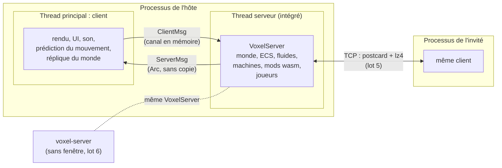

# Plan : le multijoueur, en commençant par un serveur local

But de la première étape : **deux joueurs sur le même réseau local** (ou deux fenêtres sur la même machine)
jouent dans le même monde. L'architecture doit déjà être celle du jeu final, pour que le serveur dédié et
le jeu par Internet viennent ensuite sans tout refaire.

## 1. Ce que fait Horizon

Horizon (`horizon-rust/horizon`, cloné et lu le 20 nov. 2026) est un clone de Minecraft Java en Rust. Comme
pour la génération, on reprend **les idées** et jamais le code : il est sous LGPL-3.0, et son protocole est
celui de Mojang.

### Un seul code serveur pour tout

- En solo, le monde tourne sur **son propre thread serveur** (`game/world/integrated.rs`), comme le serveur
  intégré de Minecraft. La fenêtre le rejoint comme un joueur, par un **tuyau en mémoire** : un tick long
  ne bloque jamais une image.
- « Ouvrir au réseau local » ne fait qu'ouvrir un port TCP devant ce même serveur.
- Le serveur dédié (`--dedicated`) est le même binaire, sans fenêtre ni son.
- Leur règle : *single player, LAN, `--dedicated` and the supervisor run the same server code*. Deux copies
  du code finiraient par diverger.

### Le prix d'un départ tardif

Horizon n'a pas commencé ainsi. Au départ, le jeu de l'hôte restait le jeu solo. Les invités passaient par
un « hub » à côté, et l'héritage se voit encore :

- Chaque action d'un invité **échange son état avec celui de l'hôte** dans le `Game` (`as_guest`), joue le
  code solo, puis rend l'échange. C'est fragile et tout le code doit en tenir compte.
- Il y a deux versions de nombreux fichiers : `lan_*.rs` côté hôte, `remote_*.rs` côté client.
- Le passage du solo sur un thread serveur a été fait après coup (PR #1514). Le découpage du jeu en
  `horizon-gameplay` (serveur) et `horizon-client-gameplay` (client) est encore en cours.

**Leçon pour nous** : séparer serveur et client *avant* d'ouvrir le réseau. Le solo doit lui-même passer par
le chemin client ↔ serveur ; c'est ainsi que les bogues du multijoueur se voient tous les jours.

### Leurs bonnes idées techniques

| Idée | Chez Horizon | Pour nous |
|---|---|---|
| Serveur intégré sur un thread, la fenêtre jointe par un tuyau en mémoire | `integrated.rs`, `connection::Pipe` | lots 3 et 4 |
| Sections partagées au lieu d'être copiées entre le serveur et la fenêtre du même processus | `lan/handoff.rs` (`Weak` vers les sections du serveur) | nos chunks sont déjà des `Arc<Chunk>` : on envoie l'`Arc` en mémoire, les octets seulement par TCP |
| Un chunk encodé et compressé **une fois** pour tous les joueurs, et gardé jusqu'à sa prochaine modification | `SharedFrames`, cache de chunks (§5.3) | lot 5 |
| Le tick ne fait que déposer des messages ; le cadrage, la compression et les écritures se font sur des threads réseau | `lan/io_pool.rs` | lot 5 (un thread par connexion suffit pour quelques joueurs) |
| File d'envoi bornée par joueur : au-delà, on ralentit l'envoi des chunks, puis on déconnecte | `Outbox`, `MAX_PENDING` | lot 5 |
| Le client prédit son propre mouvement ; le serveur décide de tout le reste | `remote/mod.rs` | lot 2 |
| Mouvement contrôlé par le serveur (« moved too quickly ») ; la vraie anti-triche (rejeu de la prédiction) seulement en dédié | `lan/prediction.rs`, `anticheat.rs` | contrôle simple au lot 2 ; l'anti-triche plus tard |
| État des invités sauvegardé par joueur (`players/data/<uuid>.dat`) | `lan/playerdata.rs` | lot 1 |
| Découverte LAN : annonce en multicast toutes les 1,5 s, liste dans l'écran Multijoueur | `lan/discovery.rs` | lot 5 |
| Tests de bout en bout avec des **bots** sans fenêtre, et un banc de charge (TPS, MSPT p99, octets par joueur, temps de connexion) | `horizon-bots`, `tools/lan_e2e.py`, `server_bench.py` | lot 7 |
| Jouer entre amis sur Internet : code d'invitation, tunnel chiffré, UPnP/NAT-PMP, relais | `play-with-friends.md`, `horizon-relay` | **hors de cette étape** |

## 2. Où en est notre jeu

Le moteur est déjà bien placé :

- `engine_voxel`, `engine_ecs` et `engine_mods` tournent **sans fenêtre**. `check-arch` le vérifie, et la
  règle a été écrite pour « serveur un jour ».
- Les chunks sont des `Arc<Chunk>` de 32³, déjà sérialisés avec `postcard` et compressés avec `lz4_flex`
  pour les sauvegardes.
- Les identifiants texte sont stables ; les numéros ne sont jamais écrits sur disque, et chaque chunk
  sauvegardé porte sa palette.
- La génération est déterministe à partir de la graine.

Ce qui bloque vient du jeu (`games/voxel`) :

1. **`VoxelGame` est un monolithe** de ~80 champs (`main.rs:205`). Il mêle :
   - le **serveur** : monde, fluides, mods, ECS, villages, échanges ;
   - le **client** : renderer, caméra, UI, son, terrain lointain, effets ;
   - **le** joueur : `inventory`, `vitals`, `hunger`, `gear`, `effects`, `potions`, `adventure`,
     `quest_book`...
2. **Un seul joueur partout.** Il y a un seul `player: Entity` et une ressource `PlayerEntity`. Le
   `PlayerSave` est écrit dans `world.ron`. Le streamer charge autour d'**une** caméra (`update_view`).
3. **Les entrées agissent directement sur le monde.** Le clic droit enchaîne une quinzaine de cas dans
   `update` : wagon, porte, conteneur, machine... L'UI egui lit et modifie le monde et les inventaires sur
   place.
4. **Pas `Send`.** Le monde est partagé par `Rc<RefCell<ChunkStreamer>>` (`shared.rs`). Ce n'est pas un
   défaut : un serveur construit **sur son thread** peut garder ses `Rc`. Il faut seulement que rien ne
   passe d'un thread à l'autre, sauf les messages.
5. Le pilotage `ctl` écoute un seul port fixe (7878). Pour piloter deux instances, il faut
   `VOXEL_CONTROL=7879` (déjà possible) et une commande `ctl --port`.

## 3. L'architecture visée

- **`VoxelServer`** est l'autorité. Il possède le monde, l'ECS, la simulation (fluides, machines, réseaux,
  mods wasm, créatures) et l'état de chaque joueur. Il avance à pas fixe de 60 Hz, comme aujourd'hui, et ne
  connaît ni `winit`, ni `wgpu`, ni `egui`, ni `kira` (une nouvelle règle de `check-arch`).
- **`VoxelClient`** possède :
  - le renderer, la caméra, l'UI, le son et les effets ;
  - une **réplique** du monde : chunks reçus, maillage, terrain lointain ;
  - les entités vues, interpolées ;
  - **son** joueur.

  Il prédit son propre mouvement, puis envoie des **intentions** au serveur.
- **Le lien** est un trait `Link` à deux implémentations :
  - **en mémoire** : canaux `crossbeam`, messages passés tels quels, chunks en `Arc` ;
  - **TCP** : trames préfixées par leur longueur, encodées en `postcard`, compressées en `lz4` au-delà de
    256 octets.
- **Le solo est un client relié à un serveur intégré.** « Ouvrir au réseau local » ajoute un écouteur TCP
  devant le même serveur.

### Où ranger le code

- `crates/engine_net` (nouveau, sans dépendance graphique) : le trait `Link`, le cadrage, le lien mémoire,
  le lien TCP, la poignée de main et la découverte LAN. C'est générique : le moteur ne connaît pas les
  messages du jeu, il transporte des octets ou des valeurs `T: Serialize`.
- `games/voxel/src/protocol.rs` : les enums `ClientMsg` et `ServerMsg` et la version du protocole.
- `games/voxel_server/` (nouvelle crate, une bibliothèque plus un binaire `voxel-server`) : le serveur,
  extrait de `games/voxel`, sans dépendance graphique.
- `games/voxel` : le client. Il dépend de `voxel_server` pour lancer le serveur intégré.

## 4. Les messages

Ce qui est décrit ici est la forme ; la liste exacte se complète lot par lot.

**Du client vers le serveur (`ClientMsg`)** : des intentions, jamais des résultats.

| Message | Contenu |
|---|---|
| `Hello` | version du protocole, nom du joueur, liste des mods avec leur version, empreinte du contenu |
| `Move` | position, vitesse, regard, au sol, mode (marche/vol), numéro de pas. Le serveur vérifie la vitesse et la traversée des blocs, et renvoie `Correct` s'il refuse. |
| `Dig` | début, avancement, fin, annulation ; bloc et face, numéro de séquence |
| `Use` | clic droit sur un bloc, une entité ou dans le vide ; bloc, face, point visé, main |
| `Attack` | entité visée |
| `SelectSlot`, `Drop` | barre rapide, objet jeté |
| `MenuClick` | menu ouvert, case, bouton, maj ; `MenuButton` pour les boutons (Ranger, Réparer, une recette d'enclume...) |
| `CloseMenu`, `Chat`, `Command` | — |
| `Respawn`, `Settings` | distance de vue (le serveur borne la sienne) |

**Du serveur vers le client (`ServerMsg`)**

| Message | Contenu |
|---|---|
| `Welcome` | identifiant du joueur, graine (pour le terrain lointain), dimension, **table des numéros** (texte → `BlockId` et `ItemId` du serveur), heure, météo |
| `Chunk` / `Unload` | un chunk 32³ avec ses blocs actifs visibles par le client, et sa lumière |
| `Blocks` | modifications groupées par chunk (position, nouvel état), et blocs actifs changés (couvercle de coffre, machine qui tourne) |
| `Spawn` / `Despawn` / `Moves` | entités : créatures, joueurs, objets au sol, wagons, projectiles, sous-grilles (bateaux, contraptions). Positions envoyées à 20 Hz, en relatif quand c'est possible. |
| `PlayerState` | vie, faim, XP, effets, inventaire. On envoie les **cases modifiées**, pas l'inventaire entier. |
| `OpenMenu` / `MenuState` / `CloseMenu` | une **vue de menu** décrite en données (cases, barres, textes, boutons). Le client la dessine, le serveur garde la vérité. |
| `Correct` | position imposée (téléport, mouvement refusé) |
| `Sound`, `Particles`, `Swing`, `Hurt` | effets à jouer. Les événements `BlockBroken`... deviennent des messages pour les joueurs proches. |
| `Time`, `Weather`, `Chat`, `PlayerList`, `Kick` | — |
| `ModHud` / `ModMenu` | ce que les mods affichent : barres du HUD, menus de machine, pages d'options du monde |

**La table des numéros.** Les numéros dépendent des mods installés. Le serveur envoie donc sa table à la
connexion, et le client traduit une fois pour toutes. Au premier lot réseau, on exige les **mêmes mods et la
même version** des deux côtés : la poignée de main compare les listes et l'empreinte du contenu, et refuse
sinon avec un message clair. Pousser les mods manquants au client vient plus tard.

**Les mods** tournent **uniquement sur le serveur**. Le client ne charge que leurs données (blocs, textures,
sons, modèles) pour dessiner. Leurs menus (`mod_menu.rs`) et leurs barres de HUD deviennent des vues
envoyées par le serveur.

## 5. Les lots

Chaque lot laisse le **solo jouable et identique**, passe les tests, et se commite à part. Les lots 1 à 4 ne
montrent rien à l'écran : c'est le prix d'une architecture propre (la leçon d'Horizon), et c'est là
qu'est le gros du travail.

### Lot 1 : le joueur devient un joueur parmi d'autres

- `PlayerState` regroupe tout ce qui appartient à un joueur : inventaire, survie, faim, équipement, effets,
  potions, aventure, livre de quêtes, point de réapparition, XP, mode, menu ouvert, minage en cours. Le jeu
  en garde une table `Players` (`PlayerId` → état et entité ECS) ; la ressource `PlayerEntity` disparaît.
- **Sauvegarde par joueur** : `saves/<monde>/players/<nom>.ron`. Le `player` de `world.ron` est relu une
  fois pour les anciens mondes : il devient le joueur hôte. On ne touche pas aux mondes existants avant
  leur réouverture.
- **Le streamer charge autour de plusieurs centres** (des « tickets »), un par joueur, au lieu d'une
  caméra. Le maillage reste attaché à la vue locale.
- Les événements (`BlockBroken`, `PlayerDamaged`...) portent le `PlayerId` qui les cause. Les quêtes, les
  stats et l'aventure les comptent au bon joueur.
- Les créatures choisissent **le joueur le plus proche** pour la cible, le regard, l'apparition et la
  disparition.
- Tests : deux joueurs dans un `VoxelServer` de test sans fenêtre. Le chargement couvre les deux zones,
  les inventaires sont séparés, la sauvegarde puis le rechargement rendent deux joueurs.

#### Le lot 1 en détail (état du code au 20 nov. 2026, branche `multijoueur`)

Mesures : `self.inventory` est cité 201 fois dans 33 fichiers. `self.player` 110 fois dans 28 fichiers.
`PlayerEntity` 25 fois dans 7 fichiers (`mobs.rs` surtout). `self.quest_book` 40 fois, `self.gear` 30, `self.adventure` 30,
`self.hunger` 22.

**1a. `PlayerState` et `Players` (mécanique, aucun changement de comportement)**

- Nouveau module `games/voxel/src/players.rs`. `PlayerId(u32)`, et `PlayerState` regroupe :
  - les champs de `VoxelGame` propres à un joueur : `player` (l'entité ECS), `inventory`, `vitals`, `hunger`, `gear`,
    `effects`, `potions`, `adventure` (la part du joueur), `quest_book`, `experience`, `bed`, `mining`, `air_swing`, le menu
    ouvert ;
  - `name: String` et `uuid: u128` (identifiant local).
- Ne pas y mettre ce qui est propre à la fenêtre : la caméra, l'UI, la main, le son, les effets d'eau.
- `Players` est une table (`Vec` ou `BTreeMap`) avec `local: PlayerId`. Accès : `self.me()` et `self.me_mut()`, ou des
  emprunts disjoints quand le vérificateur d'emprunts l'exige.
- Remplacer les accès un par un. `cargo build` à chaque fichier ; aucun comportement ne change.
- Le nom du joueur local vient de `settings.ron` : un champ `player_name` (par défaut « Joueur ») et `player_uuid` (tiré au
  hasard au premier lancement), avec `#[serde(default)]`.

**1b. L'ECS connaît plusieurs joueurs**

- La ressource `PlayerEntity(Entity)` devient `PlayerEntities(Vec<Entity>)`, tenue à jour par `Players`.
- Les systèmes qui lisent le joueur (`mobs.rs`, `spawning.rs`, `projectiles.rs`, `aquatic.rs`, `villagers.rs`, `ships.rs`)
  prennent **le joueur vivant le plus proche** : cible, regard, fuite, apparition et disparition des créatures (distance au
  joueur le plus proche), et tirs qui touchent n'importe quel joueur.
- Un composant `PlayerId` sur l'entité de chaque joueur permet de remonter à son état.
- Les tests existants de `mobs.rs` (`insert_resource(PlayerEntity(...))`) suivent. On ajoute des tests à deux joueurs :
  - une créature hostile vise le plus proche ;
  - les créatures n'apparaissent pas près d'un joueur ;
  - une créature ne disparaît pas tant qu'un joueur est proche.

**1c. Le streamer charge autour de plusieurs centres (`engine_voxel`)**

- `ChunkStreamer` reçoit une liste de **tickets** : `update_views(&[View { position, forward, mesh: bool }])`.
  `update_view(position, forward)` reste un raccourci pour un seul centre.
- Les chunks chargés sont l'union des rayons de chaque centre. La priorité d'un chunk est la meilleure (la plus petite) sur
  l'ensemble des centres. Un chunk n'est libéré que s'il est hors de **tous** les rayons.
- Le maillage, l'envoi au GPU et le terrain lointain restent attachés au centre `mesh: true`, la vue locale. Les autres
  centres chargent, génèrent et éclairent seulement. Ils simulent aussi : machines, fluides et créatures fonctionnent dans
  les chunks chargés, comme aujourd'hui.
- Tests dans `engine_voxel` :
  - deux centres éloignés chargent les deux zones ;
  - retirer un centre libère sa zone et seulement elle ;
  - aucun maillage hors du centre `mesh` ;
  - un seul centre se comporte exactement comme avant (les tests existants passent sans changement).

**1d. Une sauvegarde par joueur**

- `saves/<monde>/players/<uuid>.ron` contient un `PlayerFile` : le `PlayerSave` actuel, l'inventaire, l'aventure du joueur,
  le livre de quêtes, l'équipement et le nom. Le type va dans `engine_voxel::save`, à côté de `PlayerSave`.
- **Au chargement** :
  - on cherche `players/<uuid du joueur local>.ron` ;
  - à défaut, on relit le `player` et l'inventaire de `world.ron` (anciens mondes) ;
  - les deux absents, c'est un joueur neuf au point de départ.
- **À la sauvegarde** :
  - on écrit `players/<uuid>.ron` pour chaque joueur ;
  - on garde aussi l'hôte dans `world.ron`, pour que la branche `main` ouvre encore le monde.
- Ce qui reste au monde dans `world.ron` : l'heure, la difficulté, le palier du monde, la dimension.
- Si la progression d'aventure est commune au monde, elle reste dans `world.ron`. Lire `adventure.rs` et `tiers.rs` avant
  de décider. Le choix proposé : le palier choisi est au monde, les compteurs (victimes, profondeur) au joueur.
- Tests : un aller-retour de deux joueurs, un ancien `world.ron` sans dossier `players/` relu, et un joueur neuf.

**1e. Les événements portent le joueur**

- `BlockBroken`, `BlockPlaced`, `PlayerAttacked`, `PlayerDamaged`, `EntityDied` (le tueur) et les ramassages portent
  `player: Option<PlayerId>`.
- Les quêtes, les statistiques et l'aventure comptent au joueur concerné. Les mods reçoivent l'événement comme avant :
  l'ABI des mods ne change pas dans ce lot.

**Ce que le lot 1 ne fait pas** : rien sur le réseau, ni sur le découpage serveur/client, ni sur un deuxième joueur
visible en jeu. Le seul joueur réel reste le joueur local. Les tests à deux joueurs passent par l'ECS, le streamer et la
persistance, sans fenêtre.

**Vérification** :
- `cargo fmt --all` ;
- `cargo clippy --workspace --all-targets` sans avertissement ;
- `cargo test --workspace` ;
- `cargo xtask check-arch` ;
- en jeu (`VOXEL_WORLD=multitest`, puis réouverture d'un monde de test existant comme `formestest`) : déplacement, minage,
  inventaire, coffre, mort et réapparition, sauvegarde puis réouverture (position et inventaire retrouvés, fichier
  `players/<uuid>.ron` créé).
- **Ne jamais ouvrir ni modifier `saves/world`.**

### Lot 2 : les entrées deviennent des intentions

- Chaque action passe par `ClientMsg`, puis par `handle(player, msg)` côté simulation. Le clic droit, le
  minage, l'attaque, les clics de l'inventaire et des menus, les boutons de machine, la console : tout.
- **Le mouvement** reste prédit par la physique locale. Le simulateur reçoit `Move` et le contrôle : vitesse
  maximale selon le mode, pas de traversée de bloc plein. Sinon il répond `Correct`.
- En solo, les messages sont appliqués **dans la même image** : aucun changement de ressenti.
- `ctl` passe par les mêmes intentions. C'est un bon test : chaque commande d'action devient un message.

### Lot 3 : le client ne lit plus que ce qu'on lui envoie

- **`ClientWorld`** : la réplique des chunks reçus. Le maillage, le terrain lointain, la visée (lancer de
  rayon), le culling des grottes et les sons de pas lisent la réplique, plus jamais le monde du serveur.
- **Les entités vues** : composants de rendu seulement (modèle, position interpolée, animation). L'IA, la vie
  et la physique des créatures restent sur le serveur. Interpolation entre deux envois de 20 Hz, avec
  100 ms de retard (le `PreviousPosition` actuel sert de point de départ).
- **Les menus deviennent des vues** : coffres, fours, établi, établi de taille, enchantement, forge,
  échanges, quêtes, guide. Le serveur envoie une `MenuView` (données) et ses mises à jour ; l'UI dessine
  la vue et renvoie des `MenuClick`. C'est le plus gros morceau : les écrans egui lisent aujourd'hui le
  monde directement. On convertit écran par écran, en commençant par l'inventaire et le coffre.
- Le serveur et le client sont encore **dans le même thread**. Le lien mémoire est vidé à chaque pas. On
  peut ainsi comparer facilement l'ancien et le nouveau chemin.

### Lot 4 : le serveur intégré sur son thread

- `VoxelServer` est construit **sur** son thread, avec ses `Rc` internes. Seuls les messages traversent.
- Pas fixe de 60 Hz sur le thread serveur. Le client garde sa boucle d'images.
- Les chunks passent en `Arc<Chunk>`, sans copie (l'idée du `handoff` d'Horizon, en plus simple : nos chunks
  sont déjà des `Arc`).
- Pause : en solo, le menu Échap met le serveur intégré en pause, comme aujourd'hui. Ouvert au réseau, il ne
  s'arrête plus.
- Sauvegarde, fermeture, retour au titre et changement de dimension passent par des appels au serveur avec
  réponse (`Integrated::call` chez Horizon). Délai maximal : 10 s, avec un message clair.
- Mesure (`cargo xtask bench`) : le temps d'image doit baisser, puisque le tick ne bloque plus le rendu.
  Rien ne doit se dégrader.

### Lot 5 : le réseau local

- `engine_net` :
  - un lien TCP (`std::net`, `TCP_NODELAY`) ;
  - un thread de lecture et un thread d'écriture par connexion ;
  - une file d'envoi bornée : au-delà, on ralentit les chunks, puis on déconnecte ;
  - trames `[longueur varint][drapeau compressé][postcard]`, compressées en lz4 au-delà de 256 octets ;
  - un **chunk encodé une fois** pour tous les joueurs, gardé jusqu'à sa prochaine modification.
- **La poignée de main** compare la version du protocole, les mods et l'empreinte du contenu. Elle accepte
  ou refuse avec la raison. Le mode hors ligne ne vérifie pas de compte : on se reconnaît au nom. Un
  identifiant aléatoire est gardé dans `settings.ron` pour qu'un joueur retrouve son inventaire.
- **Héberger** : « Ouvrir au réseau local » dans le menu pause, avec le port (25 600 par défaut, un autre
  s'il est pris) et l'autorisation des tricheries. Le jeu annonce la partie sur le réseau local en UDP
  (multicast, toutes les 1,5 s, comme Horizon).
- **Rejoindre** : un écran « Multijoueur » dans le menu titre. Il liste les parties annoncées et propose un
  champ adresse:port. Un invité arrive au point de départ, ou à sa dernière position s'il est déjà venu.
- En jeu :
  - les autres joueurs ont un modèle (le `skin.rs` actuel) et leur nom au-dessus de la tête ;
  - une liste des joueurs (Tab) ;
  - le chat (la console actuelle, ouverte avec T, sans `/`) ;
  - des messages « X a rejoint » et « X est parti ».
- `ctl` :
  - `host [port]`, `join adresse`, `players` ;
  - `--port` dans `cargo xtask ctl` pour piloter deux fenêtres.

### Lot 6 : le serveur dédié, sans fenêtre

- Le binaire `voxel-server` lit `server.ron` : monde, port, joueurs maximum, distance de vue, liste blanche,
  opérateurs.
- Une console en ligne de commande (les commandes existantes), une sauvegarde automatique et un arrêt propre
  sur Ctrl+C.
- `check-arch` vérifie que `voxel_server` ne dépend ni de `winit`, ni de `wgpu`, ni d'`egui`, ni de `kira`.

### Lot 7 : tester et mesurer

- **Des bots sans fenêtre** (`cargo xtask bots N --behaviour walk|explore|idle`). Ce sont de vrais clients
  TCP : ils marchent, cassent et posent des blocs.
- **Tests de bout en bout** (`tests/multiplayer.rs`) avec un serveur et deux clients dans un même processus,
  en TCP sur 127.0.0.1 :
  - A pose un bloc, B le voit ;
  - A ouvre un coffre et B le remplit, A voit le contenu changer ;
  - B se déconnecte puis revient, et retrouve son inventaire ;
  - une créature poursuit le joueur le plus proche ;
  - la porte et le portillon s'ouvrent pour les deux.
- **Le banc réseau** (`cargo xtask bench-net`) mesure, avec 1, 4 et 16 bots :
  - TPS et MSPT (moyenne et p99) ;
  - octets par joueur et par chunk ;
  - temps de connexion jusqu'à l'apparition ;
  - mémoire.

  Il peut simuler une latence et des pertes, pour voir la prédiction et l'interpolation.

## 6. Choix à valider

| Question | Proposition | Pourquoi |
|---|---|---|
| Ordre des lots | séparer serveur et client d'abord (lots 1 à 4), ouvrir le réseau ensuite | la leçon d'Horizon : un seul chemin, le solo le teste en permanence |
| Fréquence | simulation à 60 Hz (inchangée), positions d'entités envoyées à 20 Hz, interpolées | ne pas toucher la physique ; 20 Hz suffit visuellement avec l'interpolation |
| Mouvement | prédit par le client, contrôlé simplement par le serveur | réactif ; l'anti-triche sérieuse n'a pas sa place sur un réseau local |
| Transport | TCP (`std::net`, threads), pas de `tokio` | quelques joueurs en local ; un pool `mio` à la Horizon se fera si un serveur dédié en a besoin |
| Lumière | envoyée avec le chunk | le client n'a pas forcément les 9 colonnes voisines pour la calculer ; à mesurer (on peut la recalculer côté client plus tard) |
| Terrain lointain | calculé par le client à partir de la graine, comme aujourd'hui | il ne coûte rien au réseau ; les constructions lointaines n'y figurent pas encore (c'est déjà le cas) |
| Mods | mêmes mods exigés des deux côtés ; les scripts ne tournent que sur le serveur | simple et sûr pour commencer |
| Identité | hors ligne, nom + identifiant local, pas de compte | réseau local seulement |
| Dimensions | tous les joueurs dans la même dimension au début ; un portail emmène un seul joueur au lot suivant | aujourd'hui, changer de dimension recharge tout le monde ; plusieurs dimensions chargées à la fois est un chantier à part |

## 7. Hors de cette étape

- Le jeu entre amis par Internet : codes d'invitation, UPnP/NAT-PMP, tunnel chiffré, relais.
- Les comptes et le mode en ligne.
- L'anti-triche (rejeu de la prédiction).
- Envoyer les mods manquants à un client.
- Le tick sur plusieurs cœurs.
- Plusieurs dimensions actives en même temps.
- Les structures mobiles avec des passagers de plusieurs joueurs à la fois : les sous-grilles sont
  répliquées comme des entités au lot 3, et le cas « deux joueurs sur le même bateau » est testé au lot 7.

## 8. Risques

- **Volume du lot 3.** Toute l'UI lit le monde directement. Une centaine de modules sont concernés. On le
  découpe écran par écran ; chaque écran converti est vérifié en jeu avec `ctl` (`texts`, `clicktext`).
- **Le ressenti du solo** ne doit pas changer : même latence de minage et de pose, même fluidité. Le bench
  actuel et des captures avant/après servent de garde-fous à chaque lot.
- **Taille des chunks.** Un chunk de 32³ fait 64 Ko bruts. La sauvegarde lz4 le ramène à quelques Ko, et un
  rayon de 12 chunks au chargement fait vite des dizaines de Mo. Il faut donc :
  - envoyer **du plus proche au plus loin** ;
  - régler un débit par joueur ;
  - laisser le terrain lointain local masquer l'attente.
- **Le déterminisme** n'est pas requis entre le client et le serveur, puisque le serveur décide de tout. Il
  reste requis pour le terrain lointain, qui doit correspondre au monde réel.
