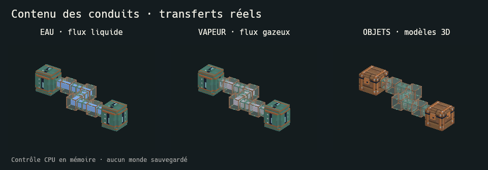

# Passe visuelle des blocs

Direction : terre, ardoise et cuivre. Références consultées le 12 novembre 2026 :
[coffre](https://www.minecraft.net/en-us/article/block-week-chest),
[four](https://www.minecraft.net/en-us/article/block-week-furnace),
[alambic](https://www.minecraft.net/en-us/article/taking-inventory--brewing-stand).
Ces références servent à lire les silhouettes et leurs pièces caractéristiques.
Les coordonnées, motifs et couleurs de cette passe sont dessinés dans le projet.
Aucune ressource externe n’est intégrée.

## Lot 1 — conteneurs et postes de travail

[Avant](01-conteneurs-avant.png) · [Après](01-conteneurs-apres.png)

Dix modèles : établi, four, lit, coffre, table d’enchantement, alambic, coffre-fort,
four à alliages, enclume et table des runes. Leurs PNG sont produits par assetgen.
Le four conserve la bouche `x=4..11, y=8..13` et son animation en maillage à boîtes.
Le test du feu vérifie toujours les quatre normales latérales, l’absence de feu
sur le dessus/dessous, l’isolation entre fours et le rechargement de l’état sauvegardé.
Il ne compte plus seize sommets : les pieds et la corniche ajoutent des faces.

Les tests CPU vérifient sélection, retrait et appui du joueur sur les dix postes,
ainsi que le passage du rayon sous l’établi. Le changement de hauteur est voulu :
lit à 9/16 (10/16 au chevet), coffre à 14/16, table d’enchantement à 14/16 au livre,
établi et four à 16/16. Les couleurs de repli sont recalculées en espace linéaire.

## Limites et validation en partie

Les planches sont des contrôles CPU, pas des captures de partie. La colonne « nuit »
est un éclairage réduit, sans simulation du shader ou de la propagation de lumière.
Le lancement natif avec `VOXEL_WORLD=/tmp/visuel-codex-20261112` est resté bloqué
sur les services macOS (`com.apple.hiservices-xpcservice`, connexion invalide).
Il a été arrêté. Aucun monde du propriétaire n’a été ouvert ou modifié.

Restent à vérifier en partie : ouverture des interfaces au clic droit, pose orientée,
déplacement autour des meubles, contacts contre un mur, juxtaposition, éclairage
nocturne réel et flammes animées. Les contrôles géométriques CPU ne remplacent pas
cette validation interactive. Aucun dossier `shots/` n’a été créé.

Les identifiants et toutes les propriétés non visuelles du registre sont comparés
à un export antérieur à la passe (couleurs, textures, boîtes et transparence dérivée
exclues de la comparaison). Aucun état n’est ajouté : les variantes décaleraient les
identifiants suivants et les échanges marche/arrêt ne transfèrent pas l’orientation.
Les formes fixes des circuits et des pistons ne prétendent donc pas suivre leur axe logique.
Le lot 4 ajoute des formes contextuelles aux câbles et tuyaux sans recourir aux états.
Les états et animations existants de Mécanique sont conservés.
Les exports [avant](registre-avant.tsv) et [après](registre-apres.tsv) sont identiques :
164 identifiants, chacun avec une empreinte des propriétés non visuelles.

## Lot 2 — circuits, réseaux et machines

[Modèles avant](02-machines-avant.png) · [Modèles après](02-machines-apres.png)
· [PNG des mods avant](02-mods-avant.png) · [PNG des mods après](02-mods-apres.png)

Les leviers, boutons, inverseurs et répéteurs ont un socle et des contacts en volume.
Les paires conservent leurs deux identifiants et leur logique de substitution.
Les pistons sont des modèles fixes verticaux, sans nouvel état ; leur axe visuel ne
représente donc pas toutes les directions logiques possibles. Les arbres du jeu de base
gardent leurs six branches fixes ; les câbles et tuyaux suivent leurs voisins depuis le lot 4.

Les réservoirs, pompes, batteries, lampes, moteurs, ventilateurs, remplisseurs,
assembleurs, panneaux, hélices, ballons et barres ont des pièces distinctes.
Mécanique conserve ses états Axis et ses rotations ; l’engrenage a des dents,
la presse un espace libre et la manivelle une poignée. Entrepôt reçoit un trieur
à trémie, une moissonneuse à dents et une foreuse sur portique. Donjons reçoit
des pointes étagées et des cages ouvertes. Le casseur d’Example et l’horloge
ont aussi des volumes propres.

Les 50 PNG des six mods sont désormais tous gérés par assetgen, y compris les deux
portails de Mécanique qui n’avaient pas de source reproductible. Le test de couverture
compare les PNG versionnés à une régénération dans un dossier temporaire.
Les objets de Forge réutilisent les silhouettes d’outils et armures du jeu ; les pièces
non montées, runes, baguette et sceau ont leurs dessins dédiés.

Les nouvelles colonnes « voisins » et « mur » montrent la juxtaposition et le contact
géométrique en rendu CPU. Elles ne valident pas l’occlusion du maillage GPU.

## Lot 3 — matières naturelles et petits volumes

[Blocs avant](03-nature-avant.png) · [Blocs après](03-nature-apres.png)
· [Matières avant](03-matieres-avant.png) · [Matières après](03-matieres-apres.png)

La torche est une tige avec une tête étagée ; le cactus est rentré de 1/16 sur ses
quatre côtés et garde sa hauteur pour les piles. Les deux terres labourées ont une
surface à 15/16, avec des sillons secs ou humides. Les cultures gardent leur croix
et leur origine de rendu : ce retrait du sol laisse donc un écart visuel de 1/16
sous leur cellule, à observer en partie. Aucune règle agricole n’est modifiée.

La pierre bleutée, le sable, la neige et la glace ont un grain périodique plus calme.
Les minerais dessinent des veines fragmentées ; les cinq bois partagent des cernes
arrondis et une construction d’écorce cohérente, avec un bouleau clair à lenticelles.
Les feuillages ont des bouquets moins saturés et des découpes périodiques. L’herbe et
la terre conservent leurs raccords antérieurs, vérifiés après réduction de palette.
Les plantes Cross, les modes de transparence, les liquides et le verre sont conservés.
Toutes les couleurs des PNG changés sont resynchronisées en espace linéaire.

Le test de raccord porte aussi sur les nouvelles matières. Les contrôles de sélection,
retrait, appui du joueur, juxtaposition et maintien de la face du mur parcourent tous
les modèles et leurs variantes (appui uniquement pour les solides).
La géométrie du cactus et la hauteur des deux terres labourées ont un contrôle dédié.
Au total, 60 définitions de blocs ont une forme modifiée ; aucun identifiant ni
paramètre de jeu n’a changé.

## Lot 4 — câbles et tuyaux raccordés selon leurs voisins

[Avant](04-connexions-avant.png) · [Après](04-connexions-apres.png)

Références Mekanism consultées : [Universal Cable](https://wiki.aidancbrady.com/wiki/Universal_Cable)
et [Mechanical Pipe](https://wiki.aidancbrady.com/wiki/Mechanical_Pipe).
Le principe retenu est le raccord automatique aux voisins compatibles et aux faces
ouvertes des machines, avec des dessins propres au projet.

`core:cable` et `core:pipe` utilisent désormais `connections` : noyau isolé, ligne,
coude, T, montée et jonction sur six faces. Le câble fait 4/16 de section ; le tuyau
6/16 avec un noyau de 8/16. Une branche existe seulement vers un conduit de même
sorte et canal, ou vers une machine avec la capacité correspondante ouverte sur
cette face. Une réserve vide accepte aussi le raccord. Les règles de transfert
existantes sont conservées.

La pose ou la casse d’un voisin modifie immédiatement la géométrie, y compris aux
frontières de chunks. Le même calcul alimente le maillage, les collisions et le
rayon. Le contour souligne le tronçon visé. Les machines dont le corps est en retrait
reçoivent un raccord dans leur propre cellule jusqu’à la première pièce que coupe
la section du conduit. Leurs interfaces restent associées au même bloc.

**Utilisation** : clic droit sur la face visée pour prolonger ou bifurquer ;
**Maj + clic droit avec le conduit en main** pour poser contre une machine sans
ouvrir son interface. Les contrôles existants de pose (case libre, support et
entités) restent actifs. Les objets en main, au sol et leurs icônes utilisent un
segment droit, indépendant des voisins du monde.

Les 64 formes sont calculées au chargement et choisies par les voisins, sans
ajouter de variantes ni de données sauvegardées. Les 164 identifiants restent les
mêmes ; l’export des propriétés non visuelles reste identique avant/après ce lot.
Le test d’audit exclut `connections`, comme les boîtes et les textures, car c’est
une propriété visuelle. Le format des sauvegardes n’a pas changé.

Les tests couvrent les 64 masques sur les six faces, les frontières de chunks,
les sortes et canaux incompatibles, les capacités et faces de machines, les
réservoirs multiples, la disparition réelle des branches à la visée/collision/rendu,
le contour du segment et la pose d’un coude, le déchargement/rechargement et les
identifiants. Un test de streaming vérifie que changer les ports remaillera aussi
le chunk voisin, tandis que changer une quantité ne déclenche aucun remaillage.
Le contrôle antérieur qui attendait exactement deux fois les faces d’un modèle
isolé est maintenu pour les modèles fixes ; les conduits sont maintenant vérifiés
par ces tests spécifiques, puisqu’ils ajoutent effectivement des branches.

Les écritures de capacités via les grilles ne changent que l’invalidation visuelle.
Aucun script, WASM, recette, butin, son ou monde du propriétaire n’est modifié.
La validation interactive du clic et du rendu GPU reste bloquée par l’environnement
macOS décrit plus haut. Le rendu CPU ci-dessus vérifie les géométries réelles.

```sh
cargo run -p voxel --example connection_review -- . /tmp/connexions.png
```

Les six contrôles demandés ont été exécutés pour ce lot : formatage, Clippy sans
avertissement, architecture, hooks et documentation passent. Le seul échec de la
suite complète est toujours le test de socket interdit par l’environnement.
La suite passe avec ce seul test exclu explicitement.

## Lot 5 — menus, infobulles et identification

Les menus, inventaires, options, fenêtres de machines et console utilisent des
fenêtres bornées à l'écran. Le contenu trop haut défile ; les cases et les colonnes
s'adaptent à la largeur disponible. Les listes de mondes, recettes, échanges et
écrans de mods peuvent revenir à la ligne. Le HUD du jeu se masque pendant les
menus et l'inventaire. Le journal de console défile séparément de sa saisie.

Les options sont regroupées en « Affichage et interface », « Audio » et « Souris
et touches ». Deux réglages sont ajoutés : `ui_scale` (75 à 150 %, défaut 100 %)
et `target_info` (activé par défaut). Les anciens fichiers de réglages continuent
à se charger avec ces valeurs par défaut.

Le survol d'une case affiche une petite fiche près du pointeur : nom, origine,
catégorie, quantité, durabilité restante, enchantement, dégâts, protection ou
nourriture selon l'objet. Les données proviennent des définitions du jeu ; les
bits d'enchantement sont séparés de l'usure avant de calculer la durabilité.
Les infobulles sont contraintes à l'écran et peuvent défiler sur un écran court.

En jeu, une fiche centrée en haut identifie le bloc ou la créature visée, y compris
dans une structure mobile. Elle montre l'outil conseillé/requis selon les règles
de récolte existantes, la vie des créatures, et les réserves d'énergie, fluides,
rotation ou stockage des machines. Elle réduit ses détails sur les écrans courts.
Le principe reprend l'identification de [Jade](https://modrinth.com/mod/jade),
avec un dessin propre au jeu. La mise à l'échelle et le placement des infobulles
ont aussi été étudiés dans les références officielles de
[Minecraft](https://www.minecraft.net/en-us/accessibility) et de la
[version 1.19.4](https://feedback.minecraft.net/hc/en-us/articles/13987663727757-Minecraft-Java-Edition-1-19-4).
Aucune ressource de ces projets n'est intégrée.

Planches inspectées :

- [Menu à 640 × 360](05-menu-640.png).
- [Options à 640 × 360](05-options-640.png), [320 × 240](05-options-320.png)
  et [1280 × 720](05-options-1280.png).
- [Cases et infobulle à 640 × 480](05-inventaire-640.png)
  et [320 × 480](05-inventaire-320.png).
- [Fiche de visée à 640 × 360](05-visee-640.png).
- [Comparaison : ancien conteneur sans contrainte de hauteur](05-options-conteneur-libre.png).

Ces images sont des rendus CPU d'egui. Le menu et les options emploient les widgets
de production ; les planches d'inventaire et de visée sont des contrôles des cases,
icônes et fiches communes, sur fond uni. La comparaison « ancien conteneur » est
une reconstitution de son débordement, pas une capture de l'ancien jeu. Le lancement
natif reste bloqué par les services macOS décrits plus haut : les interactions dans
une vraie partie, le plein écran et le changement d'échelle sur écran Retina restent
à vérifier. Aucun monde ni réglage du propriétaire n'a été écrit par ces contrôles.

```sh
cargo run -p voxel --example ui_review -- menu 640 360 /tmp/menu.png
cargo run -p voxel --example ui_review -- options 640 360 /tmp/options.png
cargo run -p voxel --example ui_review -- inventory 640 480 /tmp/inventaire.png
cargo run -p voxel --example ui_review -- hud 640 360 /tmp/visee.png
```

Sept tests supplémentaires couvrent les fenêtres pendant le redimensionnement de
320 × 240 à 1920 × 1080, les neuf cases à 150 % sur petit écran, l'accès au bouton
Retour par défilement, les infobulles au bord inférieur droit, les données d'usure,
les règles de récolte et la compatibilité des réglages antérieurs. Les six contrôles
demandés ont été exécutés : formatage, Clippy sans avertissement, architecture,
hooks et documentation passent. La suite complète ne rencontre que le test de
socket déjà interdit par l'environnement ; elle passe en excluant explicitement
ce seul test, sans changement de sa source.

## Lot 6 — composition de menus et inventaires plus proche de Minecraft

Cette seconde passe remplace le grand cadre des menus par un titre détaché et des
actions centrées au-dessus du monde. Le logo « VOXEL » est dessiné avec cinq glyphes
originaux en géométrie ; les deux actions principales sont larges, puis Options et
Quitter partagent une ligne. Les boutons gris ont un relief carré, une ombre sous le
texte et des états de survol, focus et pression. La pause utilise la même composition.
Aucune texture, police, marque ou image de Minecraft n'est importée.

Les inventaires et machines sont centrés dans un panneau clair avec texte sombre,
bords biseautés, cases en creux et sélection claire. Les cases mesurent au plus
36 points, les espacements sont réduits, le livre de recettes est près de
l'artisanat et l'aide détaillée se replie. La barre rapide partage ce dessin ;
les barres d'usure et l'objet tenu par le curseur suivent la taille des cases.
Les infobulles gardent leurs propriétés réelles, sur fond sombre à liseré violet.

Les options utilisent les onglets Affichage, Audio et Commandes. Les réglages
défilent dans leur propre zone, tandis que les onglets et Retour restent visibles.
Les tests simulent notamment un clic sur Audio, le défilement, le redimensionnement
des inventaires jusque 213 × 160 points logiques et la visibilité des quatre actions
principales sans défilement à 320 × 240. Les contrôles antérieurs sur les neuf cases,
les infobulles et la compatibilité des réglages restent actifs.

Comparaisons : [menu précédent](05-menu-640.png) / [nouveau menu](06-menu-640.png),
[cases précédentes](05-inventaire-640.png) / [nouvel inventaire](06-inventory-640.png).
Autres vues : [menu 1280 × 720](06-menu-1280.png), [menu 320 × 240](06-menu-320.png),
[pause](06-pause-640.png), [options](06-options-640.png),
[options 320 × 240](06-options-320.png), [inventaire 320 × 480](06-inventory-320.png)
et [fiche de visée et barre rapide](06-hud-640.png).

Ces aperçus CPU utilisent les widgets du jeu. La composition armure/artisanat est
commune à l'inventaire de production et à sa planche ; les objets affichés sont un
jeu de contrôle. Le fond uni remplace le monde 3D dans ces planches uniquement.
Le lancement natif reste bloqué par les services macOS décrits plus haut ; le rendu
sur le monde et les interactions complètes en partie restent à confirmer.
Les captures du lot 5 sont conservées comme comparaison historique.

Les six contrôles demandés ont été exécutés : formatage, Clippy, architecture,
hooks et documentation passent. La suite complète rencontre uniquement l'interdiction
de socket déjà décrite ; les autres tests passent avec ce seul test exclu explicitement.
Les mondes, recettes, règles du jeu, scripts et WASM sont inchangés par cette passe.

## Lot 7 — contenu visible dans les conduits



[Planche fixe](07-transports.png). Les scènes de contrôle contiennent un producteur,
un coude et un récepteur. La vapeur est un fluide gazeux déclaré uniquement dans la
fixture de contrôle ; aucun nouveau bloc ou fluide du jeu n'est ajouté.

Les transferts de fluides et d'objets émettent maintenant des traces de dessin.
Les tuyaux de fluides et les transporteurs d'objets fermés ont un cadre métallique
et des fenêtres translucides. Les collisions et la sélection conservent les boîtes
antérieures. Les courroies montrent les objets au-dessus du tapis, avec leurs vrais
modèles : pixels extrudés des objets et textures des blocs.

Les liquides utilisent un volume coloré et des reflets mobiles. Un fluide dont la
densité est négative utilise une brume colorée et des particules. La couleur et la
lumière propre proviennent du registre des fluides. Les instances reçoivent la
lumière du voisinage des fenêtres ; la lumière propre reste un effet sur le contenu,
sans modifier la propagation lumineuse du monde.

Les traces reprennent les paires et les quantités de la répartition existante. Le
trajet visuel suit les faces raccordées, les coudes, les sens uniques et le canal,
sans traverser de machine intermédiaire. Les fluides conservent les faces exactes
des réservoirs utilisés. Les chemins sont mis en cache et invalidés après un
changement de réseau. Le contenu est masqué si son trajet a été cassé ou retourné.
Il suit la position et la rotation des structures mobiles. F5 vide aussi le cache
des modèles transportés.

Les objets se déplacent à environ quatre blocs par seconde, avec une animation
plafonnée à huit secondes pour les longues lignes. Les flux de fluides s'effacent
en 0,4 seconde sans nouveau transfert. Ce sont des animations de la livraison
instantanée existante : les inventaires, réserves, débits et délais logiques ne
changent pas. Les limites de dessin sont détaillées dans
[la documentation des conduits](../modding.md#le-contenu-visible-des-conduits).

La référence étudiée est la présentation des transports de Mekanism :
[Mechanical Pipe](https://wiki.aidancbrady.com/wiki/Mechanical_Pipe),
[Logistical Transporter](https://wiki.aidancbrady.com/wiki/Logistical_Transporter) et
[Pressurized Tube](https://wiki.aidancbrady.com/wiki/Pressurized_Tube).
Le dessin et les ressources restent ceux du projet.

```sh
cargo run -p voxel --example transit_review -- /tmp/transports
ffmpeg -framerate 10 -i /tmp/transports-%02d.png -filter_complex \
  '[0:v]split[s0][s1];[s0]palettegen=max_colors=128[p];[s1][p]paletteuse=dither=none' \
  /tmp/transports.gif
```

Le rendu CPU compose les mêmes boîtes, fenêtres, modèles et effets que le jeu,
avec les transferts calculés dans trois sous-grilles en mémoire. Il ne simule pas
le shader ou l'éclairage nocturne. Le lancement natif reste bloqué par les services
macOS décrits plus haut : rendu GPU des transparences, éclairage en partie et clics
sur les fenêtres restent à confirmer. Aucun monde du propriétaire n'a été utilisé.

Neuf tests supplémentaires vérifient les traces d'objets, d'eau et de gaz, les
quantités reçues, les coudes, la casse, les récepteurs pleins, les changements de sens,
les faces des réservoirs multiples, les fenêtres et les limites de mémoire. Ils vérifient aussi les modèles en mouvement,
l'extinction des flux, les transformations mobiles, la distance et le budget de dessin.
Les tests existants des réseaux et des collisions restent inchangés.

Les six contrôles demandés passent pour ce lot : `cargo fmt --check`,
`cargo clippy --workspace --all-targets` sans avertissement, `cargo test --workspace`,
`cargo xtask check-arch`, `cargo xtask hooks --check` et `cargo xtask docs --check`.
Le test de socket précédemment bloqué passe dans l'environnement actuel, sans
exclusion ni modification du test. Le nouveau lancement natif a en revanche encore
échoué sur `com.apple.hiservices-xpcservice`, avant l'ouverture du serveur de contrôle.

## Lot 8 — première proposition d'outils en main, remplacée par le lot 9

Comparaison : [avant](08-main-avant.png) / [après](08-main-apres.png).
Autres contrôles : [pendant le geste](08-main-geste.png) et
[fenêtre portrait](08-main-portrait.png), ainsi que les
[outils de Forge](08-main-forge.png).

La référence étudiée est le modèle classique `item/handheld`, décrit dans la
[documentation des outils Fabric](https://docs.fabricmc.net/develop/items/custom-tools)
et celle des [modèles d'objets](https://docs.fabricmc.net/develop/items/item-models).
Il s'agit d'une silhouette d'icône épaissie, avec une translation, une rotation et
une échelle propres à la main. Aucun fichier, dessin ou paramètre de modèle de
Minecraft n'est importé.

Les outils sont plus grands et inclinés vers la droite : tailles de 0,50 à 0,84
selon la famille, contre 0,44 auparavant. La vue classique remplace l'avant-bras par
l'outil ; la main vide garde son bras. La prise reste sur le manche du dessin original.
Le format de la fenêtre déplace l'ancrage et réduit la taille sur les vues étroites.
Les animations existantes de frappe, de marche, de changement d'objet et d'inertie
restent actives.
Les objets classés `Tool` mais pilotés par script reçoivent aussi cette présentation,
notamment le marteau de bronze de Forge, sans leur ajouter de capacité de minage.

La main partage maintenant le modèle 3D utilisé au sol et dans les conduits.
L'extrusion commune est affinée à un pixel, au lieu des 1,5 pixels du modèle au sol
et des 1,2 pixels du rendu en main précédent. Le test de profondeur attend donc
exactement 1/16 : il vérifie ce nouveau profil commun, avec les mêmes couleurs et
trous de transparence. Les PNG, statistiques et règles d'utilisation sont inchangés.
Le cache et les poses sont isolés dans `hand_model.rs`, pour vérifier les vraies
matrices indépendamment d'une fenêtre native ; `hand.rs` raccorde les animations au joueur.

Les tests de prise et d'animation sont conservés. De nouveaux contrôles vérifient
que les six familles d'outils et les quatre outils de Forge utilisent le modèle commun, restent devant la caméra,
gardent leur tête visible et laissent le rayon du réticule libre au repos sur cinq
formats, de 3:4 à 21:9. La main vide et l'invalidation du cache par F5 sont vérifiées.

```sh
cargo run -p voxel --example hand_review -- rest /tmp/main.png
cargo run -p voxel --example hand_review -- swing /tmp/geste.png
cargo run -p voxel --example hand_review -- portrait /tmp/portrait.png
cargo run -p voxel --example hand_review -- mods /tmp/forge.png
```

Les planches rendent les instances de production avec la projection de main de 70°,
un tampon de profondeur et le relief des faces. Le fond est uni et l'éclairage de
contrôle constant : elles ne remplacent pas une vérification du rendu en partie.

Le test multi-sorties des conduits resté en échec lors de la déconnexion est corrigé :
son montage signale maintenant tous les nouveaux tuyaux et le voisin raccordé au
recalcul du réseau. Il vérifie bien que l'eau sort par la face de son réservoir,
au lieu de la face réservée à la lave. La logique de transport n'a pas changé.

Les six contrôles demandés passent pour ce lot : formatage, Clippy sans avertissement,
tests complets du workspace, architecture, hooks et documentation. Le test de
réservoir multi-sorties passe également. La nouvelle tentative native, sur un monde
automatique jetable sans sauvegarde, reste bloquée au démarrage par
`com.apple.hiservices-xpcservice` : le rendu en partie reste à confirmer.

## Lot 9 — profil d'affichage Minecraft de référence

La demande finale précise **l'affichage exact avec les dessins originaux**. La
référence est la définition Java 1.21.8
[`item/handheld`](https://mcasset.cloud/1.21.8/assets/minecraft/models/item/handheld.json)
et la chaîne de transformation du rendu en première personne. Les fichiers de
référence ont été consultés hors du projet ; aucune texture Minecraft n'est intégrée.

Comparaison : [proposition précédente](08-main-apres.png) /
[profil de référence](09-main-reference.png).
[Contrôle pendant la frappe](09-main-geste.png) et
[outils de Forge](09-main-forge.png).

La pose n'est plus une grande face tournée vers l'écran, articulée autour d'un pixel
du manche. Les outils utilisent tous l'origine centrée et l'échelle **0,68** du
profil de référence. L'orientation **(0°, −90°, 25°)** tourne le plan de l'icône
sur le côté ; sa translation **(1,13 ; 3,2 ; 1,13) / 16** s'ajoute à l'ancrage de vue
**(0,56 ; −0,52 ; −0,72)**. La perspective de 70° produit la vue oblique du côté droit.
Le bord du cadre peut couper une partie de l'objet, comme avec ce profil de
référence ; les tailles et points de prise par famille du lot 8 ne sont plus utilisés.

La frappe reprend une trajectoire courbe et les rotations successives de référence,
avec une accélération déterminée par la racine du temps de frappe. L'équipement
abaisse l'objet de 0,6 unité. Le balancement de marche et l'inertie existants restent
ajoutés à cette pose. Les outils pilotés par script, dont le marteau de Forge, ont
le même profil visuel sans changement de leurs capacités de jeu.

Les anciens tests qui imposaient une tête vers l'avant et entièrement dans la
fenêtre décrivaient la proposition rejetée. Ils sont remplacés par des repères
numériques indépendants : centre projeté du modèle, trois axes, échelle uniforme,
retour au repos et abaissement d'équipement. Les tests vérifient aussi que le format
de fenêtre ne change pas le profil, et que les six familles du jeu et les quatre
outils de Forge utilisent leurs vrais modèles et couleurs. Le contrôle des manches
dans les dessins originaux, le rechargement des assets et les tests d'animation sont
conservés.

Les planches CPU utilisent le même renderer de contrôle que le lot 8. Le rendu
natif reste à vérifier dans l'environnement graphique macOS ; ces images ne sont
pas des captures d'une partie.

Les six contrôles passent pour ce lot : `cargo fmt --check`, Clippy sans
avertissement, tests complets du workspace, architecture, hooks et documentation.
Les huit tests de la main passent, y compris les repères du profil de référence et
les modèles des outils du jeu et de Forge.

## Lot 10 — alignement des menus et taille des icônes

Les cases plafonnaient à 36 points, puis une marge de 14 % de chaque côté réduisait
les images à environ 26 points. Les cases atteignent maintenant **48 points**, avec
une image de **44 points** et le même dessin pour l'inventaire, les coffres, les
machines, la barre d'objets et la pile tenue par le curseur. La réduction sur les
fenêtres étroites garde les neuf colonnes et conserve au moins 88 % de la largeur
pour l'image. Aucun PNG de matière ou d'objet n'a été modifié.

Comparaison : [inventaire avant](10-inventaire-avant.png) /
[inventaire après](10-inventaire-apres.png).
Autres contrôles : [coffre](10-chest-1280.png), [four](10-furnace-1280.png),
[alambic](10-brewing-1280.png), [établi](10-workbench-1280.png),
[four à alliages de Forge](10-mod-1280.png), [infobulle](10-tooltip-1280.png),
[options](10-options-640.png).
Les captures de petit format comprennent
[l'inventaire en 320 × 240](10-inventory-320.png),
[une machine de mod en 320 × 240](10-mod-320.png) et
[les options en 320 × 240](10-options-320.png). Les contenus trop hauts défilent.

`ui_layout.rs` partage les dimensions de grille, les colonnes, les en-têtes et les
compositions du four, de l'alambic et de l'artisanat entre le jeu et sa planche de
contrôle. Le panneau réserve la largeur réelle du cadre et du défilement, au lieu
d'un supplément arbitraire. Les grilles de machines ne calculent plus leur nombre
de colonnes avec l'espacement extérieur de leur ligne : trois cases ne deviennent
plus deux cases suivies d'une case isolée. Le dessin déclaratif des menus de mods
est isolé dans `ui_widgets.rs`, sans changement de protocole ou de script. Les
statuts des jauges de machines occupent leur propre ligne au-dessus des cases.
Les options réservent réellement la largeur de leur colonne de libellés, et leurs
trois onglets utilisent toute la largeur disponible.

Les nouveaux tests vérifient les colonnes communes entre coffre et joueur après
redimensionnement, l'occupation des icônes, les cases d'entrée et de sortie du four
et de l'alambic, le résultat centré de l'artisanat, les lignes de machines de mods
avec un long statut et l'alignement des contrôles d'options avec des libellés de
longueurs différentes. Les tests existants de clic sur les onglets, de défilement,
d'infobulle et de bornage des fenêtres sont conservés.
Un titre de machine très long est également testé par un vrai clic sur sa
fermeture : le nom est tronqué dans l'espace réservé et reste disponible au survol.

Les six contrôles passent : formatage, Clippy sans avertissement, suite complète du
workspace, architecture, hooks et documentation. Les 18 tests ciblés de l'interface
passent également.

Ces PNG sont des rendus CPU des fonctions d'interface de production et des vrais
assets, sur des inventaires de contrôle. Ils ne proviennent pas d'une partie.
La tentative native de ce lot reste bloquée avant l'ouverture de la fenêtre par
`com.apple.hiservices-xpcservice` sur macOS ; le processus a été arrêté.

## Lot 12 — pack optionnel 32 × 32

Le menu principal propose **Packs de textures…**, avec le pack classique 16 × 16
et **Terre, ardoise et cuivre · 32 × 32**. Le choix est préparé sur cette page,
puis mémorisé avec **Appliquer** ; **Retour** abandonne la sélection en cours.
Il est utilisé au prochain chargement, pour un nouveau monde ou une sauvegarde
existante. Les anciennes options conservent le rendu classique par défaut.

Contrôles visuels : [comparaison 16/32](12-pack-comparaison.png),
[page des packs](12-packs-menu.png), [page en 640 × 360](12-packs-menu-640.png),
[page compacte en 320 × 240](12-packs-menu-320.png),
[menu principal en 1280 × 720](12-menu-1280.png) et
[menu principal en 320 × 240](12-menu-320.png).

Le pack comprend **406 PNG**, un par image de bloc ou d'objet du jeu et des mods de
référence, dans `texture_packs/earth-copper-32/assets/<namespace>/`. Le générateur
part des dessins originaux du projet et ajoute des détails adaptés à la matière,
des biseaux d'objets et une reconstruction des contours. Les tests imposent des
pixels réellement différents d'un simple agrandissement, des raccords périodiques,
la palette, l'alpha et des moyennes de couleurs proches de l'origine. Un test
reproduit tous les fichiers à partir des générateurs des dessins de base, dans un
dossier temporaire, puis les compare octet pour octet au pack livré.

Le chemin graphique conserve maintenant la résolution native : couches GPU
uniformes en 16 ou 32, cinq ou six mipmaps, icônes adaptées, miniatures de blocs et
objets extrudés. La géométrie normalisée et l'épaisseur des outils ne changent pas.
Les images absentes d'un pack utilisent les originaux ; les couches de blocs sont
alors agrandies au plus proche voisin. Un pack absent revient au rendu classique.
Les remplacements du registre ne concernent que les PNG de `textures` et `items` :
les identifiants, l'ordre des blocs et toutes les données de jeu restent inchangés.
Le rechargement à chaud conserve le pack et invalide les caches de modèles et
l'aperçu du menu. L'archive Windows inclut désormais `texture_packs/`.

```sh
cargo run -p assetgen -- --pack32-only
cargo run -p voxel --example texture_pack_review -- /tmp/pack32.png
cargo run -p voxel --example ui_review -- packs 1280 720 /tmp/packs-menu.png
```

Les tests couvrent le clic sur le choix 32 puis sur Appliquer, la persistance des
options, le retour au 16, les fichiers manquants, toutes les couches du registre,
les quatre quadrants d'une image 32 dans une miniature, l'étendue des objets 3D,
les six niveaux de mipmaps et les actions visibles sur petit écran. Les planches
CPU emploient les PNG et les modèles réellement chargés par ces fonctions.

Les six contrôles demandés passent : formatage, Clippy sans avertissement, tests
complets du workspace, architecture, hooks et documentation. La régénération des
406 PNG du pack est également identique octet pour octet.

La tentative de lancement natif reste bloquée avant la fenêtre par
`com.apple.hiservices-xpcservice` sur macOS. Le contrôle GPU supplémentaire,
explicitement hors de la suite ordinaire car il nécessite un adaptateur, a aussi
été tenté : le backend Metal ne trouve aucun adaptateur dans cet environnement.
Il n'a pas été assoupli pour masquer cette limite. Le rendu en partie et l'upload
GPU restent donc à confirmer sur une machine exposant un périphérique graphique :

```sh
cargo test -p engine_render gpu_texture_pack_32 -- --ignored --nocapture
```

## Lot 13 — dessins natifs du pack 32 × 32

La finition discrète du lot 12 est remplacée par des motifs distincts du classique.
Le même pack optionnel et son identifiant restent disponibles dans le menu ; un
choix déjà enregistré charge les nouveaux dessins au prochain lancement du monde.
La [comparaison des matières, raccords et modèles](13-pack-comparaison.png) et la
[planche des équipements, cultures et détails](13-details-comparaison.png)
présentent le classique à gauche et le nouveau pack à droite. Les images du lot 12
restent les témoins de la première version, désormais remplacée.
L'[aperçu du menu](13-packs-menu.png) utilise les nouveaux PNG et leur description.

Les principaux sols, roches, minerais, cinq essences de bois, feuillages, coffres,
fours, lits, établis, surfaces de machines, cultures et familles d'équipement sont
dessinés à leurs coordonnées natives 32. Les lames ont des faces éclairées et
biseaux, les manches des ligatures, les armures des plaques et rivets, les fioles
une étiquette et des reflets. Les accessoires qui gardent leur silhouette de base
ont une finition adaptée à leur matière. Les champs de jeu et les images du pack
classique ne changent pas.

Le générateur est réparti dans `tools/assetgen/src/texture_pack32/`. La moyenne
linéaire de chaque image est accordée à sa source : les couleurs de repli et le
terrain lointain restent cohérents malgré les nouveaux motifs. Le test de
régénération vérifie les 406 fichiers octet pour octet, leur résolution, leur
palette et leurs moyennes. Le contrôle des raccords et de la transparence est
conservé ; deux tests supplémentaires vérifient les nouvelles silhouettes, la
bouche du four et une différence de composition à résolution commune 8 × 8.
Ce dernier contrôle empêche de valider à nouveau un simple ajout de micro-grain.

Les six contrôles passent : `cargo fmt --check`, `cargo clippy --workspace
--all-targets` sans avertissement, `cargo test --workspace`, `cargo xtask check-arch`,
`cargo xtask hooks --check` et `cargo xtask docs --check`.

```sh
cargo run -p assetgen -- --pack32-only
cargo run -p voxel --example texture_pack_review -- docs/visual/13-pack-comparaison.png
cargo run -p voxel --example texture_pack_details -- docs/visual/13-details-comparaison.png
```

Les planches sont des rendus CPU des PNG et des modèles de production. La limite
macOS / Metal décrite au lot 12 empêche toujours la validation dans une fenêtre de
jeu dans cet environnement. Aucun monde de test n'a été créé ni modifié.

## Lot 14 — tranchant des haches en main

Les sept haches du pack 32 (bois, pierre, cuivre, fer, or, saphir et acier Forge)
portaient leur grande lame du côté du joueur. Le générateur dessine maintenant
la tête de l'autre côté de l'axe du manche, avec son biseau, en conservant le
manche et le profil d'affichage en main. Seuls ces sept PNG changent parmi les
406 images du pack. Les dessins classiques et le gameplay sont conservés.

Les vues à la première personne [avant](14-haches-avant.png) et
[après](14-haches-apres.png) utilisent les vrais modèles extrudés, les matrices
de la main et sa projection à 70°. Le contrôle des deux packs vérifie que le
débord de la lame se trouve devant l'emmanchement en coordonnées de vue. Il
échouait sur le pack 32 avant la correction et passe pour les sept haches
après. La [planche des équipements](13-details-comparaison.png) est actualisée.
Les six contrôles du projet passent, dont la suite complète du workspace et
Clippy sans avertissement. La régénération déterministe des 406 PNG reste vérifiée.

```sh
cargo run -p assetgen -- --pack32-only
cargo run -p voxel --example hand_review -- axes docs/visual/14-haches-apres.png --pack32
cargo test -p voxel --bin voxel axe_blades_face_away
```

Les captures sont des planches CPU ; le rendu natif reste soumis à la limite
macOS / Metal du lot 12. Aucun monde de test n'est créé.

## Lot 15 — animaux et ennemis en 16 et 32

Les sept créatures concernées ont de nouvelles formes dans `entities.ron`, avec
seize matières originales générées aux résolutions natives 16 et 32. Les formes
sont communes aux deux packs ; les détails de pelage, fibre, couture et métal
emploient les pixels supplémentaires du 32. Les trois habitants ne changent pas.

| Créature | Forme et détails |
| --- | --- |
| Cochon | Poitrail et croupe étagés, joues, groin avec narines, oreilles à intérieur distinct, queue en crochet et sabots |
| Vache | Encolure, museau large, oreilles, cornes à deux étages, pelage pie, pattes affinées, sabots et touffe de queue |
| Rôdeur | Capuche, masque en retrait, manteau plissé, gants, ceinture, bottes et fermoir cuivré |
| Cracheur de spores | Pied élargi, chapeau à trois niveaux, lamelles, taches et bouche tubulaire |
| Slime | Enveloppe à paliers, bulles, reflets et visage en relief |
| Gardien Example | Casque à visière, plastron, épaulières, gantelets, deux jambes et bottes articulées |
| Gardien de la crypte | Corps massif, pierre fissurée, plaques distinctes, épaulières, gantelets, genouillères et couronne |

Contrôles visuels : [avant](15-bestiaire-avant.png), [nouveau 16](15-bestiaire-16.png),
[nouveau 32](15-bestiaire-32.png). Chaque ligne montre trois-quarts avant, profil,
trois-quarts arrière, puis marche et regard. Les planches appliquent les vraies
formes, pivots, rotations, UV et PNG de production avec une lumière de contrôle.
Elles ne simulent pas l'IA ni l'éclairage du monde.

`mob_model.rs` partage les articulations entre le rendu du jeu et les planches,
sans allocation par créature. Le balancement diagonal et le regard conservent les
paramètres antérieurs. Les petits gardent leur échelle, les élites leur teinte et
les dégâts leur signal rouge. Une pièce peut maintenant déclarer `texture` ; les
anciens modèles à couleur unie restent compatibles. Les surfaces sont enregistrées
après les textures de blocs et de nouveau liées après un rechargement du registre.
F5 recharge les PNG ; les modifications de forme demandent de relancer le jeu.

Les matières sont dans `tools/assetgen/src/creature_skins.rs` et les deux commandes
de génération habituelles les reproduisent. Les moyennes linéaires des PNG 16 ont
été reportées dans les couleurs de repli des pièces. Le pack 32 est accordé à ces
moyennes et contient désormais 431 PNG (les seize matières s'ajoutent aux 415 images
présentes avant ce lot). La régénération reste entièrement déterministe.

Un contrôle compare les trois fichiers de créatures à leurs versions antérieures
en excluant seulement `parts` : tous les autres champs, dont identifiants, ordre,
vie, vitesses, collisions, attaques, apparition, reproduction et butins, sont
identiques. Les scripts et WASM des mods ne changent pas. Les nouveaux tests
contrôlent les hanches communes, le cou commun, l'enregistrement des textures sans
changement d'identifiants, les couleurs de repli et la résolution des deux packs.

Les six contrôles passent : formatage, Clippy sans avertissement, tests complets
du workspace, architecture, hooks et documentation. La première exécution complète
a échoué sur le test existant `gear::tests::refresh_only_recomputes_when_the_gear_changes` :
son empreinte inclut la révision du magasin global des objets, que d'autres tests
modifient en parallèle. Il passe isolément et lors de la relance complète, sans
modifier ni ignorer ce test ou la logique d'équipement.

```sh
cargo run -p assetgen -- --textures-only
cargo run -p voxel --example creature_review -- . 16 docs/visual/15-bestiaire-16.png
cargo run -p voxel --example creature_review -- . 32 docs/visual/15-bestiaire-32.png
```

Le lancement natif a été retenté avec un monde jetable, sans `VOXEL_WORLD` ni
sauvegarde. macOS bloque encore avant la fenêtre sur
`com.apple.hiservices-xpcservice` ; le processus de contrôle a été arrêté. Les
captures en partie restent donc à confirmer sur une session graphique. Aucun
fichier de `saves/` ni de `.idea/` n'a été modifié par ce lot.

## Lot 16 — moutons, poules et poissons

Trois espèces s'ajoutent à la fin de `assets/core/entities.ron` : `core:sheep`,
`core:chicken` et `core:fish`. Les moutons ont une toison à volumes superposés,
un museau découvert, des oreilles et des sabots ; les poules ont bec, petite crête,
ailes, queue et pattes ; les poissons ont écailles, branchies, nageoires et queue
articulée. Cinq matières natives et huit icônes de butin complètent les deux packs.
Les couleurs de repli sont les moyennes linéaires des PNG 16, et les PNG 32 sont
accordés à ces moyennes. Le pack contient désormais 444 images.

Contrôles visuels : [faune 16](16-faune-16.png), [faune 32](16-faune-32.png),
[butins 16/32](16-butins.png). Les modèles et articulations sont ceux du jeu.
Les planches sont des rendus CPU ; la limite macOS du lot précédent empêche encore
les captures natives en partie dans cet environnement.

Les moutons et les poules apparaissent en groupes sur l'herbe, de jour, avec les
règles des autres animaux terrestres. Ils mangent du blé et se reproduisent via
le système existant, avec petits, croissance et repos des parents. Leurs butins
sont laine et viande de mouton, poulet et plumes. Les poissons donnent un poisson
cru. Les trois aliments ont une cuisson au four ; une recette de lit en laine
s'ajoute à la recette en feuilles. Le guide du voyageur décrit ces ajouts.

`aquatic: true` sépare l'habitat des poissons de celui des animaux terrestres.
L'apparition vérifie un volume entièrement sous l'eau, à différentes profondeurs,
en groupes de trois à cinq, de jour comme de nuit. Leur limite de douze dans la
zone de simulation s'ajoute aux limites existantes. `aquatic.rs` gère la nage 3D,
les courants, le recul et l'évitement des volumes secs ou solides, par petits pas
pour éviter les traversées. Hors de l'eau, la physique normale reprend et la
réserve d'air s'épuise. Aucun comportement terrestre n'est transformé en nage.
`bone: Tail` anime la queue et sa nageoire autour d'un pivot partagé.

Les tests couvrent le choix d'habitat, les limites de banc, une apparition réelle
avec le système ECS, la nage et les changements de profondeur, le maintien dans
l'eau, les berges, les solides, la lave, l'asphyxie à sec, la reproduction des deux
espèces, la queue articulée, les butins connus, les icônes, les cuissons et le lit.
Le test de nuit existant compte désormais explicitement les animaux terrestres :
les poissons restent actifs de nuit et leur habitat est vérifié séparément.
La régénération déterministe vérifie aussi les nouveaux PNG aux deux résolutions.
Les six contrôles passent (formatage, Clippy sans avertissement, tests complets,
architecture, hooks et documentation), ainsi que `cargo build -p voxel`. Les
310 tests du binaire passent. Le contraste des plumes 32 a été accordé à la moyenne
de leur PNG 16 pour conserver le seuil de couleur existant, sans assouplir le test.

```sh
cargo run -p assetgen -- --textures-only
cargo run -p voxel --example creature_review -- . 16 docs/visual/16-faune-16.png --fauna
cargo run -p voxel --example creature_review -- . 32 docs/visual/16-faune-32.png --fauna
cargo run -p voxel --example texture_pack_details -- docs/visual/16-butins.png --fauna
```

Relancer le jeu applique les nouveaux types et leurs données ; F5 reste réservé
aux images et au registre des blocs. Aucun bloc n'est ajouté, et les identifiants
et paramètres des anciennes espèces restent inchangés. Les numéros des créatures
ajoutées par les mods sont reconstruits au démarrage ; ces créatures ne sont pas
sauvegardées. Les objets sont sauvegardés par leur clé texte. Aucun fichier de
`saves/`, `.idea/` ni aucun script ou WASM de mod n'a été modifié par ce lot.

## Lot 17 — moutons et laines de couleur

Seize toisons partagent la palette sRGB de `assets/core/wool_colors.ron` : blanc,
gris clair, gris, noir, brun, rouge, orange, jaune, vert clair, vert, cyan, bleu
clair, bleu, violet, magenta et rose. Les teintes naturelles sont plus fréquentes ;
les teintes vives ont un poids plus faible. Chaque mouton porte un composant de
couleur choisi à son apparition. Les animaux gardent le même type `core:sheep`
et les mêmes paramètres de vie, collision et apparition.

Contrôles visuels : [couleurs 16](17-moutons-16.png) et [couleurs 32](17-moutons-32.png).
Chaque case rapproche le vrai modèle texturé de son icône de laine. La teinte
linéaire s'applique exclusivement aux surfaces de laine, y compris le bonnet,
les pattes et la queue ; le visage, les yeux et les sabots restent inchangés.
Les dessins de laine proviennent d'assetgen aux deux résolutions, sans image
écrite à la main. Les quinze nouveaux objets s'ajoutent en fin de registre ;
`core:wool` reste la laine blanche et les piles de couleurs différentes sont
des objets distincts. Le pack contient désormais 459 PNG.

Deux moutons de couleurs différentes restent compatibles pour la reproduction.
L'agneau reprend la couleur d'un parent à parts égales, sans nouvelle couleur
tirée au hasard, puis la garde à l'âge adulte. La couleur est capturée au moment
de la mort et transmise au calcul du butin, même après suppression de l'entité :
seule la laine est remplacée, la viande et les quantités restent identiques.
Toutes les couleurs se trouvent dans le groupe `#wools`, accepté par la recette
du lit, y compris avec des couleurs mélangées. Le guide du voyageur les décrit.

Les tests couvrent toutes les teintes et leurs poids, l'héritage, la croissance,
le matériau teinté, l'événement de mort après disparition, le nom de butin, les
icônes 16 et 32, leurs moyennes linéaires et le lit en laines mélangées. Le test
de mort existant est actualisé avec `coat: None` pour le cochon : le nouveau
champ interne est réservé aux moutons. Aucun test existant n'est assoupli.

```sh
cargo run -p assetgen -- --textures-only
cargo run -p voxel --example creature_review -- . 16 docs/visual/17-moutons-16.png --sheep-colors
cargo run -p voxel --example creature_review -- . 32 docs/visual/17-moutons-32.png --sheep-colors
```

Validation : `cargo fmt --check`, `cargo clippy --workspace --all-targets`,
`cargo test --workspace`, `cargo xtask check-arch`, `cargo xtask hooks --check`
et `cargo xtask docs --check` passent. Les 314 tests du jeu sont verts ;
`cargo build -p voxel` et la génération des deux planches réussissent également.

Le jeu doit être reconstruit puis relancé pour charger la palette et les nouveaux
objets. Les créatures, comme auparavant, ne sont pas sauvegardées ; l'héritage
porte sur leur vie dans le monde ouvert. Les laines collectées sont sauvegardées
par leur clé d'objet. Les planches sont des rendus CPU : la limite graphique
macOS décrite aux lots précédents empêche encore les captures natives ici.
Aucun monde, fichier de `.idea/`, script ou WASM de mod n'a été modifié par ce lot.

## Commits et patchs

L’écriture dans `.git` est interdite par l’environnement : `git add` échoue sur
`index.lock` avec `Operation not permitted`. Aucun commit n’a donc été créé.
Les six premiers lots sont fournis sous forme de patchs successifs dans `patches/`, avec leurs
messages de commit français dans les fichiers `*-message.txt`.
Ces patchs décrivent les changements déjà présents dans l’arbre de travail ; ne pas
les réappliquer à cet arbre. Ils permettent de reproduire les lots sur la révision
de départ, dans leur ordre numérique, puis de créer les commits correspondants.

Pour reproduire les planches :

```sh
cargo run -p voxel --example block_review -- . conteneurs /tmp/conteneurs.png /tmp/registre.tsv
cargo run -p voxel --example block_review -- . machines /tmp/machines.png
cargo run -p voxel --example block_review -- . nature /tmp/nature.png
cargo run -p voxel --example asset_review -- . mods /tmp/mods.png
cargo run -p voxel --example asset_review -- . terrain /tmp/matieres.png
```

La première racine peut être une copie antérieure de `assets/` et `mods/`.

## Contrôles des lots 1 à 3

`fmt --check`, `clippy --workspace --all-targets`, `check-arch`, `hooks --check` et
`docs --check` passent. `cargo test --workspace` échoue uniquement sur
`control::tests::a_client_gets_one_reply_per_line` : la création de la socket locale
renvoie `Operation not permitted`. Ce test existant n’a pas été modifié ni ignoré
dans le code. La suite passe avec ce seul test exclu explicitement. Les six commandes
demandées ont été exécutées pour chaque lot ; leur état final est le même. Clippy
ne signale aucun avertissement ajouté. La régénération compare les 281 PNG versionnés.

Les propriétés non visuelles des objets ont également été comparées aux sources
antérieures : seules leurs couleurs de repli ont changé. Les scripts, WASM, recettes,
butins et sons sont inchangés ; `saves/` et `.idea/` n’ont pas été modifiés par la passe.
